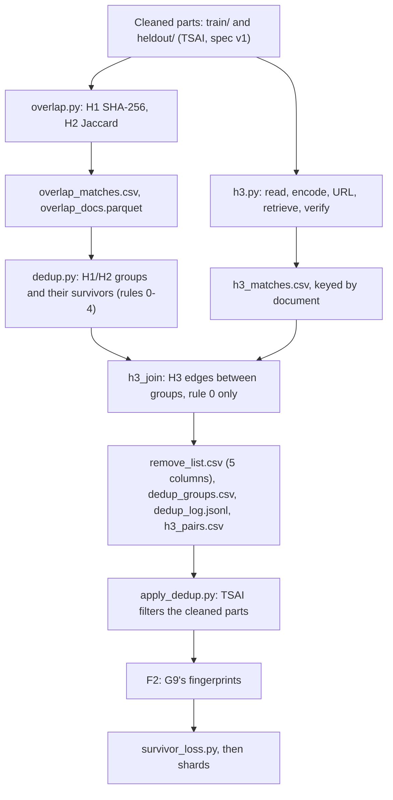
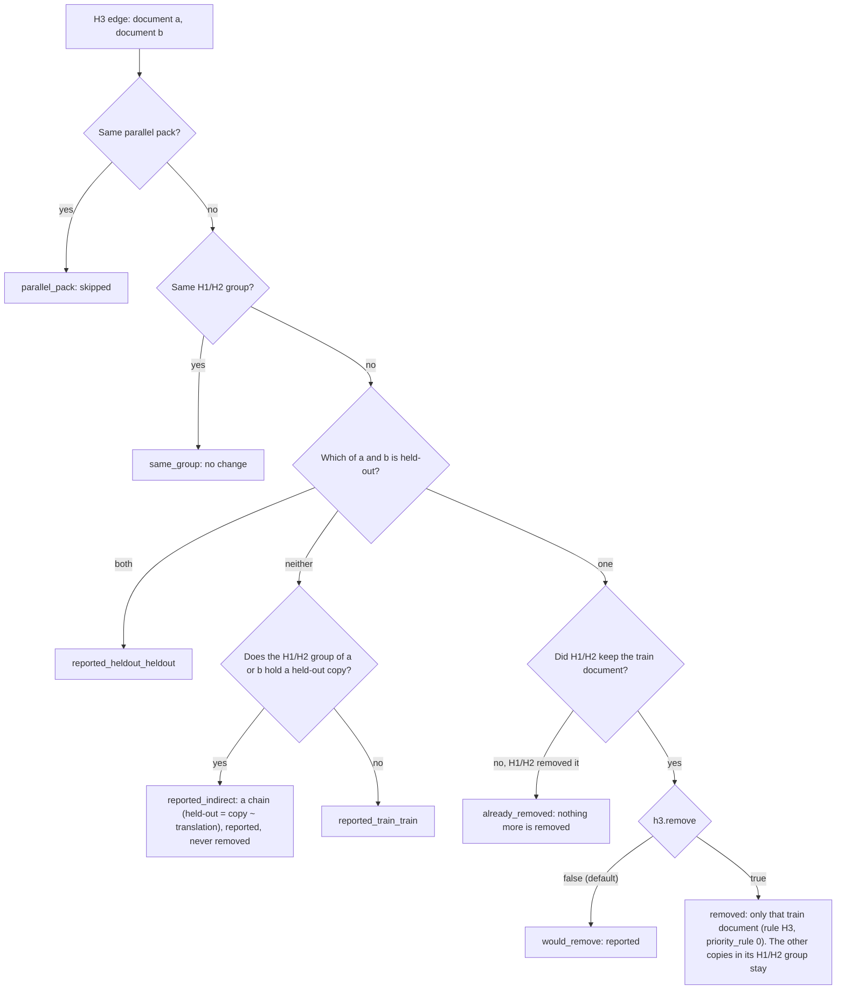

# H3 design v1: How translations are found

**Status:** draft for dedup v1.1, revised after the review on #44 (Kunal Sinha, Sourav Dhar) and the encoder check of
15 Nov. Removal waits for TSAI's ruling (see "Open decisions"); until then H3 is report-only.
**Scope:** H3 of `diagnosis/DISEASES.md`, section H: "the same content in another source or language", for example a
translation of a document seen in English. `dedup_design_v1.md` covers H1 and H2 and leaves translations out of v1
(TSAI, 5 Nov). This file is the method for that half. Later H3 questions (H3-g to H3-m) are in
`dedup_design_v2_proposal.md`, item 7.

## Summary

| Topic | Decision | Status |
|---|---|---|
| What H3 covers | The same content in two languages. Same-language copies from another source stay with H1/H2 | Proposed |
| Score | Sentence coverage: aligned sentences / sentences of the shorter document | Thresholds set per language pair by E5 |
| Method | Candidates from a multilingual encoder (LaBSE) and URL keys; confirmed by sentence alignment | Encoder checked on FLORES (Hindi, Odia pass; Sanskrit weak) |
| Survivors | H3 never chooses a survivor. An H3 edge may only remove a train copy of a held-out document (rule 0) | Agreed on #44 (H3-a) |
| Removal | Report-only (`remove: false`) until TSAI rules | Open (H3-f) |
| Where it runs | `overlap.py` and `h3.py` read the same cleaned parts independently; one `dedup.py` run reads both match files | Agreed on #44 (H3-b) |
| Hand-off | `h3_matches.csv` keyed by document; one `remove_list.csv` in today's five columns | Agreed on #44 (H3-c) |
| Parallel packs | No H3 edge inside a pack that is parallel by design (Pralekha, BPCC human parts) | Agreed on #44 (H3-d) |
| Scope | Indic ↔ English and Sanskrit ↔ Hindi, prose packs only | Proposed |
| Speed | Batched on the GPU; no Python loop per document, sentence or pair (TSAI rule, 14 Nov) | See "Speed" |

## The H3 score

H1 compares SHA-256 hashes and H2 compares word 5-grams, so neither can match two languages: a translation shares no
hash and almost no 5-grams. H3 compares meaning, sentence by sentence:

| | Compared | Score | Rule |
|---|---|---|---|
| H1 | H1 key | SHA-256 | equal |
| H2 | word or token 5-grams | Jaccard: shared / all shingles | ≥ 0.80 (prose) |
| H3 | sentences, as vectors of a multilingual encoder | coverage: aligned sentences / sentences of the shorter document | ≥ 0.6 (provisional) |

Two sentences **align** when each is the other's best match among the two documents' sentences (mutual best, so one to
one) and their cosine is at least the language pair's sentence threshold (0.7 provisional). A page on the same topic
scores high as a whole document, but its sentences do not align one to one; this is why coverage is counted on
sentences, not on whole documents.

## Methods considered

| Method | How | Strength | Weakness | Use |
|---|---|---|---|---|
| URL key | The same site and path with only a language marker changed (`hi.`, `/hi/`, `?lang=hi`) | Exact, nearly free | Finds only multilingual sites | Candidates |
| Language-neutral anchors | Numbers (any script's digits), Latin-script names | Cheap | Weak alone | Hand-review aid |
| Document embedding | One multilingual vector per document; cosine | Fast candidate search | Same-topic pages score high | Candidates |
| Sentence alignment | Sentence vectors, mutual best match, coverage | Separates translations from same-topic pages | Needs the encoder on every candidate sentence | Decision |
| Translate, then compare | Machine translation (IndicTrans2, NLLB), then Jaccard or embeddings | Familiar score | Costly; machine output rarely reaches 0.80 Jaccard against a human translation | Second opinion on a sample |
| Transliterate, then H2 | One script, then Jaccard | Reuses H2 | Same language in another script only (D2), not translations | Not H3 |

## Encoder

LaBSE (`sentence-transformers/LaBSE`, Apache-2.0), built for finding translation pairs. Checked on FLORES-200 devtest
(1,012 sentences in English, Hindi, Sanskrit and Odia; an evaluation set, never used as training data) with H3's
settings: mutual best match, coverage 0.6, sentence threshold swept from 0.5 to 0.9 (`h3_labse_check_results_v1.md`).

| Language pair | Found (P@1) | Translated blocks qualifying at 0.7 | At 0.5 |
|---|---|---|---|
| Hindi ↔ English | 1.0 | 100% (other blocks: 0%) | — |
| Odia ↔ English | 1.0 | 100% (other blocks: 0%) | — |
| Sanskrit ↔ English | 0.95–0.98 | 29% | 96% |
| Sanskrit ↔ Hindi | 0.95–0.98 | 19% | 89% |

Sanskrit is found but with low cosines (median 0.69). At 0.5, 3 of the 7 matches on real `ind-sa-fw2` pages are not
translations. So the sentence threshold is set **per language pair**, and Sanskrit needs either its own threshold with
a margin score, or another encoder (BGE-M3 or multilingual-e5, compared with the same script).

## Pipeline

`h3.py` reads every document of its packs, including those that H1/H2 will remove: excluding them would need a second
`dedup.py` run, and H1/H2 removed 0.095% of the sample on 5 Nov.

### `h3.py` stages

| Stage | What it does | Settings (provisional) |
|---|---|---|
| read | Selects parts by their `pack_id` column; sentences end at `.`, `!`, `?`, `।`, `॥` or a line break; sentences under 20 characters are dropped; short documents are skipped | `min_chars` 200, `min_sentences` 3, `max_sentences` 16 |
| encode | One vector per document, from its first sentences; cached per part | `head_sentences` 4, `max_seq_length` 128 |
| url | One language marker removed from the URL; exact join; home pages excluded | `url_group_max` 20 |
| retrieve | Per language pair, each document's nearest documents in the other language, by exact cosine in blocked matrix products; a candidate must be in both documents' lists | `top_k` 3, `doc_floor` 0.5 |
| verify | URL pairs first, then by cosine: length ratio, sentence vectors, mutual best sentence matches, coverage | `max_length_ratio` 4; sentence threshold and coverage per language pair; `max_verify` |

### `h3.py` outputs

IDs, scores and counts only; no document text.

| File | Contents |
|---|---|
| `h3_matches.csv` | One row per pair at or above the coverage threshold, exactly these columns: `pack_id_a, split_a, part_a, row_in_part_a, doc_id_a, pack_id_b, split_b, part_b, row_in_part_b, doc_id_b, lang_a, lang_b, coverage` |
| `h3_candidates.csv` | Every verified pair at or above `report_floor`, and every URL pair: cosine, length ratio, sentences, aligned sentences, coverage |
| `h3_docs.parquet` | Every compared document: `pack_id, lang, split, part, row_in_part, doc_id, chars, sentences` |
| `h3_by_pack.csv`, `h3_histogram.csv` | Per pack pair: retrieved, URL, verified and qualifying pairs; histograms of cosine and coverage |
| `h3_summary.json` | Counts, stage times and rates, an estimate for all documents, the encoder weights' SHA-256, package versions, each output's SHA-256 |

The document key is the one `overlap.py` and the remove list use: `part` is the path relative to the split folder,
with `/` (`ind-hi-fw2/part-00000.parquet`), and `row_in_part` is the 0-based row in file order. `dedup.py` looks every
H3 document up in `overlap_docs.parquet` and stops if its `doc_id` differs, which catches an H3 run on other cleaned
parts than the overlap run.

## In `dedup.py`: how an H3 edge is decided

H1/H2 groups and their survivors are decided first (`source_priority_v1.md`, rules 0–4). An H3 match is then an edge
between two sides: the H1/H2 group of each document, or the document alone. Rules 1–4 never see H3 edges; rule 3 ("the
longer copy") does not compare across scripts. Only direct edges remove (TSAI, #625, 19 Nov): a held-out ↔ train match
removes only that train document, if H1/H2 kept it; the other copies in its H1/H2 group stay.

| Output | H3's part |
|---|---|
| `remove_list.csv` | Unchanged five columns. Only `removed` edges add rows; a held-out document is never listed |
| `dedup_log.jsonl` | Each H3 removal: `rule` H3, `stage` cross_language, `priority_rule` 0, the held-out document it translates as the kept copy |
| `dedup_groups.csv` | H1/H2 groups only. A train survivor removed by H3 is written as `removed`, so the group ends with no survivor; `survivor_loss.py` counts it as `without_survivor`, as it does a rule-1 group |
| `h3_pairs.csv` | One row per H3 edge: both documents, `lang_a`, `lang_b`, `coverage`, each side's `group_id`, and the outcome |

Without an `h3` section in `dedup.json`, `dedup.py`'s outputs are unchanged.

## Which copy survives

| Case | Rule |
|---|---|
| A train document and a held-out document in two languages | Rule 0: the held-out copy survives; with `h3.remove: true` the train copy is removed. Without this, the model trains on held-out content in another language |
| Two held-out documents | Reported, not removed |
| Two train documents | Reported, not removed |
| Two documents of one parallel pack | Skipped |

## Speed (TSAI rule, 14 Nov)

The job runs on 1 GPU. Code for a TSAI run uses batched operations, no Python loops over tokens, documents or pairs,
and no avoidable host-device syncs; its PR gives the wall time of a run, the exact command and the last lines of its
output.

| Part | Implementation |
|---|---|
| Read | pyarrow compute on whole columns: regex split, `utf8_length`, list offsets for the head, `binary_join` |
| Encode | Batched; vectors kept on the device; bf16 on CUDA |
| Retrieve | torch `matmul` and `topk` on the GPU, in blocks of rows |
| Verify | Padded `[pairs, 16, d]` tensors: one batched product and a masked argmax per chunk |
| Hand-review signals | Numbers and Latin-script names, in a separate review script, not in the job |
| Checks | `set_sync_debug_mode("warn")` with no warnings inside the loop; a timed run on full packs |

Cache: document vectors are saved per part, so a rerun with other thresholds encodes nothing again. Time limit:
`max_minutes` stops the run, and an incomplete run writes only its summary. The model is loaded only from a local
folder with the Hugging Face libraries offline (`JOB_REQUEST.md` rule 1); the summary records the weights' SHA-256.

## Validation

| # | Check | What it shows | Status |
|---|---|---|---|
| E5a | **Known pairs, fake encoder:** a translation is caught; a same-topic page, a page sharing only names or numbers, and a same-URL page with other content are kept; train ↔ held-out keeps the held-out copy | The rules behave as specified | 44 tests (`tests/test_h3.py`, `test_h3_signals.py`, `test_h3_align.py`) |
| E5a′ | **Known pairs, real encoder:** FLORES-200 translations as positives; 433 same-page pairs from `ind-sa-fw2` (a Sanskrit story with an embedded English or Hindi post on the same event) as same-topic negatives | The encoder and thresholds per language pair | Measured (table in "Encoder") |
| E5b | **Timed run** on full packs (`ind-sa-fw2`, `ind-hi-fw2`, `en-fineweb-edu`) | Stage times, the estimate for the sample, first counts; the share of URL-found pairs that retrieval also finds (recall of head-only retrieval) | Open |
| E5c | **Measurement job** on the cleaned sample, report-only | H3 counts per language pair; cosine and coverage histograms | Open |
| E5d | **Threshold sweep and hand review:** bilingual readers label pairs on both sides of each threshold, blind | The thresholds per language pair | Open; the readers' labels are the result |
| Harm | No gold document removed | No harm to reviewed clean documents | With the first removal run |

## Risks

1. **Removing scarce Indic text.** A translation is new text in another language. *Mitigation:* rule 0 only;
   everything else is reported.
2. **Same-topic pages as false matches.** *Mitigation:* sentence coverage decides; E5a and E5a′ test it.
3. **Sanskrit.** Low cosines with LaBSE (median 0.69). *Mitigation:* a threshold per language pair, a margin score or
   another encoder; Sanskrit pairs reported separately.
4. **Sentence splitting.** Pages without clear sentence marks give long "sentences". *Mitigation:* `max_sentences`
   and the length checks; per-pack sentence counts in `h3_docs.parquet`.
5. **Cost.** Retrieval grows with the product of the two languages' documents. *Mitigation:* language-pair scope,
   blocked GPU products, `max_verify`, the time limit and the estimate before the job.

## Open decisions

| # | Question | For |
|---|---|---|
| 1 | Report-only, or may train copies of held-out documents be removed (rule 0)? Does such a copy affect G3's or G9's results? (H3-f) | TSAI, G3, G9 |
| 2 | Language pairs in v1.1; Data A ↔ Data B pairs (out of v1, 5 Nov) | TSAI |
| 3 | The Sanskrit encoder or threshold | E5a′ with another encoder, then E5d |
| 4 | Packs with several languages (Pralekha) need each row's language, not one language per pack | Before such packs join |
| 5 | Chains: a held-out document ↔ a train translation ↔ a train translation in a third language. Only direct edges remove | Team |
| 6 | Licence of the encoder weights for use in the data pipeline | G10 |

## Decision log

| Date | Decision | Agreed by | Where |
|---|---|---|---|
| 5 Nov 2026 | H3: translations out of scope for v1; H1/H2 cover same-language copies from another source; `DB-H3-001` stays | TSAI | PR #255, TSAI comment of 5 Nov, point 1 |
| 5 Nov 2026 | Rule 0: a held-out copy always survives; held-out ↔ held-out duplicates are reported, not removed | TSAI | PR #255, point 4 |
| 14 Nov 2026 | First draft: sentence coverage, LaBSE, URL keys, E5a–E5d | Aneesha Das | #44, commit `d236be9` |
| 15 Nov 2026 | H3 never chooses a survivor; only rule 0 removes (H3-a). `h3.py` reads all documents and one `dedup.py` run reads both match files (H3-b). `h3_matches.csv` keyed by document (H3-c). No H3 edge inside a parallel pack (H3-d) | Kunal Sinha, Sourav Dhar (review); Aneesha Das | #44 review |
| 15 Nov 2026 | Report-only until TSAI rules (H3-f); thresholds per language pair after the FLORES check | Kunal Sinha; Aneesha Das | #44; `h3_labse_check_results_v1.md` |
