<p align="center">
  
</p>

<p align="center">
  <a href="#at-a-glance">At a glance</a>&nbsp;&nbsp;·&nbsp;&nbsp;<a href="#reviewers-guide">Review</a>&nbsp;&nbsp;·&nbsp;&nbsp;<a href="#quick-start">Quick start</a>&nbsp;&nbsp;·&nbsp;&nbsp;<a href="#running-the-production-job">The job</a>&nbsp;&nbsp;·&nbsp;&nbsp;<a href="#the-job-chain">Job chain</a>&nbsp;&nbsp;·&nbsp;&nbsp;<a href="#stage-by-stage">Stages</a>&nbsp;&nbsp;·&nbsp;&nbsp;<a href="#configuration-reference">Config</a>&nbsp;&nbsp;·&nbsp;&nbsp;<a href="#outputs-and-the-manifest">Outputs</a>&nbsp;&nbsp;·&nbsp;&nbsp;<a href="#guards">Guards</a>&nbsp;&nbsp;·&nbsp;&nbsp;<a href="#measured-on-real-data">Measured</a>&nbsp;&nbsp;·&nbsp;&nbsp;<a href="#speed-and-scale">Scale</a>&nbsp;&nbsp;·&nbsp;&nbsp;<a href="#tests">Tests</a>&nbsp;&nbsp;·&nbsp;&nbsp;<a href="#troubleshooting">Troubleshooting</a>
</p>

<br>

Data A's pipeline, as one command: `run_pipeline.py --config <file>`. It runs (or adopts) the team's cleaning, overlap and dedup jobs, optionally measures H3 translation matches on the cleaned parts, applies dedup's remove list, runs F2 decontamination, counts the duplicate groups F2 emptied, writes a **ledger** of every document's decision at every stage, writes **token shards**, and **reconciles** the shards with the ledger. Between every pair of stages it checks, by counts and sha256, that each document is accounted for. Every run ends with `pipeline_manifest.json`, the record TSAI can verify.

## At a glance

| | |
|---|---|
| **Order** | clean → overlap → H3 (when configured) → dedup → **apply the remove list** → **F2** → **survivor loss** → **ledger** → **shards** → **reconcile** |
| **Shards and reconcile** | Run only when the config has `stages.shards` (and `stages.reconcile`); without them the run ends at the ledger. **The production job configures both**, and a run with an [expected inventory](#expected-inventory) is refused without them |
| **In** | the raw parts and their input manifest (clean in `"mode": "run"`), or the folders TSAI's clean, overlap and dedup jobs returned (`"mode": "adopt"`) |
| **Out** | token shards (G3's frozen p1536 tokenizer) · `pipeline_manifest.json` · the ledger, one row per document · the reconciliation, one status per kept document · filtered Parquet (`deduped/`, `final/`), kept or dropped at the end (`"intermediates"`) |
| **New in this folder** | `run_pipeline.py` · `stage_args.py` · `apply_dedup.py` · `f2_pool.py` · `survivor_loss.py` · `ledger.py` · `reconcile_shards.py` · `inventory_check.py` · `hashing.py` · `arrowtools.py` · `runlock.py` · `clean_job.py` · `clean_manifest.py` · `clean.json` · `pipeline.json` · `local_trial/` · **648 tests** |
| **Reused, never copied** | `spec_v1/run_tokenizer_sample.py` and `clean.py` (#244); the job uses `spec_v1_1/clean.py` through `pipeline/clean_job.py` · `dedup/overlap.py`, `dedup/h3.py`, `dedup/dedup.py` · `spec_v1/run_f2.py` · `shards/run_shards.py`, `shard_writer.py`, `provenance.py`, `pack_table.py`, `verify_shards.py` (**144 tests**) |
| **Needs** | Python 3.11+ (tested on 3.13) with `pyarrow`; for the shard stage `numpy`, `tokenizers` and `torch` (`shard_writer.py` imports G6's `dataio`, which imports torch); `ftfy`, `tree-sitter` and `tree-sitter-language-pack` for the clean job (`spec_v1/requirements.txt`); `numpy`, `scipy` and `pygments` to run overlap and dedup locally; `pytest` for the tests. Install them into the environment itself: every script runs with `python -I`. The job pins one environment for every stage, H3's packages included (Python 3.12, PyArrow 23.0.1): `jobs/2026-11-19-first-training/requirements_pipeline.txt`; H3 also needs an offline LaBSE model |
| **Measured** | rehearsal from raw (code-go, 3 parts of tokenizer sample v0): **40 of 40 checks**, 84,139 raw → 77,661 kept → 76,795 in 2 shards, every document accounted for ([details](#measured-on-real-data)) |

> [!NOTE]
> Cleaning, overlap and dedup are **TSAI jobs** (JOB_REQUEST rule 6). The runner can **adopt** the folders TSAI returns and check them before carrying on, or **run** each of those stages itself. The production job runs all of them in one run, from the raw training parts: per TSAI (17 Nov), the spec v1.1 cleaner on the input training Parquet, then the shard writer on the cleaned output; the runner wraps that with dedup, F2, the ledger and the reconciliation. See [Running the production job](#running-the-production-job).

> [!WARNING]
> **Open before the production job can run** (none of these is visible to `--plan`):
> 1. **The job's pack table.** It needs `language`, `script`, `domain`, `lane`, `license` and `license_source` for every approved pack. The committed `shards/pack_table.json` gives the six agreed lanes for all 38 packs (#63) but no licences; `jobs/2026-11-19-first-training/approved_inputs.json` and #47's `pack_metadata.json` carry different licence text, so which one is current is for G10 to confirm (#63). `jobs/2026-11-19-first-training/prepare_run.py` now writes the job's pack table from `approved_inputs.json` (lanes and licences) unless `--pack-table` is given, refuses an incomplete table, and checks the licences against `approved_inputs.json`.
> 2. **The approved inputs, staged.** TSAI's raw train and held-out parts of the 38 packs in `jobs/2026-11-19-first-training/approved_inputs.json`. The input manifest and the expected inventory are made from them by `build_inventory.py` (its README lists the settings that go with them).
> 3. **An offline LaBSE model for H3**, at the `model_path` in `jobs/2026-11-19-first-training/h3.json`; `prepare_run.py` refuses a missing model folder and one whose `model.safetensors`, `2_Dense/model.safetensors` or `config.json` differs (size or sha256) from LaBSE revision `836121a0533e5664b21c7aacc5d22951f2b8b25b`. H3 is report only: it measures translation matches and removes nothing.
> 4. **The job's own rehearsal.** Done on sample v0 at `4dd2802`: all 86 raw parts (38 packs), the frozen p1536, H3, the job's pinned environment on Linux, 59 of 59 checks; and on 5 of those parts, a forced rollover, an interrupted shard stage, damaged shards and a part left out whole (`jobs/logs/2026-11-19-first-training-rehearsal-38packs/`, #62, the job request's test log). The same chain with `inventory`, from `prepare_run.py`'s own `run.json` at `2691c44` (F2 at 30 workers): 74/74, the same counts and shard data. For the job: `prepare_run.py --f2-workers N` sets F2's workers (default 1; about 3.1 h on sample v0 with 1, against 12 min with 30), so set it for the host.
>
> Every shard run also needs `stages.shards.dataset_version` (`"first-training-v1"` for the first training shards, as `prepare_run.py` sets it): `--plan` and the run stop without it; `any_tokenizer` shards stay `"test"`.

<br>

## Reviewer's guide

<p align="center"></p>

One row per stage, in the review split of PR #46 (merged into `g1-pipeline` on 18 Nov), reviewers by GitHub handle. Function names are in the module named in the row. Run one file's tests with `python -m pytest teams/01-data-a/pipeline/tests/<file> -q`; the shard tests need an environment with torch (`python -m pytest teams/01-data-a/shards/tests -q`).

| Reviewer | Stage | Module · functions | What it checks | Tests | Look at first |
|---|---|---|---|---|---|
| **smitasasindran** | clean (run step) | `stage_args.py`: `build`, `generated_values`, `check_manifest` · `run_pipeline.py`: `Run.validate`, `stage_external`, `counts_clean` | the settings file exists and matches `settings_sha256`; the output is a named subfolder of `out/`; `input`, `manifest_sha256` and `expected_parts` are given; the manifest's sha256 equals the pin before the job starts; the script (or each `.py` of a script list) exists; exit code 0; every part opens as Parquet | `test_stage_args.py` (38) · in `test_run_pipeline.py`: run mode, settings pins, `--plan`, `only`, a script given as a list | the generated `<run>/cfg/clean.json` (`--plan` prints its path keys) and the clean record's `code_sha256` and `tools_sha256` |
| **smitasasindran** | overlap (run step) | `run_pipeline.py`: `counts_overlap` | status `complete`; `documents_all` = the cleaned rows; every part it lists has that cleaned part's rows; `overlap_matches.csv` and `overlap_docs.parquet` have the sha256 its summary names | `test_overlap_of_other_parts_stops`, `test_count_mismatch_stops`, `test_stages_run_from_settings_into_the_run_folder` | how `stage_args.STAGES` wires `inputs` and `out` |
| **smitasasindran** | dedup (run step) | `run_pipeline.py`: `counts_dedup` | status `complete`; the overlap files it checked (`overlap_run.checked_sha256`) are this run's; `documents_all` = overlap's; `removed` = rows of `remove_list.csv`; `heldout_removed` = 0 | `test_dedup_from_another_overlap_run_stops`, `test_dedup_removing_heldout_stops` | `checked_sha256` against overlap's `files_sha256` |
| **kunal2016** | dedup → apply | `apply_dedup.py`: `read_remove_list`, `check_part`, `filter_part`, `apply` · `run_pipeline.py`: `stage_apply` | the remove list's header is dedup.py's; no row twice; `row_in_part` a whole number ≥ 0; no held-out row (rule 0); every listed part exists and the row is inside it; the doc_id **and** pack_id at that row are the listed ones; every part opens with `doc_id` and `pack_id`, none null; no stale Parquet in `--out`; afterwards each part holds its rows minus the listed ones | `test_apply_dedup.py` (48) · in `test_run_pipeline.py`: count mismatch, held-out removed | `read_remove_list` and `check_part`: **every** check runs before the first file is written |
| **TEJASKUMAR-REDDY-J** | ledger | `ledger.py`: `build`, `part_ledger`, `base_table`, `attach`, `find_raw`, `same_text_streamed`, `publish` · `run_pipeline.py`: `stage_ledger` | every row the remove list, groups or log names is that row of its cleaned part, with that doc_id, and named once; the groups' removed rows and the log's rows are exactly the remove list's; doc_id unique per part; mode B: the raw file has the reported sha256 and holds every cleaned doc; each F2 report covers its part; each final part holds the ledger's kept docs in order; totals and per-pack counts equal apply's and F2's | `test_ledger.py` (54) · in `test_run_pipeline.py`: mode B, `"from": "ledger"`, ledger per pack = apply per pack | `part_ledger` (the joins) and mode B (`find_raw`, `same_text_streamed`) |
| **patilvijay23** | F2 | `run_pipeline.py`: `stage_f2`, `f2_units` · `f2_pool.py`: `run`, `check_pin`, `plan` | per split: F2's rows = apply's kept; each part's `.f2.json` names the sha256 apply wrote as `input_sha256`; one fingerprint set; kept + dropped + errors = rows; no errors; no stale Parquet under `final/<split>` | `test_f2_pool.py` (14) · in `test_run_pipeline.py`: parallel F2, a crashed pack, F2 errors, F2 that read other files, the pool gives the same run | `f2_pool.py`: the set's pin is checked before any worker starts, and its output is byte for byte `run_f2.py`'s |
| **patilvijay23** | survivor loss | `survivor_loss.py`: `read_groups`, `read_f2`, `report` · `run_pipeline.py`: `stage_survivor_loss` | dedup_groups.csv has dedup.py's header; every part holding a survivor has an F2 report; one set_sha256; the report covers every dedup group | `test_survivor_loss.py` (13) | the join on (split, part, doc_id) in `report` |
| **patilvijay23 + TEJASKUMAR-REDDY-J** | shards (**required for the job**) | `run_pipeline.py`: `stage_shards`, `validate_shards` · `shards/run_shards.py` · `shards/shard_writer.py` · `shards/provenance.py` · `shards/pack_table.py` | no part failed or was skipped, and none was cut short; `run_shards.py` exited 0; at least one shard written; the summary's `run_id` and `cleaning_pipeline_sha256` are this run's; the shards on disk verify (`verify_shards.py`, run by the runner). The writer: the tokenizer is the frozen p1536 (sha256 `e6b93a93…`), EOS id 130822, vocab 131,072; the part's chain back to the raw part (`provenance.py`); after writing, G6's `open_shard` reads it and every id is in range | `teams/01-data-a/shards/tests` (144: `test_shard_writer.py` 23, `test_run_shards.py` 30, `test_shard_provenance.py` 30, `test_pack_table.py` 27, `test_pipeline_shards.py` 2, `test_verify_shards.py` 32) · in `test_run_pipeline.py`: the shard stage tests | `stage_shards` (what it passes and checks) and `pack_table.row` (a null lane or licence skips the pack, which stops the run) |
| **patilvijay23 + TEJASKUMAR-REDDY-J** | reconcile (**required for the job**) | `reconcile_shards.py`: `reconcile`, `statuses`, `shard_inputs` · `run_pipeline.py`: `stage_reconcile` | every document in a shard is a kept ledger document at the same (input_part, input_row) with the same doc_id; none in two shards; every left-out doc is kept and not also in a shard; each shard's doc_count = its docs.parquet rows; no kept doc of a selected pack is `not_reached`, `part_failed`, `part_skipped` or `missing`; every listed pack holds kept documents | `test_reconcile_shards.py` (22) · in `test_run_pipeline.py`: reconcile after shards, a failed reconciliation | `statuses`: the one join on (input_part, input_row) |
| *not in the split* | expected inventory (gate 12) | `inventory_check.py`: `load`, `check_ledger`, `check_shards`, `check_manifest` · `run_pipeline.py`: `validate_inventory`, `check_inventory` | see [Expected inventory](#expected-inventory) | `test_inventory_check.py` (84) · inventory tests in `test_run_pipeline.py` | `validate_inventory`: what a production run must have |
| *not in the split* | intermediates (task 4.8) | `run_pipeline.py`: `validate_drop`, `droppable_parts`, `drop_files`, `drop` | see [Intermediate Parquet](#intermediate-parquet-keep-or-drop) | the `intermediates` tests in `test_run_pipeline.py` | `droppable_parts`: which parts may go |

**What changed after bd09924** (the head of the earlier review). PR #46, merged into `g1-pipeline` on 18 Nov:

| Commit | What |
|---|---|
| `1909fb2` | the expected inventory: `"inventory"` in the run config and `inventory_check.py` (job request gate 12); unknown config keys refused; `--plan` always prints an `inventory:` line; the manifest's `"inventory"` is `null` without one |
| `66eead1` | `shards/shard_writer.py` pinned to the frozen p1536 tokenizer (sha256 `e6b93a93a60520d7b1af2e9242485f443b5596a1e116b8f8798d83bbad25a64b`), not C3 |
| `08f2594` | `stages.<stage>.script` may be a list: a cleaner run through a wrapper (the spec v1.1 cleaner); the stage record gets `tools_sha256` |
| `dc1a1f6` | the licence and where it is recorded (`license`, `license_source`) from the job's pack table into every shard manifest (job request gate 5) |
| `4cefaba` | this README: reviewer's guide, production-job walkthrough, measured results, figures |
| `ef3805a` | `g1-pipeline` (4aa702f, synced with TSAI main) merged in; the pipeline's shard writer kept, with the p1536 pin |
| `2a30d28` | the ledger keeps its marker on a folder it could only partly delete, so the next run clears it instead of refusing |
| `265ef22` | `arrowtools.iter_sized`: every read is bounded by what the row group's footer proves, so a jump from short to long text cannot make one huge batch |
| `e359f9d` | `"intermediates": "drop"` checks every shard on disk against its manifest before it deletes any Parquet |
| `5853ce3` | this README, for the three fixes above |
| `c162f86` | `stages.shards.dataset_version` required and passed to the writer (as #621 on main); the shard stage stops on a part cut short; the ledger's mode B needs the cleaning report of every part |
| `43f31fd` | this README, for `c162f86` |

Then, on `g1-pipeline`:

| Change | What |
|---|---|
| #45 | `shards/verify_shards.py`: the shards on disk are checked in every run, not only before a drop |
| `c0240be` | `jobs/2026-11-19-first-training/`: `approved_inputs.json` (the 38 approved packs) and `build_inventory.py` (the input manifest and the expected inventory from the staged raw parts) |
| #58 | the clean stage runs `pipeline/clean_job.py` with the spec v1.1 cleaner on any pinned input manifest (`clean_manifest.py`), writes `job_summary.json` and `reports/`, and resumes an interrupted job; the runner verifies the shards once (`run_shards.py` gets `--no-verify`), `verify_shards.py` compares the licence with the pack table, and the shard hashes go to the hash cache |
| #56 | the shard writer rolls over into more shards, numbers them across a pack's parts and maps each part to its shards; `empty` and `all_left_out` parts; the manifest published last; a stopped shard run continues |
| #57 | survivor loss is checked against dedup's summary, and the ledger's survivors dropped by F2 against survivor loss |
| `03b4206` | the report-only H3 stage (`dedup/h3.py`), between overlap and dedup |
| `9965416` | overlap, run or adopted, is checked against the cleaned parts' sha256; dedup removes the train copies of a pack whose licence is not usable; `prepare_run.py` and one pinned environment for the job |
| `4dd2802` | the runner reads a CSV whose header names are quoted (H3's `h3_matches.csv`, written by pyarrow): every run with `stages.h3` stopped after H3 before; the local 5-pack run below |
| `5243cc0` (#61) | `run_shards.py` saves its summary before the first shard, so a run stopped in its first part can be run again; `verify_shards.py` compares a manifest's licence with the pack table (the separate both-or-neither check is gone); `audit/check_shard.py` treats the licence fields as optional, both or neither |
| `214d90d` (#663) | H3's hand-off to dedup (`dedup/h3_join.py`): only a direct held-out ↔ train match can remove, and only that train document (not the rest of its H1/H2 group); train ↔ train matches are reported, never removed. The first-training job keeps `h3.remove` false |
| `497df26` (#63) | `shards/pack_table.json` names a lane for all 38 packs (`code`, `code-adjacent`, `english`, `indic`, `math`, `science`, accepted on #47); `pack_table.py` refuses any other lane in any table |
| `98970f0`, `a247b31` (#64) | the clean job keeps, per rule, the `audit_samples` documents (5 in `clean.json`) it fixed or dropped with the lowest hash of rule id and doc_id: doc_ids and sizes only, in `audit/<part>.json`, and per pack in `rule_examples.csv` with each rule's fix and drop counts (a rule that never fired has one row with no document) |
| #60 | `audit/check_shard.py` (an audit tool, not run by the pipeline) checks a whole shard folder: every shard, the part-to-shards map in `shards_summary.json`, and an expected `dataset_version` |
| #62 | the 38-pack rehearsal of the first-training job: `jobs/logs/2026-11-19-first-training-rehearsal-38packs/` (all 86 parts of sample v0; 59/59 checks, and 74/74 from `prepare_run.py`'s `run.json` with the inventory) |
| #65 | `audit/audit_replay.py` runs a clean job's sampled documents again, rule by rule, through the pinned cleaner, and checks each against the job's own output (see [Audit examples from the clean job](#audit-examples-from-the-clean-job)) |
| `c7c07b8` | `prepare_run.py`: `--f2-workers`, the LaBSE pin (revision, sizes, sha256), and the job's pack table written from `approved_inputs.json` (which now carries the lanes); the input manifest must come from the same `approved_inputs.json` |

<br>

## Quick start

```bash
# tests: synthetic data only
python -m pytest teams/01-data-a/pipeline/tests -q                      # 648 tests
python -m pytest teams/01-data-a/shards/tests -q                        # 144 tests (needs torch)

# what a run would do: checks the config, prints every stage's folder and command; runs and writes nothing
python -I teams/01-data-a/pipeline/run_pipeline.py --config teams/01-data-a/pipeline/pipeline.json --plan

# the template's chain, clean to ledger, from the repository root
# (add stages.shards and stages.reconcile for shards)
python -I teams/01-data-a/pipeline/run_pipeline.py --config teams/01-data-a/pipeline/pipeline.json

# part of it: set "to": "apply" in the config file and run; later set "from": "f2" (and drop "to") and run again
```

The command line takes only `--config` and `--plan`. Everything that defines a run is a key in the config file (see [Configuration reference](#configuration-reference)), so a run is reproduced from that file alone. `pipeline.json` is the generic template; for a job, copy it to `teams/01-data-a/jobs/<date>-<name>/run.json` and edit the copy.

**Try it on six small files first:** [local_trial/](local_trial/README.md) has example configs for a full run, stopping early, resuming in steps, adopting a folder and the expected errors, and the commands to run them and keep the local log a job request asks for.

Each step also runs on its own:

```bash
python -I teams/01-data-a/pipeline/apply_dedup.py   --cleaned <cleaned> --remove-list <remove_list.csv> --out <deduped> [--workers N] [--copy] [--hash-cache <file>]
python -I teams/01-data-a/spec_v1/run_f2.py          --inputs <deduped>/train --out <final>/train
python -I teams/01-data-a/pipeline/f2_pool.py       --inputs <deduped>/train --out <final>/train --workers 16
python -I teams/01-data-a/pipeline/survivor_loss.py --groups <dedup_groups.csv> --f2 <final> --out <report>
python -I teams/01-data-a/pipeline/ledger.py        --cleaned <cleaned> --remove-list <remove_list.csv> --groups <dedup_groups.csv> \
                                                    --f2 <final> --out <ledger> [--log <dedup_log.jsonl>] [--raw <raw>]
python -I teams/01-data-a/shards/run_shards.py      --input <run>/final --manifest <run>/pipeline_manifest.json --tokenizer <p1536>/tokenizer.json \
                                                    --out <run>/shards [--pack <pack> ...] [--tokens N] [--pack-table <table>]
python -I teams/01-data-a/pipeline/reconcile_shards.py --ledger <run>/ledger --shards <run>/shards --out <run>/reconcile [--pack <pack> ...]
python -I teams/01-data-a/pipeline/inventory_check.py  --inventory <expected_inventory.json> --ledger <run>/ledger --shards <run>/shards \
                                                    [--cleaned <cleaned>] [--out <report.json>]
```

Exit code `0`: every check passed. Exit code `1`: a check failed, and the message names it and where. When the runner starts a script as its own process (clean, overlap, dedup, F2, shards), the script's output goes to `<run>/logs/<stage>.log` (F2: `logs/f2_<split>[_<pack>].log`). Apply, survivor loss, the ledger and reconcile run inside the runner's process.

<br>

## Running the production job

One run of `run_pipeline.py`, from the raw training parts to reconciled shards. In this run every stage is `"mode": "run"`: the cleaned folder is new, so overlap and dedup must run on it in the same run.

> [!NOTE]
> **The clean stage is `pipeline/clean_job.py`, not TSAI's `run_tokenizer_sample.py`.** It takes any input manifest that is the pinned file, whose parts match `expected_parts` and add up to its `total_docs`, not only the 86 parts of tokenizer sample v0; `--plan` runs the same manifest check (`clean_manifest.py`), so a manifest that would stop the job stops the plan. Only `train` and `heldout` parts are accepted. It writes what the runner, the ledger and the inventory check read (`job_summary.json` with `manifest_sha256` and each part's input and output sha256, and `reports/`). The other open items are listed under [At a glance](#at-a-glance).

**1. One checkout with everything the run calls.** `pipeline/`, `shards/`, `dedup/` for overlap, H3 and dedup, `spec_v1_1/clean.py` for the cleaner (the file `pipeline/clean.json` names and pins) and `spec_v1/run_f2.py` for F2. `--plan` stops with `… script … not found` or `… settings … not found` when one is missing, and with the manifest's own message when the input manifest is missing, is not the pinned file or does not match `expected_parts`.

**2. Make the input manifest and the expected inventory** with `teams/01-data-a/jobs/2026-11-19-first-training/build_inventory.py` from the staged raw parts (see its README). The inventory has one entry per part, with its raw sha256, raw rows and allowed final statuses (`"written"`, `"empty"` or `"all_left_out"` for train; `"not_sharded"` for held-out). The format is under [Expected inventory](#expected-inventory).

**3. Write the job's pack table** (`stages.shards.pack_table`): every pack of the inventory with `language`, `script`, `domain`, `lane`, and `license` with `license_source`. A row may leave out both licence fields, and its shards then carry no licence: `run_shards.py` allows that, but `prepare_run.py` refuses a job pack table without both for every pack (gate 5). The committed `shards/pack_table.json` has a lane for all 38 packs (#63) but no licences; a lane outside the six agreed names is refused when any table is loaded; a pack with a null field is skipped, and a skipped part stops the run.

**4. The run config.** For the first training job, `jobs/2026-11-19-first-training/prepare_run.py` writes it (`out/first-training-inputs/run.json`) from the input bundle, the tokenizer and the job's pack table, and refuses a pack table without all six fields for every pack, or with a licence other than `approved_inputs.json`'s (see the job's README). Its shape, for a config written by hand (replace every `<…>`; `<n>` and `<cores>` are numbers):

```jsonc
{
  "run_id": "<job-run-id>",                        // its folders: out/pipeline/<run_id>/; a new run needs a new run_id
  "out": "out/pipeline",
  "inventory": "teams/01-data-a/jobs/<date>-<name>/expected_inventory.json",   // makes this the production run
  "intermediates": "keep",                         // or "drop": see Intermediate Parquet
  "stages": {
    "clean":   { "mode": "run",
                 "settings": "teams/01-data-a/pipeline/clean.json",   // names the cleaner (spec_v1_1/clean.py) and pins its sha256
                 "input": "<folder of the raw training parts>",
                 "manifest": "<the approved input manifest>",           // default: sample_manifest.json in "input"
                 "manifest_sha256": "<its sha256>",                     // = the inventory's input_manifest_sha256
                 "expected_parts": { "train": <n>, "heldout": <n> },
                 "sample": "<label of the input set>" },                // optional: written into cfg/clean.json; the job summary uses it, else the manifest's "name"
    "overlap": { "mode": "run", "settings": "teams/01-data-a/dedup/overlap.json" },
    "h3":      { "mode": "run", "settings": "teams/01-data-a/jobs/2026-11-19-first-training/h3.json" },
    "dedup":   { "mode": "run", "settings": "teams/01-data-a/dedup/dedup.json" },
    "f2":      { "pool": true, "workers": <cores> },
    "ledger":  { "raw": "<folder of the raw training parts>" },          // mode B: required with "inventory"
    "shards":  { "tokenizer": "<p1536>/tokenizer.json", "dataset_version": "first-training-v1",
                 "pack_table": "<the job's pack table>" },
    "reconcile": {}
  }
}
```

The runner fills the path keys and the input set's description (`input_root`, `output_root`, `manifest`, `manifest_sha256`, `expected_parts`, and `sample` when given) into `<run>/cfg/clean.json`, a copy of the settings file, and runs `clean_job.py --config <run>/cfg/clean.json`. `clean_job.py` reads the cleaner named by `clean` in the settings (`spec_v1_1/clean.py`) and runs it only if its sha256 is `clean_sha256`: the bytes that were hashed are the bytes that run. It calls the same `clean.clean()` per document as TSAI's `run_tokenizer_sample.py` and writes the `job_summary.json` and per-part reports the ledger and the inventory check read. Leave `stages.shards.packs` out (the shard stage then takes every pack), or list exactly the inventory's packs.

**Resuming the clean job.** An interrupted or failed clean job leaves its parts and a `job_state.json` in `<run>/clean`. Rerun the same config with `"resume": true` in `stages.clean`: the job verifies each finished part (its report against the manifest, the part's rows and its sha256), keeps those that pass, redoes the part that was being written and builds `job_summary.json` from all the reports; `logs/clean.log` is appended to. A finished part that does not verify stops the job, naming the part and the two files to delete before the next run, and nothing is changed. The job also stops when it was started with another cleaner, job script, manifest or part selection, and a finished job (`job_summary.json`) is never resumed or overwritten. `"resume"` is only for clean; the stage record says `"resume": true`.

**What the runner checks on the clean output.** After the clean stage it reads the job's `job_summary.json` and compares it with the folder: the job reported no errors; it cleaned the parts the run expects (`stages.clean.expected_parts`, or the `only` parts), each with a report; it read this run's `manifest_sha256`; input rows = output rows + dropped, and the output rows are those in the Parquet footers; the parts on disk are the parts it lists, with their rows; and each part's sha256 is the one it recorded (taken through the hash cache, so the stage digest does not read the files again). A stage run from settings must have such a summary. An adopted folder is checked only when its `job_summary.json` is in the clean job's format (TSAI's `run_tokenizer_sample.py` writes the same one) and then without the checks that need the run config (the manifest pin and `expected_parts`); an older output without one is not checked, and the stage record says `"job_summary_checked": false`. A custom `command` is not checked.

**5. Plan, then run.**

```bash
python -I teams/01-data-a/pipeline/run_pipeline.py --config teams/01-data-a/jobs/<date>-<name>/run.json --plan
python -I teams/01-data-a/pipeline/run_pipeline.py --config teams/01-data-a/jobs/<date>-<name>/run.json
```

`--plan` checks the whole config as a run would, and prints the run folder, one line per stage (`01 clean run …` with its command, settings and generated paths), an `intermediates:` line and an `inventory:` line with the packs, the parts and the parts per expected status (a mistyped status shows there). It refuses the config, before anything runs, if the inventory is malformed or the run lacks `stages.ledger.raw`, `stages.shards` or `stages.reconcile`. The sample manifest's sha256 is checked when the clean job starts, not by `--plan`.

**6. After the run.** Exit code 0 and the totals on stdout. Then:

| Look at | Holds |
|---|---|
| `<run>/pipeline_manifest.json` | every stage's record, digest, counts and checks; `totals`; `by_pack`; `inventory.checked` (the inventory each check point passed with) |
| `<run>/inventory_check.json` | the last check point's report: `"ok": true`, or every difference |
| `<run>/reconcile/reconcile_summary.json` | per pack and split, the count of each status |
| `<run>/shards/shards_summary.json` | per part: status, its shards (id, docs, tokens, rows), docs, tokens, `truncated` |

On the returned folders, the same inventory check runs without the pipeline: `inventory_check.py --inventory … --cleaned <run>/clean --ledger <run>/ledger --shards <run>/shards`.

**Adopt or run.** Each of clean, overlap and dedup is one or the other:

| | `"mode": "adopt"` (default) | `"mode": "run"` |
|---|---|---|
| **Use it for** | a folder a TSAI job (or an earlier run) returned | the production job; trials |
| **Needs** | `"output"`: the returned folder | `"settings"` (settings only, no paths); for clean also `input`, `manifest_sha256`, `expected_parts` |
| **The runner** | checks the expected files and the counts and sha256 links to the stage before | writes `<run>/cfg/<stage>.json`, runs the script with `--config` on it (log in `logs/<stage>.log`), then makes the same checks |
| **Output** | the adopted folder, never written | `<run>/<stage>` (or `"output"`, a named subfolder of `out/`) |

```jsonc
// teams/01-data-a/jobs/<date>-dedup/run.json: TSAI returned the cleaned folder; test the dedup change on it, stop after dedup
{ "run_id": "dedup-trial-1",
  "to": "dedup",
  "stages": {
    "clean":   { "mode": "adopt", "output": "out/<returned clean folder>" },
    "overlap": { "mode": "run", "settings": "teams/01-data-a/dedup/overlap.json" },
    "dedup":   { "mode": "run", "settings": "teams/01-data-a/dedup/dedup.json" } } }
```

<br>

## The job chain

<p align="center"></p>

What runs after what, and which folder each job reads and writes. Every hand-over is pinned: before a job's output is used, the runner checks it against the job before it, by counts and sha256 (see [The count chain](#the-count-chain)).

| # | Job | Code | Reads | Writes | In the production job |
|:-:|---|---|---|---|---|
| 01 | **clean** | `pipeline/clean_job.py`, which loads `spec_v1_1/clean.py` | raw parts, the input manifest | `cleaned/train/`, `cleaned/heldout/`, `reports/`, `job_summary.json` | run, from the raw parts |
| 02 | **overlap** | `dedup/overlap.py` (#255) | `cleaned/` | `overlap_summary.json`, `overlap_matches.csv`, `overlap_docs.parquet` | run |
| 02a | **H3** | `dedup/h3.py` | `cleaned/` | `h3_matches.csv`, `h3_summary.json` and reports | run when configured; report only |
| 03 | **dedup** | `dedup/dedup.py` (#255) | `overlap/`, `cleaned/` for URLs, and H3 matches when configured | `remove_list.csv`, `dedup_groups.csv`, `dedup_log.jsonl`, `dedup_summary.json` | run |
| 04 | **pipeline** | `run_pipeline.py`: apply → F2 → survivor loss → ledger | `cleaned/`, `dedup/` | `deduped/`, `final/`, `report/`, `ledger/`, `pipeline_manifest.json` | always run |
| 05 | **shards** | `shards/run_shards.py` → `shard_writer.py` (#39), p1536 | `final/`, the manifest, the tokenizer, the job's pack table | `cleaning_pipeline.json`, `shards/` | `stages.shards`: required |
| 06 | **reconcile** | `reconcile_shards.py` | `ledger/`, `shards/` | `reconcile/` | `stages.reconcile`: required |

**How the jobs hand over.** When TSAI runs 01 to 03 as separate jobs, the run config adopts the folders they return, `{"mode": "adopt", "output": "<folder>"}`, and the runner checks each one before going on:
- overlap read every cleaned part;
- dedup used this overlap run (sha256);
- the remove list matches dedup's summary.

**What the job must hold.** The checks above link each job to the one before it; none of them knows which packs and parts there should be. The job's run config names an [expected inventory](#expected-inventory) made from the approved input manifest (`"inventory"`), and the run stops when a listed pack or part is missing from the ledger or the shards, or one appears that is not listed.

**Removal happens in two places, in this order.**
1. **Dedup and apply** (03, then 04): dedup decides what goes and apply carries it out, so a removed copy never reaches F2.
2. **F2** (04) then drops the benchmark copies.

H1/H2 (same language) and, if agreed, H3 (another language, #44) all go through `dedup.py`'s clusters, so there is one remove list. Apply refuses any held-out row in it (rule 0).

**After the chain:** G9 checks the first shards for contamination, and G7's loader reads them.

<br>

## Stage by stage

### How a document travels

<p align="center"></p>

| | Stage | Script | From | Reads | Writes |
|:-:|---|---|---|---|---|
| 01 | **clean** | `pipeline/clean_job.py --config <run>/cfg/clean.json` (calls `clean.clean()` of `spec_v1_1/clean.py`) | spec v1.1 | raw parts | `train/**.parquet`, `heldout/**.parquet`, `reports/`, `job_summary.json` |
| 02 | **overlap** | `dedup/overlap.py --config <run>/cfg/overlap.json` | #255 | cleaned parts | `overlap_summary.json`, `overlap_matches.csv`, `overlap_docs.parquet` |
| 03 | **dedup** | `dedup/dedup.py --config <run>/cfg/dedup.json` | #255 | overlap outputs | `remove_list.csv`, `dedup_groups.csv`, `dedup_summary.json` (and `dedup_log.jsonl`) |
| 04 | **apply** | `pipeline/apply_dedup.py` | new | cleaned parts + `remove_list.csv` | `deduped/<split>/<part>`, `apply_dedup_summary.json` |
| 05 | **f2** | `spec_v1/run_f2.py` per split, per pack in parallel, or `pipeline/f2_pool.py` | #35, #40 | `deduped/<split>` | `final/<split>/<part>`, `<part>.f2.json`, `f2_summary.json` |
| 06 | **survivor loss** | `pipeline/survivor_loss.py` | new | `dedup_groups.csv` + F2 reports | `survivor_loss.csv`, `survivor_loss_summary.json` |
| 07 | **ledger** | `pipeline/ledger.py` | new | cleaned parts (+ raw parts), dedup's list, groups and log, F2's reports and final parts | `ledger/<split>/<pack>.parquet`, `ledger_summary.json`, `ledger_sample.csv` |
| 08 | **shards** | `shards/run_shards.py` → `shard_writer.py`, after `cleaning_pipeline.json` is written | #39 | `final/<split>/<part>` + the manifest | `shards/<pack>-<split>-NNNNNN.{bin,idx.npy,docs.parquet,json,quality_report.json,dump.md}`, `shards_summary.json` |
| 09 | **reconcile** | `pipeline/reconcile_shards.py` | new | `ledger/` + `shards/` | `reconcile/reconcile_docs.parquet` (a status per kept document), `reconcile_summary.json` |

Without `stages.shards` the run stops after the ledger, and `"to": "shards"` is an error; `stages.reconcile` needs `stages.shards`. In **run** mode each of clean, overlap and dedup gets its folder and its script's paths from the run config (`settings`; see [Configuration reference](#configuration-reference)), and `--plan` prints them.

<details>
<summary><b>The same flow, with every file</b></summary>
<br>

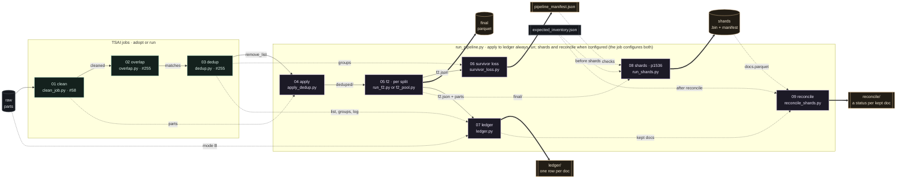

</details>

### The count chain

<p align="center"></p>

Each stage must account for every document it was given, and it must have read **exactly** what the stage before produced. Counts catch documents that went missing; sha256 links catch a stage that read the wrong files.

```text
overlap   status = complete
          documents_all            = clean.rows
          documents of every part  = that cleaned part's rows

dedup     status = complete
          checked_sha256 of overlap_matches.csv, overlap_docs.parquet = the overlap's files
          documents_all = overlap.documents_all
          removed       = rows(remove_list.csv)
          heldout_removed = 0

apply     rows = clean.rows,  removed = rows(remove_list.csv)

f2        per split:  rows = apply.kept,  input_sha256 of every part = the sha256 apply wrote
          kept + dropped + errors = rows,  errors = 0,  one set_sha256

survivor  groups = groups in dedup_groups.csv

ledger    rows with a cleaned row = clean.rows
          removed_by_dedup = apply.removed,  dropped_by_f2 = f2.dropped,  f2_error = f2.errors,  kept = f2.kept
          set_sha256 = F2's,  and every final part holds the ledger's kept docs, in order
          per pack and split:  cleaned and removed = apply's by_pack;  each row adds up;  each column = its stage's count

shards    failed = 0,  skipped = 0,  written > 0,  run_shards.py exit code 0
          the summary's run_id and cleaning_pipeline_sha256 = this run's

reconcile every kept document of a selected pack:  in_shard,  left_out:<reason>  or  not_sharded
          (in the rehearsal: 77,661 kept = 76,795 in shards + 58 left out + 808 not sharded)
```

The manifest's `totals` carry the headline: `cleaned → removed_by_dedup → dropped_by_f2 → final`, with `raw` and `dropped_by_clean` in front when the ledger ran in mode B, and `shards_written` when the shard stage ran.

### Clean, overlap and dedup

The runner never reimplements these. In **adopt** mode it checks the returned folder; in **run** mode `stage_args.py` builds the command, and the same checks follow. A run stage's settings file holds settings only (k, floor, pack order, pins) and is never edited: each stage gets a copy with its path keys filled in at `<run>/cfg/<stage>.json`, and is run with `--config` on that copy.

| Stage | Keys the runner fills in | From |
|---|---|---|
| clean | `input_root`, `output_root`, `manifest`, `manifest_sha256`, `expected_parts`, `sample` (when given) | `stages.clean.input`, the clean folder, `stages.clean.manifest` (default `<input>/sample_manifest.json`) and the other `stages.clean` keys |
| overlap | `inputs`, `out` | the clean folder, the overlap folder |
| dedup | `results`, `inputs`, `out` | the overlap folder, the clean folder, the dedup folder |

`"script"` replaces the default script (`pipeline/clean_job.py`, `dedup/overlap.py`, `dedup/dedup.py`). A **list** is the script, then the arguments that go before `--config`: that is how a script run through a wrapper is named (the spec v1 `use_clean.py` is one: `["teams/01-data-a/spec_v1_1/use_clean.py", "<the tool to run>"]`). The stage record keeps the first script's sha256 as `code_sha256` and each `.py` after it under `tools_sha256`; before anything runs, every `.py` of the list must exist. The clean stage needs no wrapper: `clean_job.py` loads the cleaner its settings file names, and the clean record's `tools_sha256` holds that cleaner's sha256 and `clean_manifest.py`'s.

`stages.clean.only` runs the clean job on some sample parts only (one `--only <part>` each), for trials; overlap's generated config then gets `"expected_packs": []`. The escape hatch `"command"` runs a script and its arguments as they are, with `"output"` naming where it writes.

### Apply the remove list

`apply_dedup.py` copies the cleaned parts without the rows dedup's `remove_list.csv` names, everything else unchanged. It runs **all** of its checks before it writes anything (see [Guards](#guards)). A part with nothing to remove is hard-linked (or byte-copied with `--copy` or `"link": false`), so its sha256 proves it is untouched. A filtered part keeps its codec, rows and row order; its row groups hold up to 64k rows or 32 MiB. A rerun with the same remove list and code skips each part whose input and output still have the recorded sha256.

> [!IMPORTANT]
> **`doc_id` alone is not a key.** In cleaned sample v0 (86 files, 1,432,552 rows), 22,773 doc_ids appear in two parts of the same pack and split. A document is found by **split + part + row** (apply) or **split + part + doc_id** (survivor loss), never by doc_id alone.

### Audit examples from the clean job

The readers who sign off a pack need, for each rule, a few documents it acted on, before and after. The clean job keeps the list without slowing the run; a separate script builds the before and after.

**In the job.** `audit_samples` in `clean.json` (5) is how many documents per rule the job keeps; 0 switches the audit off. When a rule fixes or drops a document, the job gives that (rule, document) pair a key, `crc32(rule id + doc_id)`, and each part remembers the `audit_samples` lowest keys per rule. The hash picks the same documents whatever the order of rows or parts, and after a resume; a `keep` costs nothing extra. Each part gets `audit/<split>/<pack>/<part>.json` (doc_id, action, characters before and after; no text), written before its report. At the end the job merges them into `rule_examples.csv`: for every rule that applies to a pack, the `audit_samples` lowest keys over all the pack's parts, and the rule's fix and drop counts in the pack. A rule that never fired has one row with no document. `audit_samples` is part of the job's fingerprint: a resume with another value is refused, and a finished part without its audit file stops the resume.

**Replay.** Rules run in sequence, so one document can be changed by several of them. `audit/audit_replay.py` runs the sampled documents again, and only those, through the cleaner the job used (path and pin from `job_summary.json`) and records every rule that acted on each:

```bash
python -I teams/01-data-a/audit/audit_replay.py --job <run>/clean --input-root <raw parts> --out <folder> [--pack en-dclm]
```

It writes, per pack, `<folder>/<pack>/docs.csv` (the rules each document was sampled for, every rule that acted on it, the final action), `trace.jsonl` (one line per step, with the text before and after), `raw.parquet`, `cleaned.parquet` and `ids.txt`. Each replay is checked against the job's own output (action and text, a drop absent from the part): a document that differs is marked `replay_ok=False` and the exit code is 1. Only fixes and drops are sampled, and a dropped document has a raw row and its steps but no cleaned row. The files hold document text: `--out` must be outside the job folder (the script refuses otherwise), and keep it out of the repository. Tests: `tests/audit/test_audit_replay.py`, and the sampling tests in `pipeline/tests/test_clean_job.py`.

### F2

One `run_f2.py` per split by default. With `stages.f2.workers` N > 1, up to N processes at once, one per pack folder (each loads G9's set, about 1.1 GB). With `"pool": true`, one `f2_pool.py` per split: it loads the set once, checks its pin before any worker starts, and shares the split's parts out to `workers` processes, largest first (on Linux they share the loaded set). Its parts, `.f2.json` reports and `f2_summary.json` are byte for byte what `run_f2.py` writes, apart from the `seconds` fields. A unit that fails without a summary stops the run; a rerun with `"from": "f2"` skips finished files.

### Survivor loss

<p align="center"></p>

Dedup keeps one copy of each duplicate group, or every held-out copy (rule 0). F2 runs afterwards, and when it drops a survivor, the removed copies are not brought back. TSAI accepted this on 12 Nov, on condition that those groups are **counted and listed**.

| Status | Meaning |
|---|---|
| `lost` | F2 dropped **every** survivor of the group: no copy reaches the final data |
| `partly_hit` | F2 dropped some survivors, not all (only groups with several held-out survivors) |
| `untouched` | F2 dropped none |
| `without_survivor` | dedup kept no copy (no usable licence, rule 1); F2 cannot change that |

A document whose F2 check raised an error is also kept out of the output, so it counts as dropped, with `f2_items` = `error:<type>`. `survivor_loss.csv` has one row per survivor F2 dropped: `status, group_id, group_size, priority_rule, pack_id, split, part, row_in_part, doc_id, f2_items, offset`. Benchmark **item IDs** and offsets only, never text.

### The ledger

<p align="center"></p>

The team asked for **every document's decision at every stage, including the documents that were dropped**. The ledger answers "what happened to this document, and why?" without opening any text: one row per document, with the cleaner's action, dedup's role and match, F2's action and benchmark items, and exactly one `final` status. It is built from what each stage wrote, so it decides nothing; it only lines the decisions up and checks that they agree.

<table>
<tr><th>Stage</th><th>Columns</th><th>Values</th></tr>
<tr><td>identity</td><td><code>pack_id</code> · <code>split</code> · <code>part</code> · <code>raw_row</code> · <code>row_in_part</code> · <code>doc_id</code></td><td><code>row_in_part</code> is the row in the cleaned part, as dedup numbers it (empty when the cleaner dropped the doc). <code>raw_row</code> is the row in the raw part (mode B only)</td></tr>
<tr><td>clean</td><td><code>clean_action</code> · <code>clean_rules</code></td><td><code>keep</code> · <code>fix</code> · <code>drop</code> · <code>unknown</code>; rule ids once mode A exists</td></tr>
<tr><td>dedup</td><td><code>dedup_role</code> · <code>dedup_group</code> · <code>dedup_priority_rule</code></td><td><code>none</code> · <code>survivor</code> · <code>removed</code>; <code>G000123</code>; rule <code>0</code>–<code>4</code> of source_priority_v1.md</td></tr>
<tr><td></td><td><code>dedup_match_rule</code> · <code>dedup_similarity</code> · <code>dedup_kept_doc</code> · <code>dedup_stage</code></td><td>from <code>dedup_log.jsonl</code>, for removed docs: <code>H1</code>/<code>H2</code>, the Jaccard score, the survivor's doc_id, <code>within_pack</code> or <code>cross_pack</code></td></tr>
<tr><td></td><td><code>dedup_list</code></td><td>which remove list removed it: <code>dedup</code> (dedup.py's list); later H3's</td></tr>
<tr><td>F2</td><td><code>f2_action</code> · <code>f2_items</code> · <code>f2_offset</code></td><td><code>kept</code> · <code>dropped</code> · <code>error</code> (empty when F2 never saw the doc); benchmark item ids; the character offset</td></tr>
<tr><td>final</td><td><code>final</code> · <code>final_part</code> · <code>final_row</code></td><td><code>kept</code> · <code>dropped_by_clean</code> · <code>removed_by_dedup</code> · <code>dropped_by_f2</code> · <code>f2_error</code>; where a kept doc is in <code>final/&lt;split&gt;/</code></td></tr>
</table>

**The cleaner's decision** depends on what is available, and the ledger records which mode it ran in:

| Mode | When | How |
|:-:|---|---|
| **A** | the cleaning job writes a per-document decisions file (not yet: a small addition to `clean_job.py`, to agree with its owners) | rule ids per document |
| **B** | `stages.ledger.raw` points at the raw parts (**required with `"inventory"`**) | the raw file of each part is the one whose sha256 the cleaning job's report names (any file name, as the cleaner finds it), or the file of the same name when there is no report. It is joined to its cleaned part on doc_id (the cleaner refuses duplicate doc_ids in a part). Missing from the cleaned part: `drop`. Different text: `fix`. Same text: `keep`. The text is compared inside pyarrow and never written anywhere |
| **C** | neither | the ledger starts at the cleaned documents and `clean_action` is `unknown` |

Mode B needs the cleaning job's per-part report for every cleaned part (`reports/<split>/<part>.json` with `input_rows`, `actions` and `input_sha256`, as `clean_job.py` writes them): it finds the raw file by that sha256, and stops if its drops or raw rows per part differ from the report. A part without one stops the ledger, since it would otherwise match a raw file by name and skip the check of the cleaner's drops; a clean step that writes no reports (a bare `run_clean.py`) must write them, or the ledger runs in mode C. In mode C the summary records the reports' keep / fix / drop counts when they are there. In mode B the summary lists every raw file used, with its sha256, so two runs on different raw data never get the same digest; the inventory check compares those hashes with the inventory's.

**How rows are matched.** Dedup's list, groups and log are joined on **split + part + row** and must name the doc_id the cleaned part holds at that row; none may name a row twice, and the groups' removed rows and the log's rows must both be exactly the remove list's rows. F2's reports are joined on **split + part + doc_id**, and every doc_id they name must be one apply kept in that part. A kept document's `final_row` is its rank among the kept rows of its part, and the ledger reads each final part to check that it holds exactly those doc_ids in that order. The ledger is built **part by part with pyarrow joins and compute functions**: no Python loop over documents, and no numpy needed.

```text
ledger/
├── train/<pack>.parquet      one row per document (zstd), one file per pack and split
├── heldout/<pack>.parquet
├── ledger_summary.json       clean mode · inputs and their sha256 · totals and per pack × split counts by final status · survivors_dropped_by_f2 (total, per pack)
└── ledger_sample.csv         to read by eye: per pack and split, up to 5 rows of each final status
```

The ledger is built in `<out>.partial` and swapped in whole, so `--out` never mixes two runs and a stopped rebuild leaves the previous ledger as it was.

<details>
<summary><b>Reading the ledger</b></summary>
<br>

```python
from pathlib import Path
import pyarrow.parquet as pq, pyarrow.compute as pc

t = pq.read_table(sorted(Path("out/pipeline/sample-v0/ledger").rglob("*.parquet")))
t.group_by(["pack_id", "split", "final"]).aggregate([("doc_id", "count")])     # the outcome per pack
t.filter(pc.equal(t["doc_id"], "<doc_id>"))                                  # every copy of one doc_id, with its part
t.filter(pc.equal(t["final"], "dropped_by_f2")).select(["pack_id", "doc_id", "f2_items", "f2_offset"])
```

`ledger_summary.json` holds the same counts without reading any Parquet. From the 2-pack smoke run:

```jsonc
"by_pack": {
  "sci-finepdfs": {
    "train":   { "rows": 6011, "rows_cleaned": 6011, "kept": 5995, "dropped_by_clean": 0, "removed_by_dedup": 2, "dropped_by_f2": 14, "f2_error": 0 },
    "heldout": { "rows": 63,   "rows_cleaned": 63,   "kept": 63,   "dropped_by_clean": 0, "removed_by_dedup": 0, "dropped_by_f2": 0,  "f2_error": 0 }
  }, …
}
```

</details>

### Shards

With `stages.shards` in the config, `run_pipeline.py` runs shards after the manifest holds every earlier stage. It first writes `<run>/cleaning_pipeline.json` (the `clean.py` sha256, the F2 fingerprint set, the dedup remove list with the overlap run and the dedup settings it came from: the processing behind every shard of the run). It then runs `shards/run_shards.py` on `final/`, with its log in `logs/shards.log`, and records the stage like any other. The stage stops the run if a part failed or was skipped, if rows of a written part were never read (a writer fault: the writer rolls over), if nothing was written, if `run_shards.py` exited non-zero, if the summary is not this run's, or if the shards on disk do not verify (below). With `"inventory"`, check point 1 runs on entry to this stage, before anything is sharded. `"from": "shards"` runs the shard stage (and reconcile, when configured) on a run whose ledger is recorded. Into a `stages.shards.out` that a stopped shard stage of this run left, it continues: the parts done are kept and the rest written; an out folder of another run, or made with other settings (tokens, `dataset_version`, tokenizer), or holding shards without a `shards_summary.json`, is refused.

`shards/run_shards.py` runs the writer on every part of `final/`. Held-out parts (a `heldout`, `validation` or `val` folder) are reported `not_sharded`, which is not an error. Language, script, domain and lane come from the pack's row in the pack table (`--pack-table`, default `shards/pack_table.json`). A row that gives `license` and `license_source` has both written into its shards' manifests. A row may leave out both, and its shards then carry no licence: `run_shards.py` allows that, but the job's `prepare_run.py` refuses a pack table without both for every pack (gate 5), and `verify_shards.py` checks every manifest's licence against the table. A pack that is not in the table, or has a null field (lane, or a licence field the row gives), is `skipped`, and a skipped part stops the run; a lane that is not one of the six agreed names (`code`, `code-adjacent`, `english`, `indic`, `math`, `science`, #47) is refused when the table is loaded (#63). Shard numbers run on across a pack's parts in part order (without a rollover `part-00001.parquet` still becomes `<pack>-train-000001`). A part with no document to write is `empty` (no rows) or `all_left_out` (every row left out, doc_ids in its entry) and gets no shard. The summary is saved before the first shard and after every part, and each manifest is published last, so the same command run again into the same `--out` keeps the parts already done and writes the rest; other settings, or shards without a summary, are refused. `<out>/shards_summary.json` lists each part with its status, its shards (the part-to-shards map: id, docs, tokens and the rows each holds), docs, tokens, rows read of the rows in the part, `truncated`, and the count of docs left out per reason (their doc_ids are in each shard's quality report).

The shards are checked against their files, not against `shards_summary.json` (`shards/verify_shards.py`; `shards/shard_format_v1.md`, "Verification"). In a pipeline run the runner does it, once, after `run_shards.py`, which it starts with `--no-verify` (so that script's summary has `"verified": null` and marks no part failed for its files); a failed check stops the run and names the first 3 problems. Run by hand, `run_shards.py` verifies by default. A replaced `stages.shards.script` gets no `--no-verify` and is checked by the runner all the same. The checks: the `.bin`, `.idx.npy`, `.docs.parquet`, quality report and `cleaning_pipeline.json` have the manifest's sha256 (`cleaning_pipeline.json` is also the run's own), the `.dump.md` is there, the `.bin` header and size, the index, the special ids and the metadata agree with the manifest, `language`, `script`, `domain`, `lane`, `license` and `license_source` are the pack's row in `pack_table.json` (no licence in the manifest when the row has none), the tokenizer and the F2 fingerprint set are the run's, and the first and last document of each shard, read from `final/`, encode to the tokens in the `.bin` and decode to their normalized text. The sha256 of each `.bin`, `.idx.npy` and `.docs.parquet` go to the run's hash cache, so the stage's digest does not hash those files again (except with `"hash_cache": false`, an audit run that hashes everything). By hand: `python -I teams/01-data-a/shards/verify_shards.py --out <dir> --manifest <run>/pipeline_manifest.json --tokenizer <tokenizer.json>`.

A part the writer stops on is recorded and the run goes on; the exit code is 1 unless every part was written, `empty`, `all_left_out` or `not_sharded`.

`shards/shard_writer.py` makes one or more shards from one part:

| | |
|---|---|
| **Tokenizer** | G3's frozen p1536 `tokenizer.json`, sha256 `e6b93a93a60520d7b1af2e9242485f443b5596a1e116b8f8798d83bbad25a64b`; any other file is refused (`--any-tokenizer`, tests only, marks the shard `dataset_version: test`). Vocab 131,072; each doc ends with one EOS, `<\|endoftext\|>` id 130822; no BOS |
| **Provenance** | before it writes, `shards/provenance.py` checks the part's chain back to the clean job's record of the raw part (F2 report, apply, remove list, clean job's `job_summary.json`; the raw file itself is not hashed), and `cleaning_pipeline.json` must be what the manifest gives |
| **Left out** | a doc is left out, counted and listed by doc_id when it looks like it holds a secret or an e-mail address (pr-guard's patterns: `secret`), encodes to no tokens (`empty`), holds a special token (`special`), or does not decode to the tokenizer-normalized text (`roundtrip`) |
| **Fill** | docs in order until the next would pass `--tokens` (default 2^26), then the shard is written and the next one opens with that doc (rollover), until every row is read. A doc is never split; one longer than `--tokens` alone is left out as `oversize` |
| **Writes** | `<shard_id>.{bin,idx.npy,docs.parquet,json}`, `<shard_id>.quality_report.json`, `<shard_id>.dump.md`, `cleaning_pipeline.json`; IDs and counts only. The `.bin`, index, metadata and reports are written in place; the manifest is written last, to a `.tmp` and renamed: it is the shard's completion mark, so a rerun redoes a shard that has none |
| **`dataset_version`** | `--dataset-version` (from `stages.shards.dataset_version`, through `run_shards.py`): required, never guessed, never `"test"`; `"test"` with `--any-tokenizer`. A missing or wrong one stops `run_shards.py` before any part is read |
| **Checks after writing** | G6's `open_shard` reads the `.bin`; sizes and index match the manifest; every id < 131,072; the only special ids are the EOS at the end of each doc |

```bash
python -I teams/01-data-a/shards/shard_writer.py --input <run>/final/train/<pack>/<part>.parquet \
    --manifest <run>/pipeline_manifest.json --tokenizer <p1536>/tokenizer.json \
    --language <language> --script <script> --lane <lane> --dataset-version <release> --out <dir> \
    [--domain <domain>] [--license <licence> --license-source <where it is recorded>] [--index N] [--tokens N]
```

`--license` and `--license-source` go together (one without the other is refused). `--domain` defaults to the pack's family in `clean.py`. `cleaning_pipeline.json` must sit next to the manifest (the shard stage writes it, or `python -I teams/01-data-a/shards/provenance.py --manifest <run>/pipeline_manifest.json --write-record`).

### Reconcile

`reconcile_shards.py` checks that every kept document of the ledger is in exactly one shard at its ledger position, or left out by the writer for a stated reason, or in a part that is not sharded. The ledger and the shards meet on `(input_part, input_row)`: one join, one ledger file (one pack and split) at a time. Its scope is the packs of `stages.shards.packs`, or else every pack the ledger holds kept documents of, never the shards' own summary, so a pack the shard stage left out entirely fails.

| `shard_status` | Meaning | Fails? |
|---|---|:-:|
| `in_shard` | in `<shard_id>.docs.parquet` at its ledger position, with its doc_id | |
| `left_out:<reason>` | the writer left it out: `secret`, `empty`, `special` or `roundtrip` | |
| `not_sharded` | its part is held-out | |
| `not_selected` | its pack is not in `stages.shards.packs` (only when packs are given) | |
| `not_reached` | its part was written, but rows were never read into a shard (`truncated`): a writer fault, since the writer rolls over | yes |
| `part_failed`, `part_skipped` | its part failed or was skipped | yes |
| `missing` | none of the above | yes |

It also fails when a document in a shard is not a kept ledger document at that position, a position is in two shards, a left-out document is not kept or is also in a shard, a shard's `doc_count` differs from its `docs.parquet`, or a listed pack holds no kept documents. It writes `reconcile_docs.parquet` (one row per kept document: `pack_id, split, input_part, input_row, doc_id, shard_id, shard_status`) and `reconcile_summary.json` before it stops, so they show what failed. With `"inventory"`, check point 2 runs after it.

### Expected inventory

<p align="center"></p>

Every check above compares one output of the run with another. None of them can say that a pack or a part **never reached the run**: a part that was not in the cleaned folder is in no ledger, no shard summary and no reconciliation, and all of them still agree. The expected inventory closes that gap. It is written **before the run, from the approved input manifest**, and reads nothing the run writes.

```jsonc
// expected_inventory.json
{ "input_manifest_sha256": "7fd647c8…",          // the input manifest it was made from
  "packs": ["code-go", "en-dclm", …],
  "parts": [
    { "split": "train",   "pack_id": "code-go", "part": "train/code-go/part-00000.parquet",
      "raw_sha256": "…", "raw_rows": 61393, "expected": "written" },
    { "split": "heldout", "pack_id": "code-go", "part": "heldout/code-go/part-00000.parquet",
      "raw_sha256": "…", "raw_rows": 872,   "expected": "not_sharded" } ] }
```

| Field | Meaning |
|---|---|
| `input_manifest_sha256` | the sha256 of the input manifest the inventory was made from (64 lowercase hex); compared with the `manifest_sha256` in the clean job's `job_summary.json` |
| `packs` | every pack of the input manifest, each listed once; each must have at least one part |
| `parts[].part` | `<split>/<pack>/<file>.parquet`, split `train` or `heldout`: the name the part has in the cleaned folder, the ledger and `shards_summary.json` |
| `parts[].expected` | the status the part must have in `shards_summary.json`: `"written"`, `"not_sharded"`, or a **list** of acceptable statuses (a status the shard writer gets later, such as one for a part with no document left, needs only the inventory to list it). `failed` and `skipped` are refused. A status is any text, so a mistyped one (`"writen"`) fails only when the statuses are compared, after reconcile: the `inventory:` line of `--plan` counts the parts per expected status, which is where it shows beforehand |
| `parts[].raw_sha256` · `.raw_rows` | the raw part's sha256 and rows, both required: every part is compared on both |
| `parts[].pack_id` · `.split` | optional; when given they must be the pack and the split in `part` |

Every field is spelled as above. A key that is none of these is refused, at the top and in a part (keys starting with `_` are comments), so a hash under another name, such as the input manifest's own `sha256` and `rows`, cannot go uncompared.

Set `"inventory": "<file>"` in the run config. **A run with an inventory is the production run**, and the config is refused, before anything runs, when it has

- no `stages.ledger.raw`: the ledger must account for every raw document (mode B), and the raw rows and hashes can only be checked there;
- no `stages.shards` or no `stages.reconcile`, or a `"to"` earlier than reconcile: such a run would end without one or both of the check points below;
- a `stages.shards.packs` that is not the inventory's `packs` (leave the key out and the shard stage takes every pack);
- a clean stage in `"mode": "run"` whose `manifest_sha256` is not the inventory's `input_manifest_sha256`, or an adopted cleaned folder (one that is there already) whose `job_summary.json` names another input manifest or none, is missing, or cannot be read as a JSON object;
- an inventory that is malformed: a part listed twice, a part of a pack that `packs` does not list, a pack without a part, a missing, unknown or wrong-typed field.

A config without the key runs as before: nothing is compared with an input manifest and the raw ledger is not required. `--plan` then prints `inventory: none … not a production run`, and the manifest has `"inventory": null`. A mistyped key cannot cause that by accident: a top-level key that is not a run parameter, a key under `stages` that is not a stage, and `inventory` or `intermediates` inside a stage's settings are refused.

**When it is checked.**

| When | What | Why there |
|---|---|---|
| on entry to the **shard stage**, in sequence or with `"from": "shards"` | the clean job's `job_summary.json` names the inventory's input manifest (no summary, or one that names none, fails) · the ledger is mode B · it holds exactly the listed parts · every listed pack is in it, and no other pack has kept documents · each part's raw file is the listed one (the sha256 `ledger.py` recorded for the raw file it read) · each part's raw rows are the listed ones (the part's rows in the ledger) | a part that is missing or not listed stops the run **before anything is sharded**. The ledger stage is already recorded, so after a mistake in the inventory file alone the corrected file resumes with `"from": "shards"`; the ledger is not built again |
| after **reconcile** | all of the above again · `shards_summary.json` holds exactly the listed parts · every part has a listed status · every part is of its listed pack (the `pack_id` the summary gives the part; an entry without one fails). The documents' own `pack_id` is not compared part by part: a raw file in another pack's folder fails the raw sha256 check, and a kept document of a pack that is not listed fails the ledger's pack check | the statuses exist only now; the ledger side is repeated because a run resumed with `"from": "reconcile"` skips the first check point and may have another inventory than the one it saw |

Packs are compared by the documents' `pack_id`. A listed pack must be in the ledger unless all its parts list 0 raw rows. A raw part of a listed pack may hold a document with another `pack_id`: when the cleaner dropped it, or dedup or F2 took it out, nothing of that pack goes on and the check passes, naming the pack in its detail; when such a document was **kept**, the check fails, since a pack the input manifest does not list would reach the shards.

Every check of a check point runs before the run stops, and the report goes to `<run>/inventory_check.json` first: under `differences` it lists every part and pack behind a failed check with both values (the ledger's and the listed one). Each check point writes the file over the one before it, and every run removes an earlier report when it starts, so the file is always the last check point's of the latest invocation (`checked_after`); a check point that cannot read an input writes `"ok": false` with the reason under `error`. A check point writes its report and never the manifest: stage records change only when a stage finishes, so a resumed run that a check point stops leaves the manifest, with the records of the stages after it, as it was. The stage records carry the checks (`inventory: …`, in the shards and reconcile records) and the sha256 of the inventory they passed with (`inventory_sha256`). The manifest names the inventory file, its sha256 and counts, where the report goes, and under `checked` the sha256 each check point passed with. `checked` is read from those two stage records: it is `null` until the stage is recorded (the shard stage for `ledger`, reconcile for `reconcile`), and holds two different values when a run was resumed with another inventory file. Paths in the report are shown as in the manifest, relative to the repository when inside it.

**After a job**, the same check runs on the returned files, without the pipeline:

```bash
python -I teams/01-data-a/pipeline/inventory_check.py --inventory <expected_inventory.json> \
    --ledger <run>/ledger --shards <run>/shards [--cleaned <cleaned>] [--out report.json]      # exit 0, or 1 with every difference
```

Only the sides that are given are checked (at least one of `--ledger` and `--shards`): `--cleaned` adds 1 check, `--ledger` 5, `--shards` 3, so all three make 9. Without `--cleaned` the input manifest is not compared. It prints one JSON line (`ok`, `checks`, `failed`, `parts`, `packs`) and, on a failure, every failed check with its detail.

It reads `ledger_summary.json`, `shards_summary.json` and, with `--cleaned`, `job_summary.json`, and two columns of the ledger's Parquet (`split`, `part`); no raw or final part is opened and nothing is hashed again. On the shard side it depends on three things in `shards_summary.json`: `parts` is an object keyed by `<split>/<pack>/<file>.parquet`, with one entry per input part (held-out parts too), and each entry has `status` and `pack_id`. The report holds IDs, counts, hashes and the paths it was given, no document text.

### Intermediate Parquet: keep or drop

<p align="center"></p>

Between the input and the shards, a run writes Parquet three times: `clean/` (when it runs the clean job itself), `deduped/` and `final/`. One key, `intermediates`, says what happens to `deduped/` and `final/` when the run is over.

| | `"intermediates": "keep"` (default) | `"intermediates": "drop"` |
|---|---|---|
| **Use it for** | the cleaner audit (task 5), which reads the parts before and after `clean.py`; trials; any run you may resume | a run whose product is the shards |
| **At the end of the run** | nothing is deleted | in `deduped/` and `final/`, the Parquet of every part **whose kept documents are all in shards, or left out by the shard writer for a stated reason,** is deleted |
| **Needs** | nothing | a run that ends at `reconcile` (so `stages.shards` and `stages.reconcile`, and no earlier `"to"`) |
| **Afterwards** | `"from"` works as usual | the run cannot be resumed or rerun in place: a new run needs a new `run_id` |

**Which parts go.** The drop reads `reconcile/reconcile_docs.parquet`, the reconciliation's one row per kept document. A part's Parquet is deleted only when **every** kept document of that part has the status `in_shard` or `left_out:<reason>`, and `shards_summary.json` reports the part as `written`. Anything else keeps the whole part, in both folders:

| Part | Status of its kept documents | Its Parquet in `deduped/` and `final/` |
|---|---|---|
| a train part the shard stage wrote | `in_shard`, `left_out:<reason>` | **deleted** |
| a held-out part | `not_sharded` | stays: `final/heldout/` is the only filtered copy of the held-out set |
| a part of a pack the shard stage was not asked for (`stages.shards.packs`) | `not_selected` | stays |
| a part with no kept document | (no row) | stays |

A run stops at `reconcile` when a kept document of a selected pack is missing, cut off or in a failed part, so those never reach the drop; if such a status were present, the part would stay too.

**What a drop never deletes.**

- **The cleaned folder**, adopted or written by this run. An adopted folder is an input. A folder this run wrote may since have been adopted by another run (`local_trial/configs/4-adopt-clean.json` does exactly that), and the runner cannot see who has, so it stays.
- The raw input, the overlap and dedup folders, the ledger, the shards (`*.docs.parquet` included), the reconciliation, F2's `*.f2.json` reports, every summary, the logs, the manifest.

A part that apply hard-linked from the cleaned folder loses only its name in `deduped/`; the file stays in the cleaned folder (`hard_links` in the manifest counts these: deleting them frees no disk).

**What still tells the story afterwards.** The ledger has one row per document with every stage's decision and the document's position in the final part; `reconcile_docs.parquet` maps each kept document to its shard; the shards' `docs.parquet` point back at the same `(input_part, input_row)`. The manifest keeps every stage's digest **as it was checked, before the drop**, and adds what was deleted:

```jsonc
"intermediates": { "mode": "drop", "state": "done",
  "parts": { "dropped": …, "left": … },              // left: held-out, not selected
  "shards_verified": …,                              // shards checked on disk before the first deletion
  "folders": { "deduped": { "stage": "apply", "parquet_files": …, "bytes": …, "hard_links": … },
               "final":   { "stage": "f2",    "parquet_files": …, "bytes": …, "hard_links": 0 } } }
```

**Guards.** The config is checked before the first stage runs, and `--plan` names the two folders. Everything about the files is checked before the first one is deleted.

| Guard | What it stops |
|---|---|
| `drop` without a run that ends at `reconcile` | deleting `final/` when it is the run's only product, or before the shards are known to hold a part's documents |
| `stages.shards.out` or `stages.clean.input` inside `deduped/` or `final/` (a `stages.ledger.raw` there is refused for every run) | shards or an input in a folder the drop deletes from |
| every shard the dropped parts went into is checked on disk first, against its own manifest: each file it names has the writer's name (`<shard_id>.bin`, `.idx.npy`, `.docs.parquet`, `.quality_report.json`), is a file in the shards folder (not a link to one elsewhere) and has its sha256, the `.bin` has the format's header (magic 20261025, version 2, token count) and is header + 4 bytes a token, the index is int64 and rises from 0 to the token count with one entry more than documents, the `.docs.parquet` has one row a document, and `shards_summary.json`'s docs and tokens are the manifest's (`shard_problems`) | deleting the only copy of documents whose shard is missing or damaged, although the summary and reconcile say they are in it (they read the metadata, not the `.bin` and `.idx.npy`). The drop stops with `intermediates: a shard is not on disk as its manifest says …`, nothing is deleted and the run stays resumable; the manifest records `shards_verified` |
| only files named `<split>/<pack>/<file>.parquet` from the reconciliation are deleted | anything else that happens to lie in the folder |
| `deduped/`, `final/` and each part's own folder must be where they should be once links are resolved | a folder that is a link to somewhere else, outside the run folder or inside it: the drop stops, nothing is deleted |
| a read-only part (Windows) stops the drop before it starts | changing the attribute of a file that a hard link shares with the adopted folder |
| `"state": "started"` is in the manifest before the first file goes; it is taken back only if the very first deletion fails, and never written when there is nothing to delete | a drop that was interrupted halfway looking like an intact run. A run killed between the mark and the first deletion stays marked: the guard errs on the side of refusing |
| a manifest with a drop state refuses `"from"` and a rerun | a stage starting on folders whose reports are there but whose Parquet is gone |

**For the audit.** Run the sample with the final cleaner and `"intermediates": "keep"` (clean in `"mode": "run"`): the raw parts are the input folder, the cleaned parts are `<run>/clean/`, and the ledger (with `stages.ledger.raw`) says keep / fix / drop per document.

**What this switch is not.** It does not change how the stages pass data to each other: each stage is still the team's own script reading and writing Parquet, so a run with `drop` uses the same disk at its peak as one with `keep`, and its cleaned folder stays. It decides what is left of `deduped/` and `final/` when the run is over.

<br>

## Configuration reference

The run config is JSON. Paths are relative to the repository root, or absolute; keys starting with `_` are comments. `pipeline.json` is the generic template. The whole config is checked before the first stage runs, and `--plan` checks it the same way, except `"from"` and the earlier stages' records, which only a run checks.

**Top level.** Any other key that does not start with `_` is refused (`config: unknown key …`).

| Key | Values | Meaning |
|---|---|---|
| `run_id` | text, **required** | names the run: its folders are `<out>/<run_id>/` (the clean job refuses an existing folder, so a new run needs a new `run_id`) |
| `out` | folder (default `out/pipeline`) | where run folders go; git ignores `out/` |
| `stages` | object | one entry per stage below; a key that is not a stage (and does not start with `_`) is refused |
| `to` | a stage | stop after this stage; only the stages up to it are checked, so a clean-only job needs no overlap or dedup entry. Default: `reconcile` when shards and reconcile are configured, else `shards` when shards is, else `ledger` |
| `from` | a stage | resume at this stage: the earlier stages must be recorded in the manifest with unchanged digests |
| `hash_cache` | `true` (default) · `false` | **true**: every sha256 is computed once and kept in `<run>/cache/sha256.json`, keyed on each file's device, inode, size, mtime and change time (ctime on Linux, NTFS's ChangeTime on Windows), so the digests reuse apply's hashes and a resumed run hashes nothing it has hashed already. **false**: hash everything again, for an audit |
| `intermediates` | `keep` (default) · `drop` | see [Intermediate Parquet](#intermediate-parquet-keep-or-drop); `drop` needs a run that ends at reconcile |
| `inventory` | file (optional) | the [expected inventory](#expected-inventory); makes the run a production run, which needs `stages.ledger.raw`, `stages.shards` and `stages.reconcile` and must end at reconcile. Without it (or `null`), nothing is compared with an input manifest |

**Clean, overlap and dedup** (`stages.clean`, `stages.overlap`, `stages.dedup`):

**H3** (`stages.h3`) is optional. Set `{"mode": "run", "settings": "teams/01-data-a/jobs/2026-11-19-first-training/h3.json"}` to measure translation matches after overlap. The runner sets H3's input to this run's cleaned folder and passes its `h3_matches.csv` to dedup with `remove: false`. It checks the match count and SHA256 against H3's summary, then checks dedup used that file. H3 needs a local offline LaBSE model and the packages in `dedup/requirements_h3.txt`.

| Key | Values | Meaning |
|---|---|---|
| `mode` | `adopt` (default) · `run` | **adopt**: TSAI ran it, and `output` is the folder it returned. **run**: the runner runs the stage's script |
| `output` | folder | **adopt**: required, the folder returned. **run**: optional, default `<run>/<stage>`; must be a named subfolder of `out/`, not a folder of the run (`deduped`, `final`, `report`, `ledger`, `shards`, `reconcile`, `cfg`, `logs`, `cache`, nor one of them with `.partial`, `.old` or `.lock`), and not overlap another stage's |
| `settings` | file | **run**: the stage's settings (no paths); the runner writes a copy with the path keys filled in to `<run>/cfg/<stage>.json` and runs the script with `--config` on it |
| `settings_sha256` | sha256 (optional) | pin of the settings file, checked before anything runs; the manifest records the file's sha256 either way |
| `script` | path, or list (optional) | **run**: another script than the default (`pipeline/clean_job.py`, `dedup/overlap.py`, `dedup/dedup.py`). A list is the script followed by the arguments that go before `--config`, for a script run through a wrapper; the record keeps the first one's sha256 as `code_sha256` and each `.py` after it under `tools_sha256` |
| `command` | `["script.py", "--arg", …]` | escape hatch for **run**: run this Python from the repository root as it is (then `output` is required, and no settings or generated config are involved) |
| `clean.input` | folder | **run, required**: the raw parts, written into the clean config as `input_root` |
| `clean.manifest_sha256` · `clean.expected_parts` · `clean.sample` | sha256 · `{"train": 48, "heldout": 38}` · label | **run, required** (the label is optional): the input set's description, written into the clean config over the settings file's own values (`sample` only when given: the job summary uses it, else the manifest's `"name"`); `expected_parts` must equal the manifest's number of parts per split. A new input set means new values |
| `clean.manifest` | file (optional) | the input manifest. Default: `sample_manifest.json` in the `input` folder. Its sha256 must equal `manifest_sha256`, and its parts must match `expected_parts` and add up to its `total_docs`: checked by `--plan` and again when the clean job starts (`clean_manifest.py`) |
| `clean.only` | list of parts | run the clean job on these parts only (e.g. `["train/code-go/part-00000.parquet"]`), for trials; needs clean in run mode from settings; overlap then expects no particular packs |
| `clean.resume` | `true` · `false` (default) | continue an interrupted clean job in its own folder: finished parts that verify are kept, the rest is redone ([Resuming the clean job](#running-the-production-job)). Only clean has it; it is written into `cfg/clean.json` and recorded in the stage record |

**The stages the runner always runs, and the configured ones:**

| Key | Values | Meaning |
|---|---|---|
| `stages.apply.link` | `true` (default) · `false` | hard-link untouched parts instead of copying them; falls back to a copy across file systems |
| `stages.apply.workers` | whole number ≥ 1 (default 4) | parts checked and written at once; each holds one batch and one output row group in memory |
| `stages.f2.script` | path (default `teams/01-data-a/spec_v1/run_f2.py`) | `run_f2.py`, from #35, merged into this branch with #40 |
| `stages.f2.workers` | whole number ≥ 1 (default 1) | **1**: one `run_f2.py` per split. **N > 1**: up to N processes at once, one per pack folder, with one log per pack; with `pool`, the pool's workers |
| `stages.f2.pool` | `false` (default) · `true` | **true**: one `f2_pool.py` per split. It loads G9's set **once** and shares the split's parts out to `workers` processes: on Linux they share the loaded set (about 1.1 GB in all), elsewhere each worker loads it. The output is byte for byte what `run_f2.py` writes |
| `stages.ledger.raw` | folder (optional; **required with `inventory`**) | the raw parts the cleaner read, as `<raw>/<split>/<pack>/<file>` or `<raw>/<pack>/<split>/<file>` (found by the sha256 in the cleaning report, else by name): the ledger runs in **mode B** (keep / fix / drop per document). Without it, **mode C** |
| `stages.shards` | object | adds the shard stage after the ledger; without it the run stops after the ledger |
| `stages.shards.tokenizer` | file, **required** | G3's frozen p1536 `tokenizer.json` |
| `stages.shards.out` | folder (default `<run>/shards`) | where the shards, their `cleaning_pipeline.json` copy and `shards_summary.json` go |
| `stages.shards.packs` | list of pack ids (optional) | only these packs (`--pack`); with `inventory`, exactly the inventory's packs or left out |
| `stages.shards.pack_table` | file (optional) | a pack table other than `shards/pack_table.json`: the job's. A row that gives `license` and `license_source` has both written into its shards' manifests. A row may leave out both, and its shards then carry no licence: `run_shards.py` allows that, but the job's `prepare_run.py` refuses a pack table without both for every pack (gate 5) |
| `stages.shards.tokens` | whole number ≥ 1 (optional) | token limit per shard (the writer's default is 2^26) |
| `stages.shards.dataset_version` | text (**required**, unless `any_tokenizer`) | the corpus release every shard manifest records, e.g. `"first-training-v1"` (the first training shards; `prepare_run.py` sets it) or `"sample"`; never `"test"`. With `any_tokenizer` leave it out: those shards are `"test"` |
| `stages.shards.script` · `.any_tokenizer` | path · `true` | `run_shards.py` (default `teams/01-data-a/shards/run_shards.py`); `any_tokenizer: true` accepts another tokenizer (tests only) |
| `stages.reconcile` | `{}` | adds the reconciliation after shards (needs `stages.shards`); it takes no keys and uses `stages.shards.packs` |

Keys inside a stage's entry that the runner does not read are not refused, except `inventory` and `intermediates`, which are run parameters (`config: stages.<stage>.inventory: … set it at the top level`).

Scripts run with `python -I`, which ignores user site-packages and `PYTHONPATH`: install `pyarrow` and the rest into the environment itself, not with `pip install --user`. Running overlap locally needs Linux or macOS (`overlap.py` uses `resource`). Adopting TSAI's overlap works anywhere.

<details>
<summary><b>How the runner treats each stage</b></summary>
<br>

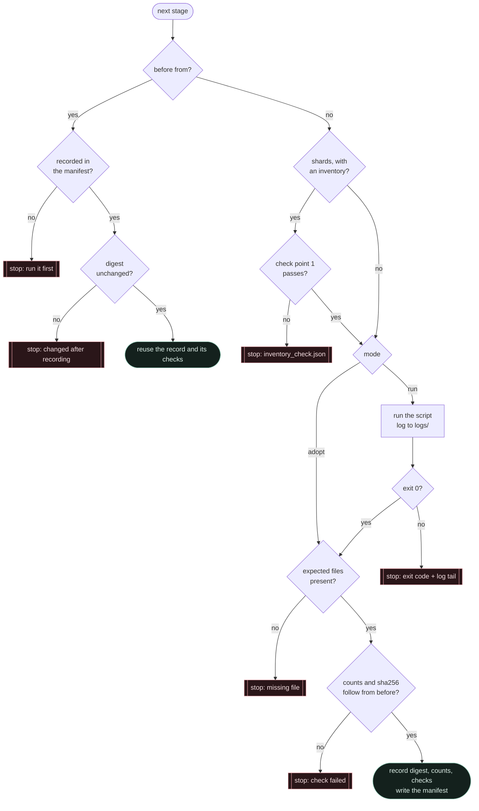

</details>

<br>

## Outputs and the manifest

At the end of every run that reaches the ledger, the runner prints the chain **per pack and split** to stderr, and the manifest keeps the same table as `by_pack`. From the 2-pack smoke run:

```text
pack               split    cleaned  -dedup  -f2   final
ind-ta-sangraha-s  train      4,336       1    0   4,335
ind-ta-sangraha-s  heldout       36       0    0      36
sci-finepdfs       train      6,011       2   14   5,995
sci-finepdfs       heldout       63       0    0      63
total                        10,446       3   14  10,429
```

Read each row left to right: `cleaned − dedup − f2 = final`. In mode B two columns come first, `raw` and `-clean` (dropped by the cleaner), and `raw − clean = cleaned`. The table comes from the ledger, and checks hold it to the other stages: per pack and split, its cleaned rows and dedup removals must equal **apply's own per-pack counts** (`apply_dedup_summary.json`); every row must add up (`raw − clean = cleaned`, `cleaned − dedup − f2 − F2 errors = final`); and each column must add up to the count of the stage that made it (clean, apply, F2). F2 errors have no column because a run with any stops at F2. A pack the cleaner emptied completely (mode B) shows `cleaned 0`.

```text
out/pipeline/<run_id>/
├── pipeline_manifest.json             the record of the run
├── cache/sha256.json                  the hash cache (hashing.py): a shortcut, never trusted over a file that changed
├── cfg/clean.json, overlap.json, …    run mode: the generated config each stage script got
├── logs/                              one log per script run as a process: clean.log, f2_train.log or f2_train_<pack>.log, shards.log, …
├── clean/, overlap/, dedup/           run mode, unless "output" says otherwise (clean/ also holds reports/, audit/, rule_examples.csv and job_summary.json)
├── deduped/                           04 apply
│   ├── train/<pack>/part-NNNNN.parquet
│   ├── heldout/<pack>/part-NNNNN.parquet      hard links: dedup never removes held-out
│   └── apply_dedup_summary.json
├── final/                             05 F2
│   ├── train/<pack>/part-NNNNN.parquet  (+ .f2.json)
│   ├── train/f2_summary.json
│   └── heldout/…
├── report/                            06 survivor loss
│   ├── survivor_loss.csv
│   └── survivor_loss_summary.json
├── ledger/                            07 ledger
│   ├── train/<pack>.parquet, heldout/<pack>.parquet
│   ├── ledger_summary.json
│   └── ledger_sample.csv
├── cleaning_pipeline.json             08 shards, first: clean.py sha256, F2 set, dedup remove list (what every shard of the run says)
├── shards/                            08 shards: <pack>-<split>-NNNNNN.{bin,idx.npy,docs.parquet,json,quality_report.json,dump.md}
│   ├── cleaning_pipeline.json         a copy of the run's file
│   └── shards_summary.json
├── reconcile/                         09 reconcile
│   ├── reconcile_docs.parquet         one row per kept document: shard_id, shard_status
│   └── reconcile_summary.json         per pack and split, the count of each status; the checks
└── inventory_check.json               with "inventory": the report of the last check point, with every difference
```

With `"intermediates": "drop"`, the `part-NNNNN.parquet` files of the parts the shard stage accounts for are gone from `deduped/` and `final/` at the end of the run; everything else in the tree stays, the held-out parts included.

<details>
<summary><b>What <code>pipeline_manifest.json</code> holds</b></summary>
<br>

```jsonc
{
  "tool": "run_pipeline.py", "run_id": "sample-v0", "config": { … },
  "code_sha256": "…",          // run_pipeline.py with stage_args.py, clean_manifest.py, inventory_check.py and the helper modules
  "git_commit": "…", "python": "3.13.x", "pyarrow": "…",
  "stages": [
    { "stage": "clean",   "mode": "run", "command": ["…/clean_job.py", "--config", "…"],
      "code_sha256": "…", "tools_sha256": { "teams/01-data-a/spec_v1_1/clean.py": "…", "teams/01-data-a/pipeline/clean_manifest.py": "…" },
      "settings": "…", "settings_sha256": "…", "config": "cfg/clean.json", "config_sha256": "…",
      "job_summary_checked": true,   // the clean job's summary was compared with its folder (false: an adopted folder with none)
      "output": "…", "digest": "…", "files": 86,
      "counts": { "rows": …, "by_split": { … }, "by_part": { "train/en-dclm/part-00000.parquet": …, … } },
      "checks": [], "seconds": … },
    { "stage": "overlap", "counts": { "documents_all": …, "parts": …, "files_sha256": { … } }, "checks": [ … ] },
    { "stage": "dedup",   "counts": { "remove_list_rows": …, "removed": …, "heldout_removed": 0, "groups": … } },
    { "stage": "apply",   "code_sha256": "…", "counts": { "rows": …, "removed": …, "kept": …, "kept_by_split": { … } } },
    { "stage": "f2",      "set_sha256": "2826a3b8…", "pool": true, "workers": …, "units": …,
      "counts": { "rows": …, "kept": …, "dropped_by_f2": …, "errors": 0, "by_split": { … } } },
    { "stage": "survivor_loss", "counts": { "lost": …, "partly_hit": …, "untouched": …, … } },
    { "stage": "ledger", "clean_mode": "B", "counts": { "rows": …, "rows_cleaned": …, "kept": …, "dropped_by_clean": …,
                                                        "removed_by_dedup": …, "dropped_by_f2": …, "f2_error": 0 } },
    { "stage": "shards",  "cleaning_pipeline_sha256": "…", "inventory_sha256": "…",
      "counts": { "written": …, "failed": 0, "skipped": 0, "not_sharded": …, "truncated": 0, "parts": … } },
    { "stage": "reconcile", "inventory_sha256": "…", "counts": { "kept": …, "in_shards": …, … } }   // and the count of each status
  ],
  "checks": [ { "stage": "dedup", "check": "dedup used this overlap run", "ok": true, "detail": "…" }, … ],
  "totals": { "raw": …, "dropped_by_clean": …, "cleaned": …, "removed_by_dedup": …, "dropped_by_f2": …, "final": …,
              "shards_written": … },   // raw and dropped_by_clean in mode B; shards_written when the shard stage ran
  "intermediates": { "mode": "keep" },   // after a drop: "state": "done", "parts", "folders" (see Intermediate Parquet)
  "by_pack": {                                                                          // from the ledger
    "sci-finepdfs": { "train":   { "cleaned": 6011, "removed_by_dedup": 2, "dropped_by_f2": 14, "final": 5995 },
                      "heldout": { "cleaned": 63,   "removed_by_dedup": 0, "dropped_by_f2": 0,  "final": 63 } }, …
  },
  "inventory": { "file": "…/expected_inventory.json", "sha256": "…", "input_manifest_sha256": "…", "packs": 38, "parts": 86,
                 "expected": { "not_sharded": 38, "written": 48 }, "checked": { "ledger": "…", "reconcile": "…" },
                 "report": "inventory_check.json" }   // null without "inventory"; "checked": the sha256 each check point passed with
}
```

A stage's **digest** is the sha256 over the sorted `relative/path<TAB>hash` of every file in its folder. JSON summaries are hashed without the fields that change between identical runs (timings, absolute paths, skip flags), so two runs on the same inputs give the same digests (a test checks this). Each stage keeps its own checks, so a `from` run still carries the earlier stages' checks.

</details>

<br>

## Guards

<p align="center"></p>

One process at a time may write apply's, the ledger's or reconcile's output folder (a lock the system releases if the process dies), a temp file left by a killed run is deleted rather than written through, and the ledger is swapped in whole, so none of those folders ever mixes two runs. Every Parquet file the runner, `pipeline/` modules and `run_f2.py` write goes to `.tmp` and is renamed. The shard writer writes a shard's files in place and its manifest last (`.tmp`, then a rename), and `run_shards.py` saves its summary after every part, so a stopped shard stage continues in the same `stages.shards.out`. The runner stops at the first failed check: the files of the failed run stay in its run folder for inspection, and a rerun refuses Parquet files that don't belong to the current parts.

<details>
<summary><b>Every check, where it runs, what you see</b></summary>
<br>

| Check | Runs in | Message |
|---|---|---|
| Header is exactly `pack_id,split,part,row_in_part,doc_id` | apply | `header is …, expected dedup.py's …` |
| A `(split, part, row)` is listed once; `row_in_part` is a whole number ≥ 0 | apply | `… is listed twice` · `… is not a whole number >= 0` |
| No `heldout` row in the remove list (rule 0) | apply | `a held-out row … this remove list is broken` |
| Every listed part exists and every listed row is inside it | apply | `… not found under --cleaned` · `row 99 is listed, but the part has 5 rows` |
| The doc_id **and** pack_id at that row are the listed ones | apply | `doc_id is 'A', the remove list says 'B'. The list was made from another cleaning run` |
| Every part opens as Parquet with `doc_id` and `pack_id` (footer only) | apply | `… cannot be read as Parquet` · `… no pack_id column` |
| No row of any part without a `pack_id` | apply | `… row(s) have no pack_id` |
| No Parquet under the output that isn't a current part | apply · f2 | `… left by an earlier run` · `no stale F2 output in final/train` |
| Output never inside input, nor input inside output | apply · f2 · config | `… overlap: the output would be read as input` |
| Overlap is complete and read these cleaned parts | runner | `overlap read every cleaned row` · `overlap read these cleaned parts` |
| Dedup is complete, used **this** overlap run, agrees with its list, removed no held-out | runner | `dedup used this overlap run` · `dedup summary matches its remove list` |
| F2 read every row, read what apply wrote, adds up, no errors, one set | runner | `F2 read what apply wrote in train` · `F2 reported no errors on train` |
| Survivor loss saw every group dedup decided (`clusters` in dedup_summary.json), and its groups without a survivor and with several are dedup's; F2 covered every part holding a survivor | runner · survivor | `dedup's summary counts its groups` · `survivor loss saw every dedup group` · `survivor loss's groups without a survivor = dedup's` · `survivor loss's groups with several survivors = dedup's` · `… F2 did not cover them` |
| The ledger's survivors dropped by F2 = survivor loss's, in total and per pack | runner · ledger | `ledger's survivors dropped by F2 = survivor loss's` · `… per pack = survivor loss's` |
| Every row the remove list, groups or log names is a row of its cleaned part, with that doc_id | ledger | `… name another doc_id than the cleaned part holds at that row` |
| No row named twice; the groups' removed rows and the log's rows are exactly the remove list's rows | ledger | `… names 1 row(s) of this part more than once` · `… in one of remove_list.csv and dedup_log.jsonl but not the other` |
| doc_id is unique within each part; mode B: the raw file has the reported sha256, and every cleaned doc is in it | ledger | `a doc_id appears twice in the part` · `no raw part has the sha256 the cleaning report names` · `… cleaned doc(s) are not in the raw part` |
| Every F2 report covers its part; each final part holds exactly the ledger's kept docs, in order | ledger | `no F2 report` · `the final part … does not hold the ledger's … kept documents in order` |
| Mode B with cleaning reports: drops and input rows per part agree | ledger | `… the cleaning report …` |
| Ledger totals and per-pack counts = apply's and F2's | runner | `ledger kept = F2's kept` · `ledger removed_by_dedup = apply's removed` · `ledger per pack = apply per pack` |
| One writer per output folder: a second apply, ledger or reconcile into the same folder stops at once | apply · ledger · reconcile | `another process is writing into … (it holds ….lock)` |
| A temp file a killed run left (possibly a hard link to the input) is deleted, never written through | apply | (no message: it is removed before the part is written) |
| The ledger's `--out` is missing, empty or an earlier ledger, and is replaced only when the new ledger is complete | ledger | `--out … exists and is not a ledger folder` |
| The swap never loses a ledger: a rename Windows refuses (a file in it open) is retried, then undone, and a run killed between the renames gets the previous ledger back | ledger | `could not swap the new ledger in for … Nothing was lost: …` |
| The ledger never touches an input: no input may be or hold `--out`, `<out>.partial`, `<out>.old` or `<out>.lock`, nor lie inside them, and it deletes only folders it made (a marker file, or an earlier ledger) | ledger · reconcile | `--cleaned … and the staging folder … overlap` · `… exists and is not a folder the ledger made` |
| No stage output and no `stages.ledger.raw` inside a folder the run writes, swaps or deletes (`deduped/`, `ledger/`, … and `ledger.partial`, `ledger.old`, `deduped.lock`, …) | runner (config) | `config: stages.clean.output … is a folder of the run itself` |
| The shard writer gets the frozen p1536 tokenizer, with EOS id 130822 and vocab 131,072 | shards (writer) | `… not the frozen p1536 e6b93a93… --any-tokenizer is for tests only.` |
| A pack whose table row is missing or has a null field (lane, or a licence field the row gives) is skipped, and a skipped part stops the run. A row without licence fields is not refused: its shards carry no licence | shards · runner | `… has no lane in pack_table.json` · `shards: no part failed or was skipped` |
| A licence comes with where it is recorded: a pack-table row has both `license` and `license_source` or neither, and the writer takes `--license` only with `--license-source` | shards (pack table · writer) | `… with or without license and license_source` · `--license and --license-source go together …` |
| Shards: no part failed or was skipped, `run_shards.py` exited 0, at least one shard written, the summary is this run's | runner | `shards: no part failed or was skipped` · `shards: the summary is this run's, made with this run's cleaning_pipeline.json` |
| Shards on disk: files and sha256, `.bin` header and size, index, special ids, metadata, pack table row (its licence fields too), tokenizer, F2 set, first and last document of every shard against `final/` (checked once per pipeline run, by the runner, not from the summary: `run_shards.py` is told `--no-verify`) | runner | `shards: the shard files on disk verify (…)`: `N problem(s), the first 3: <shard_id>: <file>: …` |
| A part holding documents of two packs is checked against its shard once, with both packs' ledger files | reconcile | (no message: they are read together) |
| A pack the shard stage left out entirely fails: reconcile's scope is every pack the ledger holds (or `stages.shards.packs`), never the shards' own summary, and a listed pack the ledger does not hold fails too | reconcile | `… missing` · `every selected pack holds kept documents in the ledger` |
| A file system that cannot lock files does not stop the run | apply · ledger · reconcile | `runlock: the file system of … cannot lock files …` (a warning) |
| With `from`, earlier outputs still match their recorded digest | runner | `… changed after the manifest recorded it; rerun from …` |
| The whole config before the first stage | runner | `config: stages.dedup.output is missing` · `f2 script … not found` |
| A run stage's settings file exists and matches its pin; its script (each `.py` of a script list) exists; its output is below `out/`, not a folder of the run, not another stage's | runner (config) | `config: overlap: … pins …` · `config: stages.clean script … not found` · `… named subfolder …` · `stages.clean.output and stages.overlap.output overlap` |
| With `inventory`: the ledger and `shards_summary.json` hold exactly the parts the input manifest lists, each with its listed raw sha256, raw rows and shard status; every listed pack is in the ledger and no other pack has kept documents; the clean job read the inventory's input manifest | runner (before the shard stage, and after reconcile) · `inventory_check.py` | `inventory: the ledger holds exactly the listed parts` · `inventory: every part ended in a listed status` |
| A run with `inventory` has `stages.ledger.raw`, `stages.shards` and `stages.reconcile`, ends at reconcile, and its `stages.shards.packs` are the inventory's packs | runner (config) | `config: "inventory" needs stages.ledger.raw …` · `config: "inventory" needs stages.shards and stages.reconcile …` · `config: "inventory" needs a run that ends at reconcile …` · `config: stages.shards.packs and the inventory's packs differ` |
| Every top-level key of the config is a run parameter and every key under `stages` is a stage (or a `_…` comment), so a mistyped `inventory` or `intermediates` is not silently ignored | runner (config) | `config: unknown key 'Inventory' …` · `config: stages.inventory is not a stage …` |

</details>

<br>

## Data handling

- **IDs, counts, offsets and hashes only.** No summary, report, log or manifest holds document text or benchmark text, and the tests check this.
- **Outputs live in `out/`**, which git ignores. Parquet, archives and files over 5 MB never go into the repository.
- **Filtered parts keep their codec, rows and row order;** their row groups hold up to 64k rows or 32 MiB and their pages about 1 MiB, whatever the input used (the cleaner's 128-row groups made writing slow), so their bytes differ from a part copied row group by row group.
- **Untouched parts stay untouched.** A part with nothing to remove is hard-linked (or byte-copied), so its sha256 proves it, and it costs no extra disk. Nothing in the pipeline edits a file in place: every Parquet file the runner, `pipeline/` modules and `run_f2.py` write goes to `.tmp` and is renamed, so a link never changes its source. The shard writer writes a shard's files in place and its manifest last (`.tmp`, then a rename), so a shard without a manifest is redone when a stopped shard stage is run again.
- **Benchmarks:** F2 uses G9's pinned fingerprint set v2 (`set_sha256 2826a3b8…d22a`), unchanged. The pipeline sees benchmark item IDs, never benchmark text.

<br>

## Measured on real data

### The first-training rehearsal on all 38 packs (19 Nov)

[Rehearsal evidence](../jobs/logs/2026-11-19-first-training-rehearsal-38packs/README.md) (sourav-dhar): all 86 raw parts of sample v0, with the frozen p1536 tokenizer, H3 report-only, and the pinned Linux environment. The inventory-enabled run at `2691c44` passed **74/74 pipeline checks** and **9/9 inventory checks**. It wrote **48 train shards**, recorded 38 heldout parts as unsharded, and reconciled all 1,407,358 kept documents: 1,385,709 in shards, 7,575 left out with reasons, and 14,074 heldout. All 144 shard data files matched the earlier full rehearsal. This is the job request's primary local execution evidence; production input selection remains subject to TSAI approval.

### The rehearsal from raw (16 Nov)

The full chain from the raw parts, on a laptop: code-go, 3 parts of tokenizer sample v0 (2 train, 1 held-out); runner at `bd09924` (before the commits listed in the [Reviewer's guide](#reviewers-guide)); the **real** `overlap.py` and `dedup.py`; shards with p1536's `tokenizer.json` through `"any_tokenizer": true` (at `bd09924` the writer still pinned C3; the p1536 pin is `66eead1`), so the rehearsal's shards are marked `dataset_version: "test"`. **40 of 40 checks passed, in 41 minutes.** This is development evidence, not the job's: it predates the changes listed in the [Reviewer's guide](#reviewers-guide) and ran on sample v0. The job request's 19 Nov rehearsal evidence is linked above.

| Step | Train | Held-out |
|---|---:|---:|
| raw | 83,267 | 872 |
| cleaner | −6,312 → **76,955** | −62 → **810** |
| dedup (apply) | −6 → **76,949** | 0 → **810** |
| F2 | −96 → **76,853** | −2 → **808** |
| shards | **76,795** in 2 shards · 58 left out | not sharded |

| What | Result |
|---|---|
| shards | 2: 56,584 docs / 56,692,090 tokens and 20,211 docs / 20,253,926 tokens · 0 truncated |
| reconcile | 77,661 kept = 76,795 in shards + 58 left out (secret-like) + 808 not sharded |
| decoding the shards | 76,784 of 76,795 documents byte-identical to the source text; the other 11 equal to the tokenizer-normalized source |
| `"intermediates": "drop"` | deleted exactly 4 files (the 2 train parts in `deduped/` and `final/`, 185.8 MB) and left everything else byte-identical |
| spec v1.1 cleaner, clean stage on the same 3 parts | 84,139 rows in, 77,765 out: the same keep / fix / drop counts as v1 |
| `inventory_check.py` on that run's folders | a 3-part inventory passes 9 of 9 checks; with a part removed, added or with its status flipped, it fails and names the part |

### Earlier runs

Smoke run on 13 Nov: a Windows laptop, one process, two packs of cleaned sample v0 (**ind-ta-sangraha-s** and **sci-finepdfs**, both splits, 10,446 documents), a hand-made 3-row remove list, and the **real** `run_f2.py` (#35) with G9's **full** set v2.

| Stage | Result | Time |
|---|---|---:|
| apply | 10,446 → 3 removed → 10,443 · held-out parts byte-identical | 1.7 s |
| f2 | 10,443 → **14 benchmark copies dropped** (all in sci-finepdfs) → 10,429 · 0 errors | **467 s** |
| survivor loss | every group accounted for; a real F2-dropped survivor, made a survivor on purpose, is reported as `lost` | 0.1 s |
| runner | **21 of 21 checks passed**, including every sha256 link · a changed adopted folder is refused on `from` | |
| f2, 2 workers | 4 units (one per pack and split) · **identical final Parquet and totals** · 23 of 23 checks · held-out parts hard-linked | **400 s** |
| f2_pool (14 Nov, the **full** set v2, 2 packs) | parts, `.f2.json` reports and summaries **byte-identical** to the serial `run_f2.py` run (10 of 10 files) · train 400 s, bounded by its largest part | 400 s |
| **5 packs, real overlap and dedup** (14 Nov) | code-go, en-dclm, math-finemath, sci-finepdfs, ind-ta-sangraha-s: 2,000 train docs each + all held-out (11,891). Real `overlap.py` and `dedup.py` (#255, 43fa750), adopted · 11,891 → 1 removed by dedup (H2) → **32 dropped by F2** (pool, full set v2, 1 worker, about 55 docs/s) → **11,858** · per-pack table printed · **30 of 30 checks** | **217 s** |
| ledger (14 Nov, mode C, `"from": "ledger"`) | 10,446 rows · kept 10,429 · removed by dedup 3 · dropped by F2 14 · **equal to the manifest's totals, and to apply's counts per pack** · every final part matched row by row · **30 of 30 checks** | 1.0 s |

> [!WARNING]
> **F2 dominates the run time.** It checked about **15 docs/s on sci-finepdfs** (long PDF text) and **53 docs/s on Tamil**, plus about 20 s to load the set (`f2_pool.py`'s docstring), once per process. At those rates the **1,432,552 documents** of sample v0 take roughly **8 to 26 hours in one process**. For the job, set `stages.f2.pool: true` with `workers` near the core count: the set is loaded once per split and the parts are shared out, so on Linux the bound becomes the largest *part*, with about 1.1 GB of memory in all. Without the pool, `stages.f2.workers` runs one `run_f2.py` per pack (about 1.1 GB each), bounded by the **largest pack**: size it as `workers ≈ min(cores − 1, free RAM in GB ÷ 1.5, number of packs)`.

<br>

## Speed and scale

Every module works on whole columns with pyarrow (no Python loop over documents), keeps memory bounded by a batch, a part or a pack rather than the run, and is parallel where the work is independent. Measured on 2 million synthetic documents shaped like the real inputs: 20 parts written in the cleaner's 128-row groups, 5% removed by dedup with matching groups and log, 1% dropped by F2. A Windows laptop, one fresh process per module and run, **medians of 3 runs**; the old code is this branch before the scale pass (b5f6bd9). Apply and the ledger were measured again on 18 Nov, after `iter_sized` gained its row-group bound (patilvijay23's review). **The outputs are the same**: the same rows in the same order in every part, ledger file and reconcile file, and a byte-identical `survivor_loss.csv` (filtered parts are written with larger row groups, so their bytes differ).

| Module | Before | After | Speed | Peak memory |
|---|---:|---:|:-:|---|
| apply | 25.9 s | **3.7 s** | **7×** | Python heap 33 → 12 MiB. Arrow is bounded per worker (about 110 MiB with 4) where the old code read one 128-row group at a time (6 MiB). On 4,000 documents of 200 KB: 108 MiB (old 123). On 128 short rows followed by 600 copies of one 200 KB text, which a dictionary stores in 1.5 KB a row (patilvijay23's case): every batch under 16 MiB (largest 15.5) and 57 MiB in all, where the scale pass's first version made one 114 MiB batch and peaked at 230 MiB. Batches are as large as the footer can prove safe (here 471 rows, not 1,024), which is why apply is slower than the scale pass's first version (2.6 s) |
| survivor loss | 4.1 s | **0.6 s** | 6.5× | Python heap 146 → 7 MiB (it grew with every group row); Arrow 118 MiB |
| ledger | 7.3 s | 6.7 s | same | Arrow 390 → **162 MiB** (each pack's first part was kept alive by the sample) |
| reconcile | 9.9 s | 8.7 s | same | Arrow **1,423 → 170 MiB**: one pack at a time instead of the whole run (about 14 GB at 20M documents before) |
| stage digests | 0.09 s | 0.12 s, then **0.01 s** | cached | the second hash of a file (the next stage, or a resumed run) comes from the cache instead of reading the data again |

The old apply varied most (25 to 121 s over 3 runs; writing thousands of 128-row groups). The gains that matter at full size are apply's time and every module's memory: reconcile and the ledger no longer grow with the run.

<details>
<summary><b>What makes each one scale</b></summary>
<br>

| Module | How |
|---|---|
| `apply_dedup.py` | The remove list is checked column-wise (held-out rows, split, row numbers, duplicates), and the first bad line is still reported. Every part is checked before anything is written, by `workers` threads. A part is filtered with **one keep-mask** while it is read in batches of about 16 MiB **of decoded data** (at most 1,024 rows), through an 8 MiB read buffer: each read is no larger than the Parquet footer proves safe or, where it proves too little, sized from the decoded bytes per row seen so far after a small first read, since the footer cannot see repeated text that a dictionary stores in a few bytes a row (`arrowtools.iter_sized`). A batch that loses no row is not copied; one bigger than an output row group is split. Output row groups are coalesced to 64k rows or 32 MiB, with pages of about 1 MiB. |
| `hashing.py` | Each file is hashed **once**, keyed on (device, inode, size, mtime, change time), the change time being ctime on Linux and NTFS's ChangeTime on Windows, so an edit that puts mtime back is still seen. A hard link moves the change time, so apply records the input's sha256 for a part it linked (`remember`). Files are hashed in parallel threads. Kept on disk under `<run>/cache/`, so a resumed run hashes nothing it has hashed already. |
| `survivor_loss.py` | One join of the survivors with F2's drops on (split, part, doc_id), and one `group_by(group_id)` for the statuses. |
| `ledger.py` | Part by part. Mode B compares texts in batches sized from the decoded text, while both parts are read (the cleaner keeps raw order). The sample is taken by index. Built in `<out>.partial` (with a marker file) and swapped in whole, with retries and a way back; it deletes only folders it made, and a folder it could only partly delete keeps its marker, so the next run clears it instead of refusing it. |
| `reconcile_shards.py` | One ledger file (one pack and split) at a time, appended to one Parquet writer; ledger files that share a part (two packs in one part) are read together; shards no ledger file claims are checked at the end. |
| `f2_pool.py` | G9's 1.1 GB set loaded once; on Linux the workers share it, so `workers` can match the cores. |
| `inventory_check.py` | Two summaries and two columns (`split`, `part`) of the ledger, a batch at a time; nothing is hashed again. |
| `arrowtools.py` | Shared helpers. `by_part` cuts a sorted table where a key changes, never by `group_by`'s output order, which is not the order of first appearance (with 60+ parts it paired rows with the wrong part). `iter_sized` reads a Parquet file in batches of about a given decoded size. The footer's stored sizes cannot size a read (dictionary-encoded repeated text is tiny in the footer, and a row group of short text says nothing about the next one), but they give a bound: no value decodes to more than its column chunk uncompressed. Row groups the bound proves small are read together by one reader, in batches the bound allows (the cleaner's 128-row groups of short text: as fast as before). Any other row group is read on its own: its first read is what the bound allows, at least 16 rows; later reads are sized from the largest decoded row seen so far, and shrink as soon as a read could pass the bound. So a batch the bound covers never passes the target; otherwise a change of row size costs at most 16 rows between row groups, and one read at the old size inside one. Lists are not bounded (a list repeats a value without storing it again). |

</details>

> [!IMPORTANT]
> **F2 takes most of a run.** Measured at 15–55 docs/s per process on real text (more on short documents), plus about 20 s to load the set. For the job, set `stages.f2.pool: true` with `workers` near the core count: the set is loaded once and the parts are shared out, so the run time divides by the cores. Further speed-ups beyond the pipeline folder (for example in the F2 check itself, or larger row groups from the cleaning job) are open questions for their owners; the measurements behind them are above.

<br>

## Tests

```bash
python -m pytest teams/01-data-a/pipeline/tests -q      # 648 tests
python -m pytest teams/01-data-a/shards/tests -q        # 144 tests; shard_writer.py needs torch (G6's dataio)
```

| File | Tests | Covers |
|---|:-:|---|
| `test_apply_dedup.py` | 48 | exact removal · byte copies · hard links (and `--copy`) · the same doc_id in two parts · Windows `\` paths · 8 bad lists, each with the bad row in the last part processed and nothing written · an unreadable or column-less part · row-group boundaries, with zstd kept · stale outputs · a corrupted output redone on rerun · train-only · resume · no text in the summary · CLI · a hard-linked temp file left by a killed run never touches the input · two runs into one folder · a newline inside a quoted doc_id · Unicode and odd doc_ids · a null pack_id · an empty part and a part with every row removed · one huge row group read in batches · 120 packs · 1 worker = 8 workers · a resumed run that hashes nothing · bad workers · batches and row groups bounded in bytes · the peak memory with 200 KB documents · a hard-linked part is not hashed again · other code redoes the parts · a part name with glob characters · the same long text repeated, read in small batches · its peak memory in a fresh process · a batch bigger than a row group is split |
| `test_survivor_loss.py` | 13 | lost · partly hit · untouched · without survivor · with several survivors · split + part + doc_id matching · F2 errors count as dropped · no drops · no groups at all · an uncovered part · mixed fingerprint sets · CLI, and its exit code 1 on a failed check · the row order (G9 before G10, the CSV's order within a group) · a doc both dropped and an error counts once, as the error |
| `test_stage_args.py` | 38 | the command each stage script gets: a generated config for clean, overlap and dedup (path keys filled in, other settings kept) · the clean input and its description required · `only` · the settings pin · a script override, and a script given as a list puts its arguments before `--config` · a script that is neither a path nor a list of strings refused · outputs outside `out/` or the repository refused · the clean stage runs `clean_job.py` by default · `resume` only for clean, true or false · a missing, changed or mismatched input manifest stops a run and a plan · H3 reads the cleaned parts and dedup uses its matches, report only |
| `test_run_pipeline.py` | 228 | the full chain (13 → 11 → 9) · parallel F2 gives the same result as one process · a crashed pack is named and a rerun recovers · bad `workers` values · identical runs give identical digests · `from` keeps earlier checks · a changed adopted folder · dedup from another overlap run · overlap of other parts · count mismatch · held-out removed · F2 errors · F2 that read other files · stale F2 output · train-only · `run` mode success and failure · a stage script given as a list runs the tool through its wrapper, with `tools_sha256`, and a list naming a missing script stops before anything runs · a bad config stopped before anything runs · the plan · CLI (only `--config` and `--plan`) · the shard stage: recorded after F2, absent without `stages.shards`, `"from": "shards"`, a second run into the same out, a failed part, no summary, another run's summary · the ledger in the full chain and with parallel F2 · mode B adds the cleaner's drops to the totals · `"from": "ledger"` · the per-pack table, its checks against apply, a pack the cleaner emptied (mode B) · F2 through `f2_pool.py` gives the same run · the reconcile stage after shards, and a failed reconciliation · CSV records, not lines · a resumed run reuses the hash cache · the same digests without it · an input in a folder the run writes is refused before any stage · run-varying fields of overlap and dedup summaries leave the digest unchanged · `intermediates`: kept by default; `drop` deletes only the parts whose kept documents are all in shards or left out for a stated reason, never the cleaned folder, keeps the checked digests; every way a drop can be refused or interrupted (see [Intermediate Parquet](#intermediate-parquet-keep-or-drop)) · `inventory`: a matching run passes and the manifest names the inventory, the report and the sha256 each check point passed with; without the key the plan and the manifest say so; unknown keys refused; every refusal of a production config; each kind of difference stops the run at the right check point, with the report; a corrected inventory resumes at the shard stage; a resumed run is checked against the inventory as it is now; a failed check drops nothing; an inventory together with `drop` · `dataset_version` passed to the shard stage, `any_tokenizer` runs stay `test`, a missing or `test` one refused · a part cut short stops the shard stage · survivor loss against dedup's summary (all groups, without a survivor, with several, a summary without them) · H3 may leave a group without a survivor only when the summary says so · the ledger's survivors dropped by F2 against survivor loss's, in total and per pack · H3's match file is this run's and dedup's · overlap of changed cleaned bytes stops · the clean job's summary checked against its folder (run and adopted), resume of the clean stage · the default shard script is told `--no-verify` and the runner verifies, its hashes going to the hash cache · a CSV whose header names are quoted (as pyarrow writes H3's matches) |
| `test_ledger.py` | 54 | each document's row in mode C (removed copy with its H1 match, survivor dropped by F2, kept with its final row) · `final_row` points into the final parts · mode B keep / fix / drop, with both raw layouts · a raw file found by sha256 under another name, and a same-named one from another run refused · cleaning reports agree, or stop · raw from another run · a missing raw part · a list naming another doc_id or a row past the end · groups disagreeing with the list · a row in two groups · a log row naming a survivor · an unknown part · a final part out of order · a missing F2 report · F2 naming a removed doc · F2 errors as their own status · the dedup survivors F2 dropped or errored on, counted per pack · no log · byte-identical reruns · stale ledger files · a stopped rebuild leaves no summary · no text in the sample or summary · CLI · two builds into one folder · an --out that is not a ledger folder · a rerun replaces the ledger whole · a stopped rebuild leaves the previous one whole · the streamed text compare = the in-memory one · a cleaned part out of raw order · a pack folder named unlike its pack_id · 60 parts keep their own dedup rows · mode B without a text column · large documents compared in small batches · a refused swap keeps both ledgers · a refused rename is retried · a run killed between the renames gets the previous ledger back · an input at `<out>.partial` or `<out>.old` is never touched · an --out inside an input · a folder by those names the ledger did not make is never deleted · a staging folder a killed run left is cleared · an old ledger only partly deleted is cleared next time · the same long text repeated in mode B · mode B stops on a part without a full cleaning report |
| `test_f2_pool.py` | 14 | the pool writes the same bytes as run_f2.py part by part (spawn, and fork where the machine has it) · in-process · resume · a broken part or a dying worker fails only its part · a broken set stops before any worker · relative inputs reported as given · the summary names this run's script |
| `test_hashing_and_lock.py` | 24 | a file hashed once · a rewritten file and an in-place edit hashed again · a hard link has its source's hash · the cache on disk · a broken, old or bad cache never trusted · many files in parallel, in order · audit mode · one writer per folder · a killed holder releases the lock · an in-place edit that puts mtime back · a link recorded without reading it · the code hash covers the helper modules · only a lock someone holds is busy: a file system without locks warns and goes on, an I/O error is raised (7 cases) |
| `test_arrowtools.py` | 10 | `by_part` cuts at every key change in sorted order · rows with a null key stay together · `batch_rows` from the widest row group · `iter_sized` gives every row once, in order, through small rows, repeated long text and distinct long rows · an empty file and one big row group · patilvijay23's 128 short rows then 600 × 200 KB: every batch under 16 MiB, and apply's memory stays bounded · row groups the footer proves small are read together in full batches · uniform short rows in big row groups still read in full-size batches · a list column proves nothing |
| `test_inventory_check.py` | 84 | a run that matches its inventory · one side alone · the inventory's shape, its optional `split` and `pack_id`, comment keys · the file is read once and the sha256 is of what was parsed · 13 malformed inventories and 30 malformed parts refused (a part listed twice, a pack without a part, `failed` or `skipped` expected, a bad or missing sha256 or row count, an unknown key at the top or in a part, a `pack_id` or `split` that is not the part's, …) · a listed part the ledger lacks and a ledger part that is not listed, each named · a listed pack missing from the ledger · a pack that is not listed fails only with kept documents · another raw file or row count, with both values · a raw file without a recorded hash differs · a raw part without rows is still a part · a pack whose parts all list 0 rows · a ledger without the raw parts (mode C) fails · `\` in the ledger's part names · a folder that is not a ledger · 10 ledger summaries that are not what `ledger.py` writes stop with a message · the same for the shard summary: missing and unlisted parts, 5 other statuses, a list of acceptable statuses, another pack and an entry without one, `\` in part names, a summary that is not an object · the input manifest: equal, another, and a clean job that names none or has no summary (a failed check, never left out) · CLI: the report, exit 0 and 1, `--cleaned`, nothing to check against, an unreadable or malformed input without a traceback |
| `test_reconcile_shards.py` | 22 | every kept document accounted for (in a shard, left out with each of the writer's four reasons, not sharded) · a document both left out and in a shard · a dropped document in a shard · a row past the part · a document in two shards · a truncated part (not_reached) · a silently missing document · a left-out document that is not kept · a manifest count mismatch · packs not selected · a written part without its files · CLI · a shard no ledger file claims · two runs into one folder · a part holding two packs · statuses in input_part order whatever the case of the pack names · an --out that overlaps an input · a pack the shard stage left out fails by default · a listed pack the ledger does not hold fails · a part rolled over into two shards · a part left out whole, from its summary entry |
| `test_clean_job.py` | 76 | the cleaner is the file the config names, run only with the pinned sha256 · any manifest the config allows, and one that is not the pinned file or does not match `expected_parts` stops the job · `only` · the same results as the cleaner run directly, streamed, with its rule counts · held-out and train outputs apart · errors counted and partial output not published · a part with every row dropped still has a valid schema · resume: an interrupted job continues only with `resume`, ends as a job that was never interrupted, redoes a part without its report and a `.tmp`, stops on a finished part that does not verify (naming the files to delete), never resumes a job started with something else or a finished one · the audit samples: one audit file per part, at most `audit_samples` documents per rule, the lowest keys over all parts of a pack in `rule_examples.csv`, no audit folder or file without `audit_samples`, a missing audit file named (also when resuming) · the documents a rule keeps do not depend on the order of the rows, differ between rules, and are only fixes and drops (ids and lengths, no text) · audit sampling leaves the cleaned Parquet and the rule counts unchanged |
| `test_clean_manifest.py` | 27 | a consistent pinned manifest · any part count the run config allows · a missing manifest, another file than the pin, no `shards` or `total_docs` · per-split counts against `expected_parts` · a split other than train and held-out, a malformed part path, a duplicate part, an entry that disagrees with its path or lacks rows, bytes or sha256 · parts that do not add up to `total_docs` · a requested part not in the manifest |
| `test_local_trial.py` | 10 | the trial has the configs its README names, each explaining itself · paths relative to the repository · the steps share one run and follow each other · the adopt config takes the steps' clean folder · the error configs match what they test · the cleanup removes every run · `show.py` prints the totals and flags a failed check |
| **pipeline total** | **648** | |

The shard stage's own tests, in `teams/01-data-a/shards/tests` (144):

| File | Tests | Covers |
|---|:-:|---|
| `test_shard_writer.py` | 23 | a shard of five languages written and checked · a literal special string, secret-like and empty docs left out · a doc never split · the round trip compares with the normalized text · any tokenizer but the p1536 pin refused, and the pin, EOS id and header size checked · the manifest records the pipeline run · a part changed after F2, a held-out part, an out folder with other processing refused · the domain default · the run's `cleaning_pipeline.json` required, unedited, copied byte for byte · the licence with where it is recorded, none without, and the two only together · `--dataset-version` required, never `test` for a real run, always `test` with `--any-tokenizer`, and written into the manifest · a rollover loses, repeats and splits no doc, and leaves out one longer than a shard |
| `test_run_shards.py` | 30 | every part gets its shard and its table row · a pack without a lane or row skipped, the rest written · held-out and validation parts not sharded, not an error · a part changed after F2 fails alone · an existing shard stops the run before anything is written · a second run for other packs adds to the summary · another run's summary refused · a truncated part flagged · a table with licences puts them in every manifest; a pack without a licence is skipped like one without a lane · a missing or wrong dataset version stops the run before any part is read · a forced rollover numbers shards across a pack's parts and maps every row · `--no-verify` writes and checks nothing, but does not hide a part the writer failed · an emptied part and a part left out whole get their own status and no shard · a run stopped part way and run again ends as one clean run · a run stopped in its first part (a pack with no held-out part) runs again to the same files · a rerun with other settings is refused |
| `test_shard_provenance.py` | 30 | the chain back to the raw part with a dedup removal and an F2 drop · ids, counts and hashes only · every broken link stops: a part changed after F2, another fingerprint set, F2 errors, F2 that read another file, a remove list changed after apply, a removed doc without a group, a clean folder without its summary, a cleaned part that is not what clean wrote, a pack_id column of another pack, a file outside the run's final folder · the processing record and `--write-record` |
| `test_pack_table.py` | 27 | the 38 week-2 packs · domains agree with `clean.py` · every pack has one of the six agreed lanes, with the agreed counts · a null lane, a lane outside the six, an unknown pack, a malformed row refused · a table with licences gives them in the row; a null licence refused like a null lane; a licence without where it is recorded refused |
| `test_pipeline_shards.py` | 2 | the pipeline runs through the shard stage · shards damaged after `run_shards.py` finished stop the pipeline |
| `test_verify_shards.py` | 32 | good shards pass and their hashes are returned · each way a shard on disk can be wrong is caught and named: a changed byte, a truncated payload, a wrong header count, an index that does not end at the token count, a missing index, dump or quality report, an id above the vocabulary, a special id inside a document, metadata with a missing row or another doc_id, another tokenizer or F2 set, a stray manifest, a pack not in the table or a manifest that disagrees with it, a licence the table does not give, one it gives that is missing, or one other than the table's · shards from other processing are not compared with this run's final data · the command line |

The data is made up inside the tests (`conftest.py`), in dedup's real formats (`G000001` group ids, rule numbers 0–4). The runner's tests use stand-ins with the real scripts' command lines, output files and exit codes: `tests/fake_run_f2.py` for `run_f2.py`, `tests/fake_run_shards.py` for `run_shards.py`, `tests/fake_stage.py` for the clean, overlap and dedup scripts. The real F2 needs G9's full set (about 1.1 GB) and is tested in its own PR, and on real data above.

<br>

## Design decisions

| Decision | Why |
|---|---|
| **Call the team's scripts, never copy them** | Their owners still change them in open PRs. A copy would drift, and its sha256 would no longer match what TSAI checks. |
| **Adopt or run** for clean, overlap and dedup | TSAI runs the data jobs, so the runner has to start from what TSAI returns; the production job runs them itself, from raw. |
| **A stage script may be a list** | A script that has to be run through a wrapper (the spec v1 `use_clean.py` loads another `clean.py` for the spec v1 job script) is named as a list, without copying either, and the record keeps both hashes. The clean stage no longer needs it: `clean_job.py` loads the cleaner its settings name and refuses one whose sha256 is not `clean_sha256`. |
| **Link stages by sha256, not only by counts** | Two runs can have the same counts. Only hashes prove that dedup used this overlap and that F2 read what apply wrote. |
| **F2 after dedup, as its own stage** | TSAI's order (12 Nov). Runs are per split (or per pack), so `train/` and `heldout/` never collide in F2's output. |
| **Parallel F2 by pack, not by part** | F2 is the slow stage, and each process loads the 1.1 GB set once. Packs are big enough to keep that load small next to the work, and small enough to spread across cores. |
| **F2 pool: load the set once, share out parts** | The set costs 1.1 GB and 20 s per load. One load, forked workers and parts handed out largest first make the bound the largest part, not the largest pack, with no change to G9's code. |
| **Hard-link untouched parts** | A third copy of the sample would triple the disk; a link costs nothing and keeps the same sha256. |
| **Find rows by position, then verify the doc_id** | doc_ids repeat across parts. A mismatch means the list belongs to another cleaning run. |
| **A held-out row in the list stops the run** | Rule 0 says dedup never removes held-out documents. If one is listed, something upstream is broken. |
| **"Lost" vs "partly hit"** | Held-out groups can have several survivors. Losing one is not losing the group. |
| **Fail closed** | A half-filtered dataset is worse than no dataset. |
| **Hash each file once, by its identity** | The same bytes were hashed three or four times per run (stage digests, apply's input and output, every resume). A key of device, inode, size, mtime and change time finds a file again, and every writer replaces files by rename, so a changed file is always hashed again; a hard link apply makes takes its input's hash. |
| **A system lock per output folder** | Two runs into one folder would interleave their writes. An OS lock (flock / msvcrt) is released when the process dies, so a crash never leaves a lock to delete by hand. |
| **Build the ledger aside, swap it in whole** | A rerun can never leave files of two runs side by side, and a failed rebuild leaves the previous ledger as it was. |
| **Memory bounded by a batch, a part or a pack** | At tens of millions of documents, anything that holds the whole run (as reconcile did) or a whole part's text (as apply and mode B did) runs out of memory. Batches are sized in bytes, not rows, since documents range from a few hundred bytes to hundreds of KB. |
| **Reconcile on (input_part, input_row)** | The shard writer records where each document came from in the final parts, and the ledger records where each kept document is: the two meet in one join, with nothing to guess. |
| **The shard writer refuses any tokenizer but the frozen p1536** | A shard's ids mean nothing without the tokenizer that made them, and a manifest never changes after it is written; G3 froze p1536 in place of C3. |
| **The licence comes from the job's pack table, both fields or neither** | A shard manifest names a licence together with where it is recorded (gate 5); a null field skips the pack instead of guessing, and a skipped part stops the run. A row may leave out both (a generic table); the job's `prepare_run.py` refuses a pack table without both for every pack, and `verify_shards.py` checks every manifest's licence against the table. |
| **A ledger built from the stages' own outputs** | It records what happened rather than recomputing it, and every count it reports is checked against the stage that made it. |
| **Ledger in its own folder (`ledger/`)** | If it lived inside `report/`, writing it would change survivor loss's digest and make `"from": "ledger"` refuse to start. |
| **Ledger files per pack and split** | At 1.4M documents one file is unwieldy; per pack, anyone can open the pack they own. |
| **Intermediate Parquet is kept unless the config says `drop`; a drop is per part, after reconcile, and never the cleaned folder** | Deleting is the one thing a run cannot undo, so it is never the default. A part goes only when the reconciliation shows all its kept documents in shards or left out by the writer for a stated reason, which leaves the held-out set and unselected packs in place. The cleaned folder stays because other runs adopt it. |
| **The expected inventory comes from the input manifest, and a run with one must be whole** | The ledger, the shard summary and the reconciliation all describe what the run made, so a pack or part that never reached it is missing from all of them and they still agree. Only a list made before the run, from the approved manifest, can fail on it. Such a run is the production run, so it must also account for every raw document (`stages.ledger.raw`) and end at reconcile: no `"to"` lets it finish without its checks. The ledger side is checked on entry to the shard stage, also on a resume there, so a missing part stops the run before anything is sharded and with the ledger stage recorded; it is checked again at the end, with the statuses. The inventory is strict on purpose: every field is required and unknown keys are refused, because a field that is absent or misnamed would otherwise be a comparison that silently does not happen. |
| **Unknown config keys are refused** | `"Inventory"` or `"stages": {"inventory": …}` would otherwise run a production job without its inventory check, and nothing would say so. |
| **Mode B compares text, mode A will name rules** | Comparing raw with cleaned works today with no change to the cleaning job; rule ids need the job to write them. |

<br>

## Troubleshooting

| Message | Meaning | Fix |
|---|---|---|
| `doc_id is 'A', the remove list says 'B'` | the remove list was made from different cleaned parts | point `clean.output` at the parts dedup used, or rerun overlap and dedup |
| `dedup used this overlap run` failed | the adopted dedup output came from another overlap run | adopt the matching pair of folders, or rerun dedup |
| `a held-out row … rule 0` | dedup's output is broken | report it to the dedup owners; don't edit the list by hand |
| `… left by an earlier run` · `no stale F2 output` | the run folder holds parts that aren't in the current input | use a new `run_id`, or delete that run folder |
| `intermediates: a shard is not on disk as its manifest says, so its Parquet stays: …` | a shard the drop would rely on is missing a file, or a file differs from its manifest (sha256, header, size, index, rows) | nothing was deleted and the run is resumable: find out why the shard is broken (a copy that did not finish, a disk problem), write the shards again into a new `stages.shards.out` with `"from": "shards"`, and drop then |
| `F2 reported no errors on train` failed | some documents raised during the F2 check | see `logs/f2_train.log` and the `errors` in the `.f2.json` files |
| `f2 script … not found` | the branch has no `spec_v1/run_f2.py` (it came with #40) | update the branch, or set `stages.f2.script` to where `run_f2.py` is |
| `config: stages.<stage> script … not found` · `config: <stage>: stages.<stage>.settings … not found` | a script or settings file named by the config is absent from this checkout | check out a branch that has it, or correct the path |
| `config: clean: stages.clean: the sample manifest … is not there` · `… has sha256 …, the pin is …` · `… the manifest has parts {…}, stages.clean.expected_parts says …` | the input manifest is missing (without `stages.clean.manifest` it is `sample_manifest.json` in the input folder), is not the file `manifest_sha256` pins, or has other part counts per split than `expected_parts` (also a duplicate part, an entry that disagrees with its path, or rows that do not add up to `total_docs`) | correct `manifest`, `manifest_sha256` or `expected_parts`; `--plan` shows the same message |
| `clean.py differs from the pin` (in `logs/clean.log`) | the file `clean` names in `pipeline/clean.json` has another sha256 than `clean_sha256` | update the pin after a reviewed change of the cleaner, or point `clean` at the right file |
| `check failed: clean: …` | the clean job's `job_summary.json` disagrees with its folder: errors reported, another number of parts than the run expects, another manifest, rows that do not add up, a part that is missing, extra or has other rows, or a part whose sha256 is not the recorded one | the message names which; the output folder was changed after the job or the job did not finish: see `logs/clean.log`, and run again into a new `run_id` (or with `"resume": true` for an interrupted job) |
| `clean: … job_summary.json is missing or is not a clean job's summary` | a clean stage run from settings finished without writing its summary | the job did not complete: see `logs/clean.log` |
| `cannot resume: …` (in `logs/clean.log`) | `"resume": true`, and a finished part does not verify (the message names it and the two files to delete), or the job was started with another cleaner, job script, manifest or part selection | delete the files named and rerun, or use a new `run_id`/output folder for a different input |
| `output folder holds an interrupted job: set "resume": true …` · `output folder holds a finished job` | the clean folder has an earlier job's files | add `"resume": true` to `stages.clean` to continue an interrupted job; a finished job is never reused: use a new `run_id` |
| `ledger per pack = apply per pack` failed | the ledger and apply count a pack differently | look at that pack's rows in `ledger/` and `deduped/apply_dedup_summary.json`; report it, it means a bug |
| `… changed after the manifest recorded it` | an adopted folder changed since the last run | rerun from that stage (`"from": "<stage>"`) |
| `"from": f2: stage clean has no record` | `from` needs the earlier stages recorded | run once without `from`, or with `"to": "apply"` |
| `ledger: … name another doc_id than the cleaned part holds` | the adopted dedup folder was made from other cleaned parts | adopt the matching folders, or rerun overlap and dedup |
| `another process is writing into … (it holds ….lock)` | a second run into the same folder, or one still running | wait for it; a killed run's lock is released by the system, so nothing needs deleting |
| `--out … exists and is not a ledger folder` | the ledger's `--out` holds other files | use a new `--out`; the ledger only replaces a folder that holds `ledger_summary.json` |
| `… row(s) have no pack_id` | a cleaned part has rows without a pack_id | fix the cleaning job's output; every row needs its pack |
| `ledger: --cleaned … and the staging folder … overlap` | an input sits at `<out>.partial`, `<out>.old` or `<out>.lock`, or inside `--out` | move the input, or use another `--out`: the ledger writes, swaps and deletes there |
| `ledger: … exists and is not a folder the ledger made` | a folder named `<out>.partial` or `<out>.old` that the ledger did not create | move it away; the ledger only deletes folders it made |
| `config: stages.… is a folder of the run itself` | an input or output inside `deduped/`, `ledger/`, … or `ledger.partial`, `ledger.old`, `*.lock` of the run | put it outside the run folder |
| `ledger: could not swap the new ledger in for …` | a file in the ledger folder is open (a notebook, an Explorer preview, a virus scan) | close it and rerun; nothing was lost, and the message says where the previous and the new ledger are |
| `runlock: the file system of … cannot lock files` | a mount without file locks (some NFS, FUSE or Lustre mounts) | a warning: the run goes on; make sure no other run writes into the same folder |
| `ledger: … no text column (mode B …)` | a raw or cleaned part has no `text` column | point `stages.ledger.raw` at the raw parts the cleaner read |
| `ledger: --raw …: no raw part has the sha256 the cleaning report names` | the raw folder holds other files than the cleaning run read | point `stages.ledger.raw` at the raw parts of that run |
| `ledger: … cleaned doc(s) are not in the raw part` | `stages.ledger.raw` is not the raw input of this cleaning run | point it at the raw parts the cleaner read, or drop it (mode C) |
| `ledger: … does not hold the ledger's … kept documents in order` | a final part was changed or replaced after F2 wrote it | rerun with `"from": "f2"` |
| `… not the frozen p1536 …` (in `logs/shards.log`; the part is `failed`) | `stages.shards.tokenizer` is not G3's frozen p1536 `tokenizer.json` (C3, or another file) | point it at the p1536 `tokenizer.json` (sha256 `e6b93a93…`), then resume with `"from": "shards"` and a new `stages.shards.out` |
| `shards: no part failed or was skipped` failed | a part failed (see `logs/shards.log` and its `reason` in `shards_summary.json`) or was skipped: a pack not in the pack table, or with a null field (lane, or a licence field the row gives) | fix the cause, or restrict a trial with `stages.shards.packs`; then resume with `"from": "shards"`: into the same `stages.shards.out` the parts done are kept and the rest written, since the pack table is not one of the settings an out folder must share (a new tokenizer, `tokens` or `dataset_version` needs a new one) |
| `shards: no part failed or was skipped` failed in a run with `inventory` | with an inventory the shard stage takes every pack of it (`stages.shards.packs` is all of them, or left out), so the pack table must hold a full row for every one | give `stages.shards.pack_table` a table with every pack filled in, then resume as above |
| `shards: run_shards.py failed … and wrote no shards_summary.json` | `run_shards.py` stopped before any part: for example the pack table is malformed (`<pack> has fields […], expected […], with or without license and license_source`: a row with only one of the two licence fields) | see `logs/shards.log`; give both licence fields in every row, or neither |
| `shards: no part was cut short …` · `reconcile: … not_reached` | rows of a written part were never read into a shard: the writer rolls over, so this is a writer fault | see `logs/shards.log` and the part's entry in `shards_summary.json`, and report it with the part named |
| `shards: the shard files on disk verify …` failed · `shards: the shards could not be verified: …` | a shard file is missing or differs from its manifest, or a manifest disagrees with the pack table, the tokenizer, the F2 set or `final/` (the first 3 problems are named); or the check could not run (an unreadable tokenizer, manifest or pack table) | find out why (a damaged copy, another pack table or tokenizer than the run's), then write the shards again into a new `stages.shards.out` with `"from": "shards"` |
| `config: stages.shards.dataset_version is …` | no corpus release named, or `"test"` without `any_tokenizer` | set it, e.g. `"first-training-v1"` for the first training shards (`prepare_run.py` writes it into the job's config) |
| `ledger: --raw: … has no cleaning report with input_rows, actions and input_sha256` | mode B on a clean step that wrote no per-part reports | have the clean step write them (as `clean_job.py` does), or leave out `stages.ledger.raw` (mode C) |
| `reconcile: … missing` · `… at no kept ledger position` | the shards do not match this run's ledger | shard this run's `final/` again (`"from": "shards"`), and look at `reconcile/reconcile_docs.parquet` |
| `config: "inventory" needs stages.ledger.raw` | a run with an expected inventory must account for every raw document | set `stages.ledger.raw` to the raw parts the clean job read |
| `config: "inventory" needs stages.shards and stages.reconcile` | a run with an expected inventory checks each part's shard status after reconcile | add both stages |
| `config: "inventory" needs a run that ends at reconcile` | a `"to"` earlier than reconcile would end the run before the inventory's checks | leave `"to"` out; for a partial run, take `"inventory"` out of the config |
| `config: unknown key '…'` · `config: stages.… is not a stage` | a key that is not a run parameter: mistyped, or in the wrong place (`inventory` is a top-level key) | correct the name; a comment key starts with `_` |
| `config: inventory: … unknown key '…'` · `… raw_rows is missing` | the inventory has a field under another name, or lacks one | write every part with `part`, `expected`, `raw_sha256` and `raw_rows`, and the file with `input_manifest_sha256`, `packs` and `parts` |
| `inventory: made from the input manifest the clean job read` failed, or `config: the inventory was made from input manifest …` | the clean job read another input manifest than the inventory was made from, or its `job_summary.json` does not say which | rebuild the inventory from the manifest the clean job read (`manifest_sha256` in its `job_summary.json`) |
| `inventory: every listed pack is in the ledger, and no other pack has kept documents` failed | a listed pack has no document in the ledger, or a kept document carries a `pack_id` the input manifest does not list | see `differences.ledger_packs_missing` and `ledger_packs_unlisted` in the report |
| `inventory: the ledger holds exactly the listed parts` failed | a part of the input manifest never reached the run, or the run holds a part the manifest does not list | open `<run>/inventory_check.json` (`differences`). If the inventory is wrong, correct it and resume with `"from": "shards"` (the ledger stage is recorded). If the run read the wrong input, start a new run (new `run_id`) on the cleaned folder or input of the approved manifest |
| `inventory: every part ended in a listed status` failed | a part's status in `shards_summary.json` is not the one the inventory expects | see `differences.status` in the report; fix the shard stage, or list the status in the part's `expected` if it is acceptable and resume with `"from": "reconcile"` |

<br>

<p align="center"><sub>Data A · G1 · ERA V5 Capstone Lab&nbsp;&nbsp;·&nbsp;&nbsp;design: <code>dedup/dedup_design_v1.md</code>&nbsp;&nbsp;·&nbsp;&nbsp;F2: <code>teams/09-evaluation/decontam</code>&nbsp;&nbsp;·&nbsp;&nbsp;shard format: <code>shards/shard_format_v1.md</code></sub></p>
