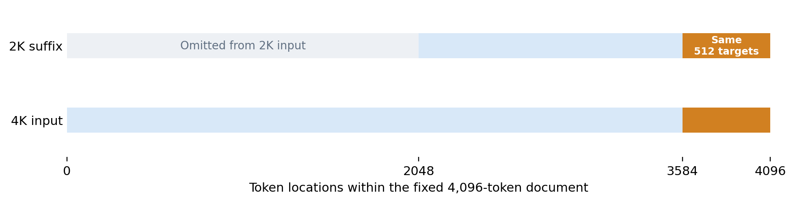
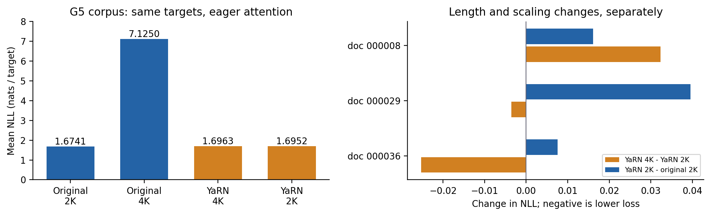
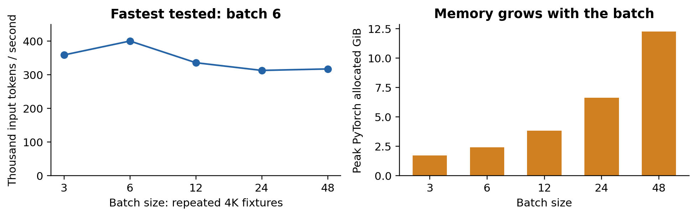

# G5 long-context extension: design and small-model test

**Team 5 - Architecture | Long-context proposal | 18 November 2026**

## Decision and measured result

Propose a controlled **2,048-to-4,096-token YaRN trial** on a compatible RoPE checkpoint. The completed fixed-weight SmolLM-135M experiment demonstrates execution at 4K and a substantial improvement over unscaled 4K extrapolation: on three complete documents from the frozen G5 benchmark-free corpus, mean tail NLL falls from **7.125009 to 1.696318 nats/token**. Native 2K NLL is **1.674093** on the same target tokens.

This supports YaRN as a candidate for a team-checkpoint follow-up. It does not establish that the extra context improves mean prediction quality over native 2K, nor that the capstone model should use 4K. **Production context lengths, continued-training phases and adoption remain TSAI's Gate 3 decisions.**

### Assignment and architecture boundary

The assigned deliverable is the long-context design and an actual small-model extension test log, for G5 review by Thursday 19 November. This document and [the executed test log](../results/context_extension/TEST_LOG.md) provide those artifacts. PR submission and lead acceptance are separate remaining steps.

The signed Gate 2 decision retains **v0 eager GQA**, Muon and the selected expert configuration; production sequence length and model dimensions remain open. It explicitly does not copy the experimental RoPE/window settings into `config_v1.yaml`. The Week 2 reference harness contains rotary GQA, but that implementation is not itself a signed production context decision. [Signed configuration][S1] | [Decision rationale][S2] | [Owner allocation][S3]

| Item | Signed team baseline | Completed surrogate test |
|---|---|---|
| Checkpoint | Team model/checkpoint selected by TSAI | Original `HuggingFaceTB/SmolLM-135M`, 134,515,008 parameters |
| Attention execution | Eager v0 GQA | Eager and full vocabulary head for the course-corpus run; SDPA only in the separate exploratory pilot |
| Embeddings/tokenizer | Kronecker input; signed tokenizer v0 baseline, with p1536/current approved release to be frozen for a new trial | SmolLM's pretrained embeddings and original tokenizer |
| Position/window | Production choice open | Original RoPE at 2K; trial static YaRN x2 at 4K |
| Weights/training | Team training process | Fixed pretrained weights; no gradient updates |
| Output metric | Use team-approved evaluation accounting for integration | Natural-log token NLL and exp(mean NLL), within one tokenizer |

The surrogate isolates a positional retrofit on an available pretrained checkpoint. Its results and throughput are not capstone-model benchmarks. This submission does not change the signed configuration, tokenizer, attention kernel or training job settings.

## Why this checkpoint and method

A context-extension method changes how a model represents token positions when reading beyond its original window. **Successful execution**, **retained prediction quality** and **useful retrieval of distant information** are separate claims. This experiment measures the first two on a small, explicitly bounded sample.

The original SmolLM-135M checkpoint is small enough for a fast, replayable evaluation and has an explicit 2,048-token configured window, RoPE and GQA. Extending it to 4,096 is a genuine trial beyond that configured window. A newer checkpoint already configured for long context would answer a different question. Its small size and English-language data limit transfer to the capstone. [Pinned checkpoint configuration][S4]

| Candidate | Main change | Trade-off and use here |
|---|---|---|
| Linear position interpolation | Divide positions, equivalently all rotary frequencies, by the extension factor | Simple baseline for a later comparison; changes local as well as long-range rotations |
| NTK-aware scaling | Change the rotary frequency schedule through its base | Frequency-sensitive alternative; concrete static/dynamic implementation must be specified |
| YaRN | Blend frequency bands and apply attention scaling | Selected as one testable proposal; adds configurable rotary hyperparameters and implementation checks; no new learned weights |

YaRN provides a published context-extension method and a concrete framework implementation. Its paper motivates the candidate; it does not predict a numerical result for SmolLM-135M. No empirical comparison against PI or NTK-aware scaling is claimed here. A broader method sweep and continued training are follow-up work, not prerequisites for this small-model log. [YaRN method][S5]

### Resolved YaRN settings

| Parameter | Value |
|---|---:|
| Original reference length L | 2,048 |
| Trial input length | 4,096 |
| Factor s | 2.0 |
| Rotary base theta | 10,000 |
| beta_fast / beta_slow | 32 / 1 |
| Resolved rotary amplitude factor | 1.0693147181 |
| Frequency-ramp bounds for this head dimension | 8 and 21 |

The experiment sets `max_position_embeddings=4096` and `rope_parameters` on the YaRN configuration while preserving `original_max_position_embeddings=2048`. The unscaled model retains its original rotary frequencies and accepts a complete 4K input. The earlier exploratory notebook includes an independent frequency calculation that matches its loaded YaRN rotary buffer. The course-corpus runner uses the same pinned framework and explicit rotary settings. The stored framework amplitude matches the expected scalar, and the notebook adds no manual attention-temperature multiplier. This check validates configuration, not an end-to-end count of internal multiplications.

## Controlled evaluation

The primary class-aligned self-run check uses **G5 heldout_v1**, a frozen, benchmark-free corpus whose published purpose explicitly allows any team to use it for a perplexity check. The Lab 3 briefing generally directs other testing to Team 3's held-out text; G5's published evaluation corpus supplies the specific documented route used here. No protected benchmark questions or solutions are read. This is a personal small-model run permitted by the job-request guide, not a TSAI-returned run or a claim of lead acceptance. [G5 corpus purpose][S7] | [Lab 3 briefing][S8] | [Job-request scope][S9]

The entire input file has SHA-256 `21c6e4b2df8dae9d69e254f4a00fc934d2a3c70f0675065a03724299d94312bb` and 1,059 document records. Before scoring, scan the C4, OpenWebMath and peS2o prefixes in file order and select the first three **complete documents** with at least 4,096 SmolLM tokens. No concatenation, repetition or outcome-based selection is used. All three qualifying documents are OpenWebMath: `owm-test-000008`, `owm-test-000029` and `owm-test-000036`, with 4,665, 7,537 and 5,872 available tokens. Retain each document's first 4,096 IDs.

This is a small math-domain subset, not the full corpus, the full group-balanced BPB evaluation, or a multilingual validation. Pretraining overlap with the surrogate checkpoint is unknown. The exact document/text/token hashes are recorded in the manifest, and the corpus Git revision is listed in the reproducibility table; raw text is already supplied by the existing lab corpus and is not duplicated into this PR.

The short input is the exact **last 2,048-token suffix** of the 4K input. Every condition predicts the identical final **512 target IDs per article**, or 1,536 targets per condition. Positions restart at zero for each independent input. This avoids comparing losses on different text when changing length.



Figure 1. Both windows contain the same scored suffix. The axis identifies token locations in the fixed 4K document; model positions reset independently within each window.

| Run | Input | Rotary setting | Question |
|---|---:|---|---|
| A | 2,048 | Original | Native-window reference |
| B | 4,096 | Original | Unscaled extrapolation |
| C | 4,096 | YaRN x2 | Candidate extension |
| D | 2,048 | Same YaRN configuration as C | Short-context sensitivity |

Run in evaluation and inference modes with no KV cache, no dropout, no parameter updates, batch size three and BF16. Inputs are coherent single-article windows without cross-document packing. For the course-corpus check, compute the full vocabulary logits, select rows `[-513:-1]` and align them with the last 512 input IDs. This avoids making a vocabulary-head speed change in the class-aligned check. All earlier input tokens still pass through every transformer layer and causal attention.

For target losses l_i = -log p(target_i | preceding tokens), report NLL = mean(l_i) and perplexity = exp(NLL). Each document contributes exactly 512 targets, so the mean of the three document NLLs equals the token-weighted mean. Perplexity is computed after aggregation, not by averaging document perplexities.

Correctness screens require identical pretrained parameters, identical scored targets, finite losses, actual 2K/4K inputs, the intended original YaRN reference length and correct next-token alignment. The primary runner uses eager attention for every arm. The separate exploratory notebook records a native-2K BF16 SDPA/eager check with a 0.02-nats/token engineering screen. [Offline course-corpus runner](../harness/context_extension_check.py) | [Primary configuration and checks](../results/context_extension/approved_manifest.json)

## Results and interpretation: frozen G5 corpus subset

| Run | Context | Method | Mean NLL | Perplexity |
|---|---:|---|---:|---:|
| A | 2,048 | Original RoPE | 1.674093 | 5.333954 |
| B | 4,096 | Original RoPE | 7.125009 | 1242.659623 |
| C | 4,096 | YaRN x2 | 1.696318 | 5.453827 |
| D | 2,048 | YaRN x2 | 1.695154 | 5.447483 |



Figure 2. Eager-attention results on three complete G5 OpenWebMath documents. Every row scores the same 1,536 targets. Changes are descriptive, without a population uncertainty estimate.

| Comparison | Mean NLL change | Interpretation |
|---|---:|---|
| C - B: scaled vs unscaled 4K | -5.428692 | Substantially lower loss with YaRN |
| D - A: static YaRN at 2K | +0.021061 | Higher mean short-window loss on this subset |
| C - A: overall candidate vs native | +0.022225 | Changes length and scaling; 2.25% higher perplexity |
| C - D: additional prefix, fixed YaRN | +0.001164 | Direct length comparison; 0.12% higher perplexity |

**Recommendation:** retain YaRN as a candidate that avoids severe unscaled extrapolation failure, then validate it on the approved team checkpoint before adoption. It does not beat the native-window mean here. C - D holds the positional method fixed and does not show a mean gain from the additional prefix on these three documents. D - A records an observed short-window penalty; it is not a general guarantee of harmless short-context behavior.

All four inputs reached the model at their stated lengths and produced finite losses. Inputs and weights were identical within the intended comparisons. The runner used **eager attention, BF16 and the full vocabulary head**. The exact final script and returned source hash match. [Per-document measurements](../results/context_extension/approved_document_results.csv) | [Run manifest](../results/context_extension/approved_manifest.json) | [Executed log](../results/context_extension/TEST_LOG.md)

## Exploratory WikiText pilot: separate evidence

The earlier reviewed notebook tested three WikiText-103 articles with SDPA/BF16. Its NLLs were A=2.470164, B=6.693264, C=2.482160 and D=2.470355. C - B was -4.211104; C - D was +0.011805. FP32 sensitivity preserved that pilot's broad conclusion, and its original isolated replay reproduced its four BF16 means exactly. These checks concern the WikiText pilot, not an FP32 or isolated rerun of the G5 corpus result. Its external corpus, different backend and different domains are not pooled with the primary measurements. [Pilot notebook](../notebooks/context_extension.ipynb) | [Pilot log](../results/context_extension/PILOT_TEST_LOG.md) | [WikiText source][S6]

Neither small study demonstrates useful distant-fact retrieval, a multilingual outcome, a production training schedule, or a generally safe short-context trade-off.

## Efficiency and reproducibility

The run used an RTX PRO 6000 Blackwell Server Edition with 94.97 GiB visible GPU memory, Python 3.13.11, PyTorch 2.11.0+cu130, CUDA 13.0 and Transformers 5.14.1. The kernel exposed 20 CPU-affinity entries and 160 GiB host RAM; these observations are not a scheduler reservation guarantee. Full versions and configuration are in the manifest.

The primary course-corpus runner keeps eager attention and the full output head. The separate WikiText pilot used BF16, `torch.inference_mode`, SDPA, batched coherent inputs, a single pinned test-data load and the reduced vocabulary-head projection. A direct short-input probe against full logits gave zero loss difference. The native-2K SDPA/eager check's maximum per-document mean-NLL difference was 0.002087. This does not certify backend equivalence for every model, precision or 4K condition.

A separate **WikiText-pilot-only** batch-size sweep repeated the same three fixtures at batch sizes 3, 6, 12, 24 and 48. Batch six was fastest tested: **400,418 input tokens/second**, with **2,475.6 MiB** peak PyTorch allocated GPU memory while both BF16 models were resident. Repeated fixtures do not increase the quality sample count. Larger batches were slower here, so GPU capacity alone is not a reason to increase batch size.

No team-code speed change is proposed here. Any later speed-only integration must satisfy the Lab 3 requirement for byte-identical output. The pilot's BF16 SDPA/eager tolerance check is not that proof.



Figure 3. Exploratory WikiText-pilot measurements: warmed-up GPU forward plus tail loss, median of three CUDA-event repetitions. Loading, data preparation, warmup and host-side finite checks are excluded. Allocated memory is not device-wide or reserved memory. This is neither training throughput nor cached generation throughput, and it is not a timing of the eager G5 corpus run.

### Reproduce the course-corpus check from the repository root

Use a compatible recent CUDA driver and the recorded Python 3.13 / PyTorch 2.11.0 / Transformers 5.14.1 environment. Before offline execution, stage the exact public SmolLM revision `1d461723eec654e65efdc40cf49301c89c0c92f4` in the Hugging Face cache. The runner uses `local_files_only=True`, accepts only the canonical model ID, reads the existing frozen G5 file and makes no network requests. A missing cache or mismatched input hash fails explicitly. It writes only `./out/`.

```bash
python teams/05-architecture/tests/verify_context_extension.py
python teams/05-architecture/harness/context_extension_check.py --heldout teams/05-architecture/heldout_v1/data/heldout_v1.jsonl
python teams/05-architecture/tests/verify_context_extension.py
```

The offline verifier checks both saved studies, numerical conclusions, the executed primary-runner hash, notebook structure and file integrity without executing a GPU job. Fresh outputs are in `out/`; the committed measurement snapshot is not overwritten. Do not compare these subset token perplexities with published full-corpus BPB numbers or across tokenizers.

| Reproducibility identifier | Value |
|---|---|
| Model/tokenizer revision | `1d461723eec654e65efdc40cf49301c89c0c92f4` |
| Primary runner SHA-256 | `41a8b4b0870d465071fa6cb09e332e5e214e99d8790f46934fe40a3e8e9f3e00` |
| Frozen G5 file SHA-256 | `21c6e4b2df8dae9d69e254f4a00fc934d2a3c70f0675065a03724299d94312bb` |
| Corpus repository revision | `87323846b325997ea2c21737c7816f950b8f1a26` |
| Primary execution | 2026-11-17T21:50:08.066045+00:00 (UTC), 18 November IST |
| Document IDs and hashes | [approved_manifest.json](../results/context_extension/approved_manifest.json) |

The exploratory pilot is supplied as a standard Jupyter notebook with a labelled snapshot of the original results and embedded charts. The notebook now explains the assignment, alternatives, matched comparisons and scoring concepts with comments and visuals. Its 16 code cells were executed in a fresh CUDA kernel after the readability revision; saved outputs include tables, charts and the run manifest. The [rerun receipt](../results/context_extension/readability_rerun.json) binds the executed notebook and code hashes to its input hashes and results. Maximum mean-NLL drift from the historical BF16 pilot was 0 nats/token. Follow the [notebook run instructions](../notebooks/context_extension_README.md) to run it on CUDA; new outputs go to `out/context_extension_pilot/`. Original executed source and replay hashes remain in `source_provenance.json`, and the exact original source is preserved in Git commit `9539c7be6263b3fe429a5096dac8c77ed1428f63`. The complete supporting-evidence download retains both studies' raw losses, exact selected IDs and historical execution logs. Required design/result claims can be inspected from the PR without a private ChatGPT link.

## Proposed team-checkpoint follow-up

1. **Freeze the approved baseline.** Record the team checkpoint, tokenizer, rotary convention, head dimension, original window, eager GQA implementation, precision and evaluation data. The Gate 2 configuration names tokenizer v0, while the Week 3 dry run uses the frozen p1536 release. Pin the p1536 artifact or any subsequently approved team release and its hashes for a new trial; do not silently carry over the older tokenizer reference. Confirm whether the approved positional path actually uses RoPE; YaRN is not a drop-in change for learned absolute embeddings.
2. **Implement only the positional proposal.** Preserve eager GQA, masks, architecture and weights for the first comparison. Use the checkpoint's own rotary convention; the Week 2 harness uses adjacent pairs, whereas a library model may pair dimensions differently. Preserve the approved native reference length. Do not copy SmolLM's head dimensions or its 2K reference into a different checkpoint.
3. **Verify data and alignment.** Ensure a complete extended sequence reaches attention; inspect token counts, positions, document boundaries and loss masks. Use the same scoring text and target-byte accounting for comparisons within the team tokenizer. Recheck full-head/tail alignment and rotary calculations against an independent reference.
4. **Evaluate both lengths.** Repeat A/B/C/D on a larger held-out sample covering the team's language and domain groups. Add distant-fact retrieval at several positions only after verifying that the base model solves the short version. Record per-group and short-context regressions and agree acceptance criteria with TSAI.
5. **Propose training only if needed.** Any continued-training experiment needs an agreed target length, token budget, coherent long-document source, retained short-document mixture, optimizer settings and memory estimate. This inference-only experiment supplies no optimal mixture, learning rate or training budget. Dispatch a production job only through the team-approved process after TSAI's context decision.

The candidate stage is a modest 2x extension, not a proposal to jump directly to the context lengths advertised by larger open-weight models. The broader model-report research is supporting motivation; its budgets and claims are not transferred into this result.

## Delivery and remaining action

The design and an actual small-model test on the published G5 corpus subset are supplied, with the exploratory pilot separated. A job request is needed only for work beyond the available personal machine, per the repository guide; no job request is pending for these completed self-runs. Submit these files in one G5 topic PR for the G5 lead's review by **Thursday 19 November**. Link the PR or merged evidence in G5 by **Friday 20 November, 23:59 IST**. No production configuration change or lead acceptance is claimed by this document.

## Sources

[S1]: https://github.com/theschoolofai/era-v5-lab/blob/aec75afc93070f56d891f438ccdd9a791b2c18bd/teams/05-architecture/configs/config_v1.yaml
[S2]: https://github.com/theschoolofai/era-v5-lab/blob/aec75afc93070f56d891f438ccdd9a791b2c18bd/teams/05-architecture/decisions.md
[S3]: https://axiom.theschoolofai.in/courses/cmq97i5kn032208o8xu5dab4q?chat=cmvkupxl427gl09l7rv9m4fwy&msg=cmwg7xjek0ji109o5b03mxagt
[S4]: https://huggingface.co/HuggingFaceTB/SmolLM-135M/blob/1d461723eec654e65efdc40cf49301c89c0c92f4/config.json
[S5]: https://arxiv.org/abs/2309.00071
[S6]: https://huggingface.co/datasets/Salesforce/wikitext/tree/b08601e04326c79dfdd32d625aee71d232d685c3
[S7]: https://github.com/theschoolofai/era-v5-lab/blob/87323846b325997ea2c21737c7816f950b8f1a26/teams/05-architecture/heldout_v1/README.md
[S8]: https://axiom.theschoolofai.in/widgets/cap_lab3_briefing.html
[S9]: https://github.com/theschoolofai/era-v5-lab/blob/87323846b325997ea2c21737c7816f950b8f1a26/JOB_REQUEST.md

- Signed Gate 2 configuration and decisions, 14 November 2026: [configuration][S1] and [decisions][S2].
- G5 Week 3 owner allocation: [assignment][S3].
- SmolLM-135M: [pinned configuration][S4].
- Peng et al., *YaRN: Efficient Context Window Extension of Large Language Models*: [technical paper][S5].
- WikiText-103: [pinned dataset][S6]. Exact public test split and selection rule are recorded above. WikiText derives from Wikipedia; retain source attribution and applicable CC BY-SA terms for redistributed fixtures.

- Primary class-corpus authority: [G5 heldout purpose, frozen bytes and licences][S7]; [Lab 3 rules][S8]; [conditional job-request guide][S9]. The primary selected text is OpenWebMath via Proof-Pile-2, under the corpus's ODC-By attribution. Existing source tracking stays with the lab corpus.
