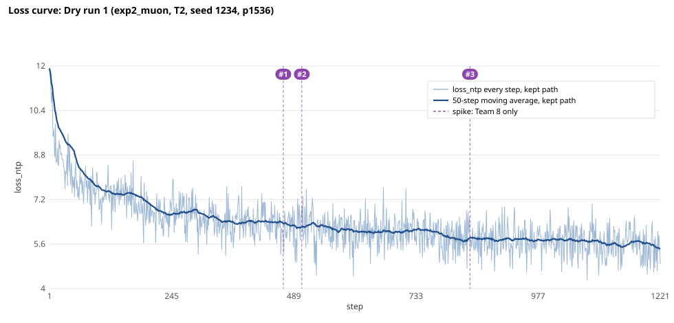
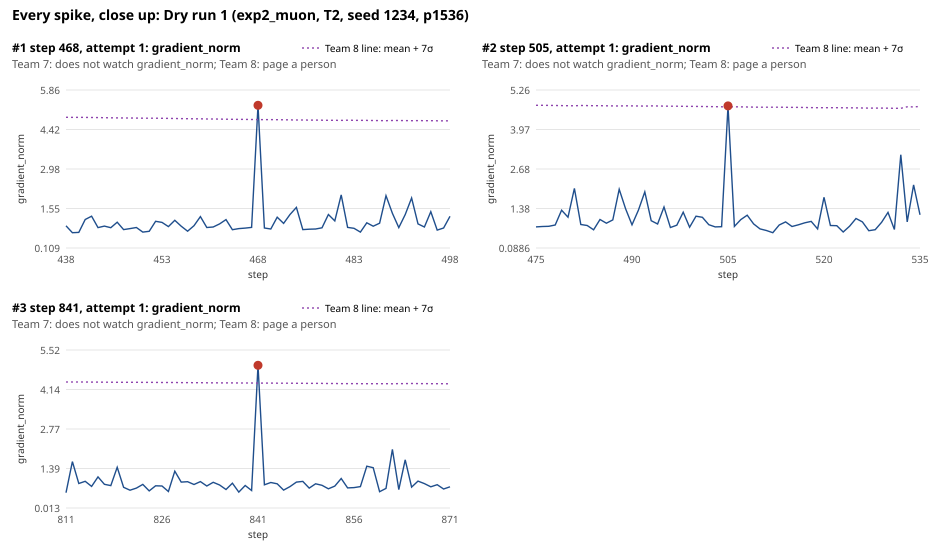

# Dry run 1: the loss record

**Owner:** Deepjyoti Saha (G5, week-3 task 4). **Status:** complete, filled from the full dry run 1 log (TSAI,
[#620](https://github.com/theschoolofai/era-v5-lab/pull/620)); ready for the lead's review. **Gate 3 evidence:** "dry run 1 ends with a stable loss curve" (Fri 20 Nov, 23:59 IST).

How the numbers are made, the two spike rules and how to rerun everything: [`dryrun1_README.md`](dryrun1_README.md).
A filled example with injected events, for illustration only: 🧪 [`dryrun1_loss_sample_attn0.md`](dryrun1_loss_sample_attn0.md).

<!-- generated by dryrun1_spikes.py from metrics.jsonl (sha256 cb10920c04fbfa6c6f2c794b642956a5e12bd02434fc4129f2f3b070d0c18a88): 1221 training rows, 1 attempt(s) -->

## 1. What ran

| Item | Value | Source |
|---|---|---|
| Job request | [`jobs/2026-11-15-dryrun1.md`](../../jobs/2026-11-15-dryrun1.md), one job, one command | [#475](https://github.com/theschoolofai/era-v5-lab/pull/475) (Shivanshu, 15 Nov; approved and merged by TSAI, 16 Nov) |
| Result | **COMPLETED**, 1,221 of 1,221 steps, not timed out. Held-out bits per byte **1.5159** (English 1.9844, code 1.8901, Indic mean 1.3289, three-group 1.7345). Final training loss 4.8906, gradient norm 0.7037. Same arm with tokenizer v0 at seed 1234: 1.6443 (difference −0.1284). | `summary.json`, last row of `metrics.jsonl`; TSAI on [#475](https://github.com/theschoolofai/era-v5-lab/pull/475), 16 Nov |
| Trainer | `teams/05-architecture/harness/train_week2.py` at `71bc0fb`, with TSAI's Gate 2 speed fixes and the scoring patch of [#474](https://github.com/theschoolofai/era-v5-lab/pull/474) (its sha pin changed to p1536's); run directly, one process | job request; TSAI on [#474](https://github.com/theschoolofai/era-v5-lab/pull/474) |
| Config | `configs/arms/exp2_muon.yaml`, which carries the Gate 2 choices of `config_v1.yaml` ([#447](https://github.com/theschoolofai/era-v5-lab/pull/447)) at T2 size | job request; `manifest.json` |
| Optimizer | Muon for the block matrices with **`muon_lr` 0.01**; `lr` 0.001 for the other parameters; gradient clip 1.0. (Since then TSAI's learning-rate recheck on p1536 found 0.005 better on two seeds and recommends it for Gate 3; that does not change what dry run 1 ran.) | `manifest.json`; TSAI in the 05 Architecture channel, 17 Nov |
| Model size | T2: 8 layers, width 512, 8 heads (2 key-value), 16 routed + 1 shared expert, top-2, eager attention, dense untied head, no second head | `exp2_muon.yaml` / `t2.yaml` |
| Steps, batch, context, seed | 1,221 steps, batch 8, context 2,048, seed 1234; held-out scored at steps 0, 611 and 1221 (`eval_every_steps` 611 in the run's runtime file) | `manifest.json` |
| Tokenizer | **p1536**, the frozen tokenizer since TSAI's Gate 3 notice (sha256 `e6b93a93…a64b`), with its raw P32 table (content sha256 `21072027…`). The job request was filed with C3; TSAI ran p1536. | `manifest.json`; the Gate 3 notice (CAP, 16 Nov) |
| Training data | the TSAI-staged text bundle of the week-2 jobs | job request |
| Held-out scoring | the original `heldout_v1` (1,059 documents) and its original byte count, 3,775,551 | job request |
| Spike rules inside the job | **none.** `train_week2.py` has no loss guard and no Team 8 monitor; it stops on a NaN or infinite value. This record applies both lab rules to `metrics.jsonl` and reports what each **would** have done. | `train_week2.py` |
| Run by, wall time | TSAI; 2,481 s (41 min); hardware not given | `summary.json`; [#620](https://github.com/theschoolofai/era-v5-lab/pull/620) README |
| Logs used | [`jobs/evidence/2026-11-15-dryrun1-full/`](../../jobs/evidence/2026-11-15-dryrun1-full/) ([#620](https://github.com/theschoolofai/era-v5-lab/pull/620), TSAI, 18 Nov): `metrics.jsonl` sha256 `cb10920c04fb…`, `summary.json` `459ab23d9b7e…`, `manifest.json` `570a5f5da04f…`, `losses.txt` `38f5c8351f7c…`. The folder `2026-11-15-dryrun1/` holds only the 3-step smoke of [#475](https://github.com/theschoolofai/era-v5-lab/pull/475). | the evidence folder |

## 2. The loss curve

Along the kept path (for each step, the last attempt that ran it): the first step, every 61 steps, every held-out evaluation step and the last step. loss_ntp is one batch, so it is noisy; the 50-step moving average shows the trend. Spike steps are in the next table.

| step | loss_ntp | 50-step average | loss_mtp | gradient_norm | lr | tokens/s | held-out bpb |
|---:|---:|---:|---:|---:|---:|---:|---:|
| 1 | 11.9148 | 11.9148 | 0.0000 | 2.3439 | 0.0010 | 3698 | — |
| 61 | 7.7790 | 8.3300 | 0.0000 | 1.4790 | 0.0010 | 8543 | — |
| 122 | 7.6420 | 7.4818 | 0.0000 | 0.7151 | 0.0010 | 8843 | — |
| 183 | 7.3763 | 7.2890 | 0.0000 | 1.0184 | 0.0010 | 8796 | — |
| 244 | 6.9149 | 6.6667 | 0.0000 | 0.9500 | 0.0010 | 8845 | — |
| 305 | 6.1834 | 6.6934 | 0.0000 | 0.8668 | 0.0010 | 8540 | — |
| 366 | 6.4804 | 6.3997 | 0.0000 | 0.7943 | 0.0010 | 8018 | — |
| 427 | 7.1090 | 6.4213 | 0.0000 | 1.2703 | 0.0010 | 8602 | — |
| 488 | 5.4923 | 6.2727 | 0.0000 | 2.0113 | 0.0010 | 8029 | — |
| 549 | 5.9670 | 6.2473 | 0.0000 | 0.8137 | 0.0010 | 7796 | — |
| 610 | 6.4615 | 6.0654 | 0.0000 | 0.9296 | 0.0010 | 8575 | — |
| 611 | 6.2643 | 6.0623 | 0.0000 | 0.6304 | 0.0010 | 8401 | 1.6217 |
| 671 | 6.2639 | 6.0738 | 0.0000 | 0.8501 | 0.0010 | 8528 | — |
| 732 | 5.6953 | 6.1179 | 0.0000 | 0.8003 | 0.0010 | 8899 | — |
| 793 | 6.2729 | 5.8750 | 0.0000 | 0.5898 | 0.0010 | 8310 | — |
| 854 | 5.8299 | 5.7948 | 0.0000 | 1.0412 | 0.0010 | 8526 | — |
| 915 | 6.0153 | 5.8032 | 0.0000 | 0.8320 | 0.0010 | 8442 | — |
| 976 | 6.2278 | 5.7624 | 0.0000 | 0.5982 | 0.0010 | 8617 | — |
| 1037 | 6.9213 | 5.7607 | 0.0000 | 1.5383 | 0.0010 | 9239 | — |
| 1098 | 4.4626 | 5.6828 | 0.0000 | 1.9766 | 0.0010 | 8043 | — |
| 1159 | 6.4251 | 5.6031 | 0.0000 | 0.9087 | 0.0010 | 8394 | — |
| 1220 | 5.3808 | 5.4291 | 0.0000 | 0.6142 | 0.0010 | 8474 | — |
| 1221 | 4.8906 | 5.4175 | 0.0000 | 0.7037 | 0.0010 | 8995 | 1.5159 |

## 3. Every spike

| # | attempt | step | metric | value | Team 7 guard (1.5 × median of last 100; 3 in a row stops) | Team 8 (mean + 7σ of last 1,000 pages; NaN stops) | what the log shows next |
|---:|---:|---:|---|---:|---|---|---|
| 1 | 1 | 468 | gradient_norm | 5.2997 | does not watch gradient_norm | **page**: gradient_norm 8.02σ above mean 1.2152 (line 4.7803) | step 469: gradient_norm 0.8368; attempt 1 continued to step 1221 |
| 2 | 1 | 505 | gradient_norm | 4.7427 | does not watch gradient_norm | **page**: gradient_norm 7.06σ above mean 1.2054 (line 4.7134) | step 506: gradient_norm 0.7947; attempt 1 continued to step 1221 |
| 3 | 1 | 841 | gradient_norm | 4.9868 | does not watch gradient_norm | **page**: gradient_norm 8.33σ above mean 1.0977 (line 4.3677) | step 842: gradient_norm 0.8232; attempt 1 continued to step 1221 |

### Details of each spike

All three are Team 8 `spike_score` pages on `gradient_norm`; Team 8's own `alarms.py --jsonl` on the same file reports the same three. Team 7's guard watches only the loss and found nothing. At each of the three steps the trainer clipped the gradient to norm 1.0 (gradient clip 1.0, `gradient_clipping_applied` true), so the update was no larger than on any other clipped step.

| # | What the log shows | Why it paged, and what it did to the loss | What happened next |
|---|---|---|---|
| 1 | `gradient_norm` 5.30 at step 468 | 8.0σ above Team 8's trailing mean of 1.21. The loss at that step, 5.73, was below its 50-step average (6.35). | Next step: gradient norm 0.84, loss 5.27. The run continued. |
| 2 | `gradient_norm` 4.74 at step 505 | 7.1σ above the trailing mean of 1.21. The loss, 6.94, was above its 50-step average (6.20) but well under Team 7's line. | Next step: gradient norm 0.79, loss 6.03. The run continued. |
| 3 | `gradient_norm` 4.99 at step 841 | 8.3σ above the trailing mean of 1.10. The loss, 5.35, was below its 50-step average (5.82). | Next step: gradient norm 0.82, loss 5.75. The run continued. |

Because neither rule ran inside the job, these pages were not sent during the run; they are what Team 8's rule would have paged.

## 4. Stops and restarts

| attempt | steps | how it ended | next attempt |
|---:|---|---|---|
| 1 | 1 to 1221 (1221 rows) | finished at step 1221 | — |

None. `summary.json`: status COMPLETED, 1,221 steps, not timed out; `metrics.jsonl` has one row for every step from 0 to 1221, with no gap and no step run twice, and no NaN or infinity ([#475](https://github.com/theschoolofai/era-v5-lab/pull/475): "No NaN or inf in the loss record"). The run's console output was not returned; with a completed summary and no gap it is not needed to show that nothing stopped.

## 5. Is the curve stable?

The loss falls steadily: the 50-step average of `loss_ntp` goes from 8.95 at step 50 to 6.06 at step 611 and 5.42 at step 1221, and held-out bits per byte falls from 2.51 before training to 1.62 at step 611 and 1.5159 at the end. Team 7's loss guard finds no spike, so it would never have stopped the run. Team 8's rule would have paged three times, all on the gradient norm (steps 468, 505 and 841, 7 to 8σ); each was clipped to 1.0, the loss stayed in its normal range, and the norm was back under 0.85 at the next step. Gradient clipping was active on 457 of 1,221 steps, falling from 335 in the first half to 122 in the second. There were no stops, restarts, gaps or non-finite values, and nothing is unexplained. This reports what the log shows; the Gate 3 judgement is TSAI's.

### The script's summary

- Rows read: 1221 in 1 attempt(s); kept path: steps 1 to 1221; no gaps.
- Team 7 guard: 0 loss spike step(s); it would not have stopped the run.
- Team 8: 3 spike_score alarm(s), 0 non_finite step(s); other Team 8 warnings: 0.
- Team 8's code: teams/08-monitoring/alarms/alarms.py.
- loss_ntp on the kept path: first step 11.9148, last step 4.8906, lowest 4.2853 (step 1075).
- 50-step moving average of loss_ntp: 8.9498 at step 50, 6.0623 at step 611, 5.4175 at step 1221.
- Held-out bpb: 2.5052 at step 0 → 1.5159 at step 1221 (3 evaluations; lowest 1.5159 at step 1221).
- Chart: dryrun1_loss.svg.
- Spike close-ups: dryrun1_loss_spikes.svg.

## 6. Sources

- The job request: [#475](https://github.com/theschoolofai/era-v5-lab/pull/475), [`jobs/2026-11-15-dryrun1.md`](../../jobs/2026-11-15-dryrun1.md); TSAI's result comment there (16 Nov).
- The full log: [`jobs/evidence/2026-11-15-dryrun1-full/`](../../jobs/evidence/2026-11-15-dryrun1-full/) ([#620](https://github.com/theschoolofai/era-v5-lab/pull/620), TSAI, 18 Nov): `metrics.jsonl`, `losses.txt`, `total_losses.txt`, `summary.json`, `manifest.json`, `README.md`.
- Spike rules: Team 8's [`alarms.py`](../../../08-monitoring/alarms/alarms.py), imported unchanged; Team 7's guard in [`train.py`](../../../07-infrastructure/support/simulation/trainer/train.py), copied with its defaults.
- Tables and charts: `python -I teams/05-architecture/experiments/results/dryrun1_spikes.py --jsonl teams/05-architecture/jobs/evidence/2026-11-15-dryrun1-full/metrics.jsonl --title "Dry run 1 (exp2_muon, T2, seed 1234, p1536)" --svg teams/05-architecture/experiments/results/dryrun1_loss.svg --spike-svg teams/05-architecture/experiments/results/dryrun1_loss_spikes.svg`.
