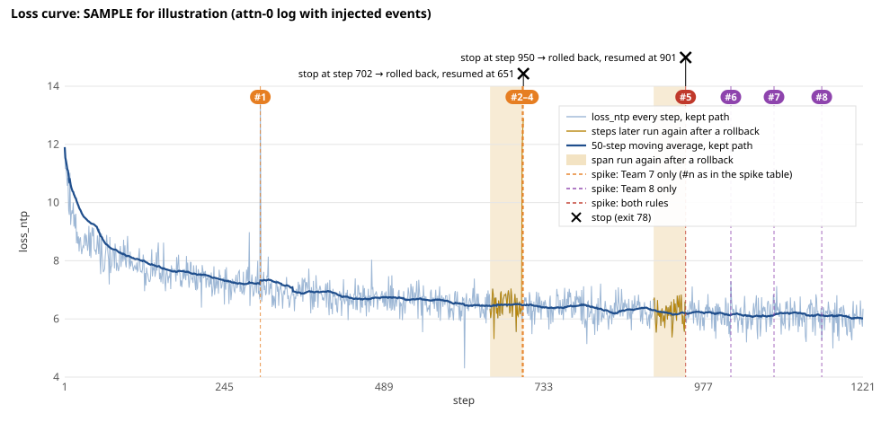
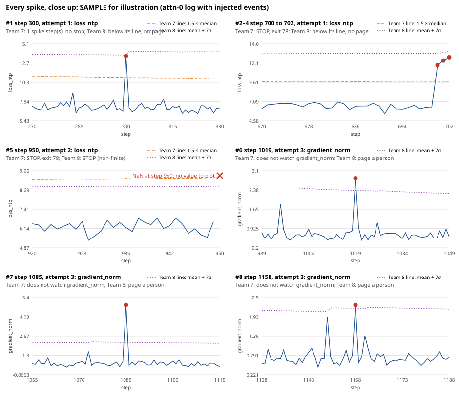

# 🧪 Dry run 1: the loss record — SAMPLE FOR ILLUSTRATION

> [!WARNING]
> **🧪 This is a sample, made to test and illustrate the method. It is not dry run 1, and the events marked
> "injected" below never happened.** It is [`dryrun1_loss.md`](dryrun1_loss.md) filled in end to end from the real
> T2 reference run of the 10 Nov attention screen (`attn-0`), with four events injected into a copy of its log so
> that every kind of row the real record may need (a single spike, a stop by the loss guard, a NaN stop, a
> requeue, two rollbacks) appears at least once. Every other number is that run's own.
> How it is made and how to rerun it: [`dryrun1_README.md`](dryrun1_README.md), section 4.

<!-- generated by dryrun1_spikes.py from dryrun1_sample_log.jsonl (sha256 6b948824230e46cb4d2f4b02869213472d3fdd15e9c25cf3f9094bdcf2774abe): 1323 training rows, 3 attempt(s) -->

**What is real and what is injected** (attempt = one launch of the trainer; a rollback starts a new attempt at an
earlier step):

| # in the tables | Step | Event | Real or injected |
|---|---:|---|---|
| #1 | 300 | `loss_ntp` doubled for one step | 🧪 injected |
| — | 520 | preemption: saved, exit 75, requeued, no step lost | 🧪 injected (job log only) |
| #2–#4 | 700–702 | `loss_ntp` doubled three steps in a row | 🧪 injected |
| #5 | 950 | `loss_ntp`, `loss_mtp`, `gradient_norm` are NaN | 🧪 injected |
| — | 650, 900 | rollbacks after the two stops | 🧪 injected (the steps run again reuse the original values) |
| #6, #8 | 1019, 1158 | gradient-norm bumps that page only after a restart (see #6 below) | real values; the pages come from the injected restart |
| #7 | 1085 | gradient-norm spike, 4.87 | ✅ real |
| all other rows | | | ✅ real |

## 1. What ran

| Item | Value | Source |
|---|---|---|
| Config | `configs/arms/t2.yaml` with `configs/runtime.yaml` (T2, the attention reference design) | `command.json` |
| Optimizer | AdamW, learning rate 0.001, constant schedule | `command.json`, `manifest.json` |
| Job request | [`jobs/2026-11-10-attention-t2.md`](../../jobs/2026-11-10-attention-t2.md) (Revant; one-seed preliminary screen) | job request |
| Data | all 48 TRAIN parts across 38 packs (train sha256 `368c6d7b…`); held-out `heldout_v1` (sha256 `21c6e4b2…`, 1,059 documents) | `command.json` |
| Model size, steps, batch, sequence length | 8 layers, width 512, 8 heads (2 key/value), 16 routed + 1 shared expert, top-2; 1,221 steps; global batch 8, microbatch 1; context 2048; bf16; seed 1235 | `manifest.json`, evidence README |
| Hardware, run by, start and end | 1 × NVIDIA RTX PRO 6000 Blackwell (95 GiB); run by Revant on 10 Nov; 1,796.7 s wall time (for the real, uninterrupted run) | `environment.json`, `summary.json` |
| Logs used | 🧪 [`dryrun1_sample_log.jsonl`](dryrun1_sample_log.jsonl) (sha256 `6b948824…`), made by [`dryrun1_make_sample_log.py`](dryrun1_make_sample_log.py) from the real `attn-0/metrics.jsonl` (sha256 `0e4efcf3…`) | the evidence folder |

## 2. The loss curve

How to read it: the light blue line is `loss_ntp` at every step and the dark blue line its 50-step average, along
the *kept path* (for each step, the last attempt that ran it). The shaded spans were run twice: the brown line
is the first attempt's values, abandoned by the rollback. Dashed lines mark spike steps, numbered as in the spike
table and coloured by the rule that caught them; ✕ marks a stop.

Along the kept path (for each step, the last attempt that ran it): the first step, every 50 steps, every held-out evaluation step and the last step. loss_ntp is one batch, so it is noisy; the 50-step moving average shows the trend. Spike steps are in the next table.

| step | loss_ntp | 50-step average | loss_mtp | gradient_norm | lr | tokens/s | held-out bpb |
|---:|---:|---:|---:|---:|---:|---:|---:|
| 1 | 11.9039 | 11.9039 | 0.0000 | 2.9849 | 0.0010 | 10507 | — |
| 50 | 8.4644 | 9.1682 | 0.0000 | 0.8322 | 0.0010 | 16813 | 2.4162 |
| 100 | 7.7149 | 8.1480 | 0.0000 | 0.7963 | 0.0010 | 15182 | 2.2314 |
| 150 | 7.7621 | 7.7458 | 0.0000 | 1.0410 | 0.0010 | 16890 | 2.1979 |
| 200 | 7.2745 | 7.5533 | 0.0000 | 0.7743 | 0.0010 | 16636 | 2.0751 |
| 250 | 7.3270 | 7.3042 | 0.0000 | 0.7038 | 0.0010 | 15999 | 2.0734 |
| 300 | 13.5632 | 7.3251 | 0.0000 | 0.8243 | 0.0010 | 17219 | 2.0242 |
| 350 | 6.8209 | 6.9489 | 0.0000 | 0.8264 | 0.0010 | 14469 | 1.9666 |
| 400 | 7.2189 | 6.9403 | 0.0000 | 1.2327 | 0.0010 | 14821 | 1.9770 |
| 450 | 7.1208 | 6.6903 | 0.0000 | 0.8470 | 0.0010 | 16474 | 1.9309 |
| 500 | 6.2884 | 6.7276 | 0.0000 | 1.1887 | 0.0010 | 9466 | 1.9086 |
| 550 | 6.7773 | 6.6730 | 0.0000 | 1.0221 | 0.0010 | 12826 | 1.8993 |
| 600 | 6.5412 | 6.5389 | 0.0000 | 0.7006 | 0.0010 | 11121 | 1.8656 |
| 650 | 6.8539 | 6.4571 | 0.0000 | 0.7899 | 0.0010 | 11756 | 1.8746 |
| 700 | 5.9298 | 6.4674 | 0.0000 | 0.7101 | 0.0010 | 11626 | 1.8414 |
| 750 | 6.3123 | 6.3827 | 0.0000 | 0.7389 | 0.0010 | 11903 | 1.8644 |
| 800 | 6.5749 | 6.4498 | 0.0000 | 0.7822 | 0.0010 | 12709 | 1.8451 |
| 850 | 6.0814 | 6.2638 | 0.0000 | 0.7630 | 0.0010 | 12602 | 1.8421 |
| 900 | 6.2493 | 6.3023 | 0.0000 | 0.5698 | 0.0010 | 12043 | 1.8210 |
| 950 | 5.9776 | 6.2006 | 0.0000 | 0.7142 | 0.0010 | 11471 | 1.8078 |
| 1000 | 6.5190 | 6.2005 | 0.0000 | 0.6850 | 0.0010 | 12935 | 1.7932 |
| 1050 | 5.6269 | 6.0840 | 0.0000 | 0.5969 | 0.0010 | 10368 | 1.7852 |
| 1100 | 5.8388 | 6.1970 | 0.0000 | 0.8839 | 0.0010 | 11390 | 1.7758 |
| 1150 | 6.7041 | 6.1461 | 0.0000 | 0.7480 | 0.0010 | 10659 | 1.7742 |
| 1200 | 6.1667 | 6.0553 | 0.0000 | 0.8524 | 0.0010 | 11895 | 1.7761 |
| 1221 | 6.3524 | 6.0182 | 0.0000 | 0.6629 | 0.0010 | 11313 | 1.7770 |

## 3. Every spike

| # | attempt | step | metric | value | Team 7 guard (1.5 × median of last 100; 3 in a row stops) | Team 8 (mean + 7σ of last 1,000 pages; NaN stops) | what the log shows next |
|---:|---:|---:|---|---:|---|---|---|
| 1 | 1 | 300 | loss_ntp | 13.5632 | spike 1 in a row (line 10.8555) | no page: below its line (13.6896) | step 301: loss_ntp 7.0591; attempt 1 continued to step 702 |
| 2 | 1 | 700 | loss_ntp | 11.8595 | spike 1 in a row (line 9.7463) | no page: below its line (13.3812) | step 701: loss_ntp 12.4597; attempt 1 continued to step 702 |
| 3 | 1 | 701 | loss_ntp | 12.4597 | spike 2 in a row (line 9.7463) | no page: below its line (13.5053) | step 702: loss_ntp 12.8873; attempt 1 continued to step 702 |
| 4 | 1 | 702 | loss_ntp | 12.8873 | spike 3 in a row (line 9.7463) → **stop, exit 78** | no page: below its line (13.6597) | attempt 1 ends here; attempt 2 starts at step 651 |
| 5 | 2 | 950 | loss_ntp | nan | non-finite loss → **stop, exit 78** | **stop**: loss_ntp is nan; **stop**: loss_mtp is nan; **stop**: gradient_norm is nan | attempt 2 ends here; attempt 3 starts at step 901 |
| 6 | 3 | 1019 | gradient_norm | 2.8202 | does not watch gradient_norm | **page**: gradient_norm 9.06σ above mean 0.7593 (line 2.3509) | step 1020: gradient_norm 0.9530; attempt 3 continued to step 1221 |
| 7 | 3 | 1085 | gradient_norm | 4.8726 | does not watch gradient_norm | **page**: gradient_norm 19.59σ above mean 0.7403 (line 2.2167) | step 1086: gradient_norm 0.5855; attempt 3 continued to step 1221 |
| 8 | 3 | 1158 | gradient_norm | 2.2811 | does not watch gradient_norm | **page**: gradient_norm 7.47σ above mean 0.7304 (line 2.1840) | step 1159: gradient_norm 0.5723; attempt 3 continued to step 1221 |

### Details of each spike

| # | What the log shows | Which rule caught it, and why | What happened next (job log) |
|---|---|---|---|
| #1 🧪 | `loss_ntp` 13.56 at step 300, back to 7.06 at step 301 | **Team 7** counted one spike (above its line, 10.86) and reset at the next normal step: no stop. **Team 8 did not page**: its line was 13.69, just above the spike, because its 1,000-step window still holds the fast fall of the first 300 steps, which makes its σ large. | 🧪 nothing to do: no page, no stop; noted here only. |
| #2–#4 🧪 | `loss_ntp` 11.86, 12.46, 12.89 at steps 700–702 | **Team 7** counted 3 in a row above its line (9.75) and **stopped the run at step 702: no save, exit 78, job held**. **Team 8 did not page** (its line about 13.4–13.7). | 🧪 the person on shift found the last good checkpoint and rolled back as in [USER_GUIDE §5.4](../../../07-infrastructure/USER_GUIDE.md): `--from-step 650 --skip 5 --branch b1`. Attempt 2 started at step 651; 52 steps were run again. |
| #5 🧪 | `loss_ntp`, `loss_mtp`, `gradient_norm` NaN at step 950 | **Both rules stop at once.** Team 7: non-finite loss, exit 78, no save. Team 8: `non_finite` on all three metrics. | 🧪 rollback `--from-step 900 --skip 5 --branch b2`; attempt 3 started at step 901; 50 steps run again. |
| #6 | `gradient_norm` 2.82 at step 1019, 0.95 at 1020 | **Team 8 paged** (9.1σ). Team 7 does not watch the gradient norm. In the real uninterrupted run this step **did not** page: the monitor restarts with the trainer, and 118 steps after the restart its window is short and quieter, so its line here was 2.35 (in the real run, its line at the step-1085 page was 2.83). | 🧪 the person on shift looked, saw the loss unaffected and the norm back to normal at the next step: no action. |
| #7 ✅ | `gradient_norm` 4.87 at step 1085, 0.59 at 1086 | **Team 8 paged** (19.6σ here; 14.3σ in the real run, line 2.83). The real spike of attn-0. | the loss absorbed it; no action. |
| #8 | `gradient_norm` 2.28 at step 1158, 0.57 at 1159 | **Team 8 paged** (7.5σ, line 2.18). Like #6, only because the window restarted at step 901. | 🧪 no action. |

## 4. Stops and restarts

From the metrics (generated):

| attempt | steps | how it ended | next attempt |
|---:|---|---|---|
| 1 | 1 to 702 (702 rows) | Team 7 guard: 3 loss spikes in a row, stop at step 702 → exit 78, job held | attempt 2 resumes at step 651: rolled back, 52 step(s) run again |
| 2 | 651 to 950 (300 rows) | non-finite loss at step 950 → stop, exit 78, job held | attempt 3 resumes at step 901: rolled back, 50 step(s) run again |
| 3 | 901 to 1221 (321 rows) | finished at step 1221 | — |

With the job log (by hand; 🧪 all illustrative):

| Time | Step | Exit code | Cause | What happened | Source |
|---|---:|---:|---|---|---|
| 🧪 | 520 | 75 | preemption by the main run | saved at step 520, requeued, resumed at step 521; no step lost, so the metrics show nothing | job log |
| 🧪 | 702 | 78 | loss spike, 3 in a row (Team 7 guard) | no save; held; rolled back to step 650 on branch `b1`, skipping 5 batches | job log; shift log |
| 🧪 | 950 | 78 | NaN loss | no save; held; rolled back to step 900 on branch `b2`, skipping 5 batches | job log; shift log |
| 🧪 | 1221 | 0 | done | final checkpoint committed | job log |

Exit 75: saved and requeued by itself. Exit 78: no save, the job is held until a person rolls back.

## 5. Is the curve stable?

🧪 *Illustration: in the real attn-0 run there was no stop and only spike #7.* The loss falls: along the kept path
the 50-step average of `loss_ntp` goes from 9.17 at step 50 to 6.51 at step 611 and 6.02 at step 1221, and held-out
bits per byte falls from 2.99 before training to 1.78. The run stopped twice, at step 702 (three loss spikes in a
row) and at step 950 (NaN), and after each rollback the loss came back to the same trend, with no new stop.
Team 7's guard caught every loss spike; Team 8 paged three gradient-norm spikes, none of which moved the loss.
Nothing is unexplained. This reports what the logs show; for dry run 1 the Gate 3 judgement is TSAI's.

### What the sample teaches for dry run 1

1. **The two rules catch different things.** Team 8's 7σ rule missed all four loss spikes, because early in a run
   its window includes the fast fall of the loss; Team 7's guard caught every one. Team 7's guard never looks at
   the gradient norm, which only Team 8 watches. Keep both columns.
2. **After a restart Team 8 pages more.** Both rules run inside the trainer and start empty after every restart;
   Team 8's shorter, quieter window gives a lower line, so smaller bumps page (#6, #8). Expect extra pages after a
   rollback in dry run 1, and say so when they appear.
3. **A requeue that loses no step is invisible in the metrics.** The exit-75 row comes only from the job log, so the
   job log must be part of the returned logs.

### The script's summary

- Rows read: 1323 in 3 attempt(s); kept path: steps 1 to 1221; no gaps.
- Team 7 guard: 4 loss spike step(s); 2 stop(s), at step 702, 950.
- Team 8: 3 spike_score alarm(s), 1 non_finite step(s); other Team 8 warnings: 0.
- Team 8's code: teams/08-monitoring/alarms/alarms.py.
- loss_ntp on the kept path: first step 11.9039, last step 6.3524, lowest 4.3022 (step 612).
- 50-step moving average of loss_ntp: 9.1682 at step 50, 6.5136 at step 611, 6.0182 at step 1221.
- Held-out bpb: 2.9870 at step 0 → 1.7770 at step 1221 (26 evaluations; lowest 1.7742 at step 1150).
- Chart: dryrun1_loss_sample_attn0.svg.
- Spike close-ups: dryrun1_loss_sample_attn0_spikes.svg.

## 6. Sources

- Job request: [`jobs/2026-11-10-attention-t2.md`](../../jobs/2026-11-10-attention-t2.md).
- Real logs: [`jobs/evidence/2026-11-10-attention-screen/attn-0/`](../../jobs/evidence/2026-11-10-attention-screen/attn-0/)
  (`metrics.jsonl`, `command.json`, `manifest.json`, `summary.json`), the screen's
  [`README.md`](../../jobs/evidence/2026-11-10-attention-screen/README.md) and `environment.json`.
- 🧪 Sample log: [`dryrun1_sample_log.jsonl`](dryrun1_sample_log.jsonl), made by `python -I teams/05-architecture/experiments/results/dryrun1_make_sample_log.py`.
- Spike rules: Team 8's [`alarms.py`](../../../08-monitoring/alarms/alarms.py), imported unchanged; Team 7's guard
  in [`train.py`](../../../07-infrastructure/support/simulation/trainer/train.py), copied with its defaults; the
  rollback procedure in [`USER_GUIDE.md`](../../../07-infrastructure/USER_GUIDE.md) §1.5 and §5.4.
- Tables and charts: `python -I teams/05-architecture/experiments/results/dryrun1_spikes.py --jsonl teams/05-architecture/experiments/results/dryrun1_sample_log.jsonl --title "SAMPLE for illustration (attn-0 log with injected events)" --svg teams/05-architecture/experiments/results/dryrun1_loss_sample_attn0.svg --spike-svg teams/05-architecture/experiments/results/dryrun1_loss_sample_attn0_spikes.svg`.
