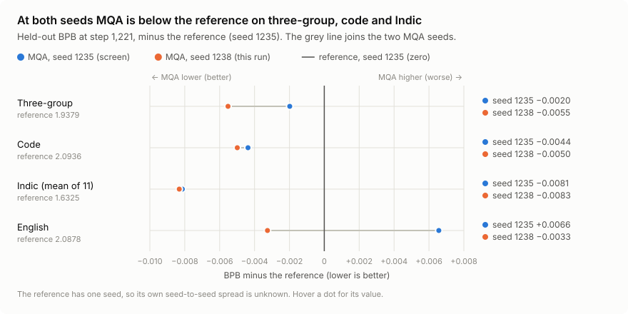
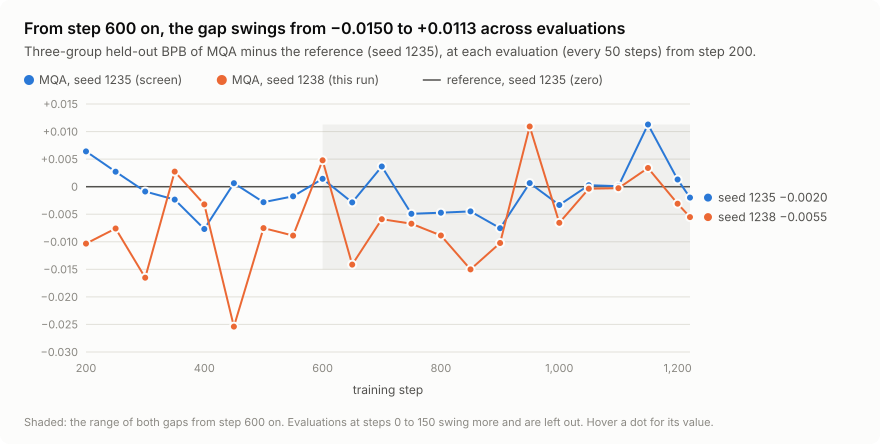
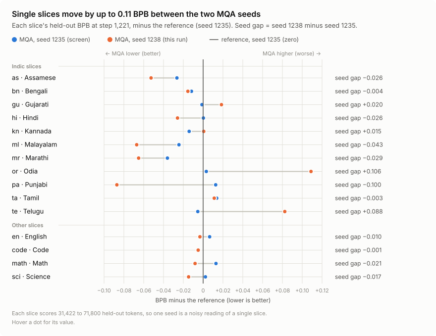

# Rotation: MQA arm at seed 1238

Yasir Reshi (Team 4) — week 3 rotation into Team 5.

**Assignment.** Run the T2 MQA arm (`configs/arms/attn1_mqa.yaml`, "more key/value sharing", attn-1) again at seed 1238 on my own GPU. Report its bits per byte next to the existing MQA run (seed 1235). The arm file sets `comparison_final: false`. As Team 5 said, one new seed does not pick a winner and does not change config v1. The T2 reference stays the runs already done.

## Result

Held-out bits per byte (BPB) at step 1,221; lower is better. All three runs score the same held-out set, 654,581 tokens (check C3).

| BPB at step 1,221 | Reference (attn-0), seed 1235 | MQA (attn-1), seed 1235 | **MQA (attn-1), seed 1238** |
|---|---|---|---|
| Three-group | 1.9379 | 1.9360 | **1.9324** |
| Code | 2.0936 | 2.0892 | 2.0886 |
| Indic (mean of 11 slices) | 1.6325 | 1.6243 | 1.6242 |
| English | 2.0878 | 2.0943 | 2.0845 |
| All text | 1.7770 | 1.7722 | 1.7680 |

The three-group score is the mean of English, code and the Indic mean (`harness/week2/scoring.py`). The seed-1235 values come from `jobs/evidence/2026-11-10-attention-screen/screen-comparison.csv`.

| Difference | MQA 1238 − MQA 1235 (seed to seed) | MQA 1235 − reference (the screen) | MQA 1238 − reference |
|---|---|---|---|
| Three-group | −0.0035 | −0.0020 | −0.0055 |
| Code | −0.0006 | −0.0044 | −0.0050 |
| Indic | −0.0002 | −0.0081 | −0.0083 |
| English | −0.0098 | +0.0066 | −0.0033 |



## Does the screen result hold?

- **Direction: yes.** At seed 1238, MQA again scores below the reference on the three-group, code and Indic scores.
- **Code and Indic: the gap repeats closely.** Against the reference, code is −0.0050 here and was −0.0044 at seed 1235. Indic is −0.0083 here and was −0.0081. On these two groups the two MQA seeds differ by only 0.0006 and 0.0002.
- **Three-group: the size of the gap is not stable.** The two MQA seeds differ by 0.0035, which is more than the 0.0020 gap the screen measured. Almost all of that seed-to-seed change is English (0.0098). English is also where MQA was worse than the reference at seed 1235 (+0.0066) but better at seed 1238 (−0.0033).
- **Over training, the gap is noisy.** The run scores the held-out set every 50 steps. From step 600 on, MQA minus the reference on the three-group score ranges from −0.0150 to +0.0113 across those evaluations, taking both seeds together (the figure below). Both final gaps, −0.0020 and −0.0055, lie well inside that range.
- **Against the arm's own rule: nothing points to MQA being worse.** The arm file sets `acceptance_rule: not_worse`. `docs/attention_harness.md` defines the rule: on each of the three-group, code and Indic means, MQA minus the reference must be no more than the larger seed range of the two arms. The two-seed MQA mean minus the reference is −0.0038 on three-group, −0.0047 on code and −0.0082 on Indic. All three are negative, so MQA is not worse on any of them. The MQA seed range is 0.0035, 0.0006 and 0.0002. The rule is defined on three seeds per arm, and neither arm has three yet, so this is not a formal pass.
- **Limits.** The reference has only one seed, so its own seed-to-seed spread is unknown. Comparing MQA at seed 1238 with the reference at seed 1235 crosses seeds. As Team 5 set out, this run picks no winner, does not change config v1, and leaves `comparison_final` false.



## Per-slice BPB at step 1,221



| Slice | Scored tokens | Reference, seed 1235 | MQA, seed 1235 | MQA, seed 1238 | 1238 − 1235 |
|---|---|---|---|---|---|
| as | 40,078 | 2.0513 | 2.0249 | 1.9988 | −0.0261 |
| bn | 35,583 | 1.3060 | 1.2942 | 1.2906 | −0.0037 |
| gu | 36,404 | 1.3554 | 1.3542 | 1.3739 | +0.0197 |
| hi | 31,422 | 1.1431 | 1.1434 | 1.1173 | −0.0261 |
| kn | 36,397 | 1.3380 | 1.3239 | 1.3386 | +0.0147 |
| ml | 31,840 | 1.2294 | 1.2050 | 1.1623 | −0.0427 |
| mr | 35,215 | 1.4005 | 1.3645 | 1.3354 | −0.0291 |
| or | 50,916 | 1.4011 | 1.4043 | 1.5099 | +0.1056 |
| pa | 49,853 | 4.2418 | 4.2545 | 4.1548 | −0.0997 |
| ta | 32,584 | 1.1747 | 1.1884 | 1.1859 | −0.0025 |
| te | 37,380 | 1.3160 | 1.3106 | 1.3984 | +0.0878 |
| en | 53,299 | 2.0878 | 2.0943 | 2.0845 | −0.0098 |
| code | 62,318 | 2.0936 | 2.0892 | 2.0886 | −0.0006 |
| math | 71,800 | 2.5212 | 2.5342 | 2.5131 | −0.0211 |
| sci | 49,492 | 1.9553 | 1.9576 | 1.9406 | −0.0170 |

Between the two MQA seeds, single slices move by up to about 0.1 BPB (or +0.106, pa −0.100, te +0.088). So a one-seed difference on a single slice is not evidence for or against the arm.

## Setup: same as the screen except seed, output folder and one time limit

- **Which runs this compares with.** The existing T2 numbers come from the preliminary one-seed attention screen, run at seed 1235 (pull request 345; "Completed owner-managed preliminary screen" in `jobs/2026-11-10-attention-t2.md`). That screen is marked smoke and used training data rebuilt from the published cleaned parts. The official three-seed T2 job on the job-310 inputs has not run. This run repeats the screen's setup, so it compares with the screen, not with that future job.
- **Command.** This is the screen's attn-1 command (`jobs/evidence/2026-11-10-attention-screen/attn-1/command.json`) with only `--seed`, `--out` and `--runtime` changed. It uses source commit `c1849c1b`, tokenizer v0 (`2de039f2…`), the P = 32 byte table (content `47d411a9…`), training data `368c6d7b…` and held-out data `21c6e4b2…`. The inputs were rebuilt with the screen notebook's data preparation and match the screen's hashes.
- **Manifest.** 112 of the 119 manifest fields equal the screen's attn-1 manifest. The 7 that differ are the seed, the GPU, the time limit, the runtime file hash, the identity hash (computed over the config), the `.npz` container hash and the held-out report's `source_commit` label. Check C4 lists them; the table content and the held-out bytes are equal.
- **The one config change.** The T2 time limit `max_time_min` in `runtime.yaml` was raised from 90 to 150 minutes (`runtime_t2_150min.yaml`; check C6 confirms that is the only change). The trainer uses this limit only as a wall-clock stop (`harness/train_week2.py`, line 401). It was raised because my first attempt ran at about 4.2 s per step, which would have needed about 96 minutes. This run finished in 56.0 minutes, inside the original 90 (check C5), so the stop never acted. A first attempt under the unchanged `runtime.yaml` logged bit-identical losses on all 1,044 steps the two runs share (check C7).
- **Training sample.** The seed also drives the training batch sampler (`harness/week2/data.py`), so this run trained on different windows: 7,357,305 scored training tokens, against 7,216,228 at seed 1235. That is the expected effect of a new seed. The held-out evaluation is identical.
- **Hardware.** NVIDIA RTX 5000 Ada Generation Laptop GPU (16 GB), torch 2.11.0+cu130 (the screen's version), Python 3.12.13. Wall time was 56.0 minutes and the median step 2.05 s. The arm sets `official_step_time: false`, and the screen ran on an RTX PRO 6000, so step times are not comparable.
- **Final model.** SHA-256 `ba25fd8e6ba82954290258b6ca7039f23aa5c67908b56c066773398395f0030f` (from `summary.json`). The 2.85 GB checkpoint is kept locally and not committed.

## First attempt (not used)

The first attempt started on 15 Nov 2026 at 11:32 IST. The laptop went into standby from 12:53 to 17:51. On waking, the trainer's wall-clock check stopped the run at step 1,044 (`timed_out: true`). Its manifest, summary and losses are kept in `attempt1/` for check C7. No result above comes from it.

## Evidence and checks

Everything is in `jobs/evidence/2026-11-15-rotation-mqa-seed1238/`:

- `command.json` and `runtime_t2_150min.yaml`: the run as launched;
- `manifest.json`, `summary.json`, `metrics.jsonl`, `losses.txt` and `total_losses.txt`: the trainer's output, minus the checkpoint;
- `attempt1/`: the first attempt's manifest, summary and losses;
- `compare_rotation.py`: recomputes every number above from those files and the screen's evidence, writes `rotation-comparison.csv` and `rotation-slice-scores.csv`, and runs these checks;
- `rotation_figures.py`: draws the three figures (`rotation-scores.svg`, `rotation-gap.svg`, `rotation-slices.svg`) from those CSVs and the three runs' `metrics.jsonl`. It uses the standard library only.

| Check | What it verifies | Result |
|---|---|---|
| C1 | The run reached all 1,221 steps and did not time out | pass |
| C2 | Every logged number is finite (1,222 rows) | pass |
| C3 | All three runs score the same held-out tokens and bytes, overall and per slice | pass |
| C4 | The manifest differs from the screen's attn-1 run only in the 7 fields listed above | pass |
| C5 | The run finished inside the original 90-minute limit (56.0 minutes) | pass |
| C6 | Changing 150 back to 90 in the runtime file reproduces the screen's runtime hash `cee02cca…` | pass |
| C7 | The first attempt, under the unchanged runtime file, logged bit-identical losses on all 1,044 shared steps | pass |

To reproduce from the repo root:

```
python teams/05-architecture/jobs/evidence/2026-11-15-rotation-mqa-seed1238/compare_rotation.py
python teams/05-architecture/jobs/evidence/2026-11-15-rotation-mqa-seed1238/rotation_figures.py
```
