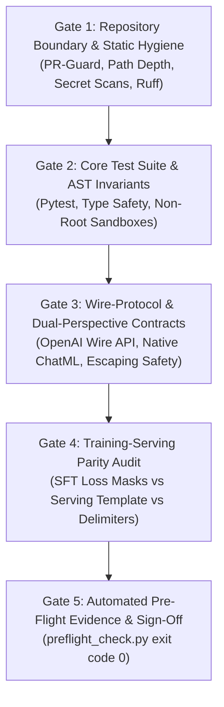

# G10 Post-Training Quality Gates & Pre-Flight Protocol

**Document:** `teams/10-post-training/docs/quality_gates.md`  
**Scope:** Team 10 (Post-Training and Agentic Engine)  
**Applicability:** Mandatory pre-push quality gates for all AI agents, contributors, and pull requests.  
**Objective:** Prevent interface blindspots, training-serving format skews, protocol regressions, and repository boundary violations prior to pull request presentation.

---

## 1. The Quality Gate Philosophy

In modern frontier LLM engineering, the greatest failure mode is **asymmetric abstraction**: code works in local isolation or unit tests, but silently breaks when deployed into a downstream serving engine (vLLM, `llama.cpp`) or when receiving real-world client requests (OpenAI API wire format).

Every feature, fix, or dataset contribution in Team 10 must pass **Five Automated Quality Gates** before pushing or opening a PR:



---

## 2. The Five Mandatory Quality Gates

### Gate 1: Repository Boundary & Static Hygiene
* **Principle of Least Privilege (PoLP):** Zero file mutations outside `teams/10-post-training/`. AI agents must never touch `.github/workflows/`, other team folders (`teams/03-tokenizer/`, `teams/12-quantization/`), or root files.
* **PR Guard Topic-Folder Rule:** Non-markdown files inside `teams/10-post-training/` must reside inside a topic subdirectory (depth $\ge 4$, e.g. `teams/10-post-training/chat-format/file.py`). Only `.md` files may sit directly in `teams/10-post-training/`.
* **Secret & Credential Scan:** Zero hardcoded private keys (`BEGIN PRIVATE KEY`), GitHub tokens (`ghp_`), AWS keys (`AKIA`), or API keys (`sk-`).
* **Linter & Formatting:** `ruff check` passes with zero errors and zero unused `# noqa` pragmas.

### Gate 2: Core Unit & Regression Invariants
* **Test Suite Green:** All unit and integration tests under `teams/10-post-training/tests/` must pass cleanly (`pytest -v`).
* **Deterministic Sandboxing:** Coding verifiers and SWE environment tests must run with non-root privileges, isolated network (`--network none`), and strict memory caps (`--memory 2g`).
* **Indic Orthography Preservation:** Unicode Zero-Width Joiner (`U+200D`) and Non-Joiner (`U+200C`) must remain un-corrupted across all 10 target Indic languages without harmful NFKC normalization.

### Gate 3: Wire-Protocol & Dual-Perspective API Contracts
Every interface component (e.g., `chat_template.jinja`, `render.py`, inference handlers) must be tested against **BOTH** perspectives:
1. **Internal Native Perspective:**
   - Evaluates internal pipeline objects (e.g. `tool_calls` as `{"name": "...", "arguments": {...}}`).
2. **External Client Wire Protocol (OpenAI SDK):**
   - **`tools` Parameter Injection:** When `tools=[{"type": "function", "function": {"name": ..., "parameters": ...}}]` is supplied, the template must render schemas in the first system turn under `# Tools` (line-delimited JSON schemas).
   - **OpenAI Tool Call Unwrapping:** Multi-turn history with assistant `tool_calls` containing `{"id": "...", "type": "function", "function": {"name": "...", "arguments": ...}}` must unwrap `call.function` and preserve `call.id` without dumping the raw envelope.
   - **Jinja Autoescape Resilience:** Assert that no special tokens (`<|im_start|>`, `<|im_end|>`, `<|think|>`, `<|tool_call|>`) are HTML-entity encoded into `&lt;` or `&gt;` under any Jinja environment.

### Gate 4: Training-Serving Parity (Zero Skew)
* **Format Parity:** The tool schema format emitted by `chat_template.jinja` during serving must match character-for-character with the prompt format generated by `sft/convert.py` during training.
* **Delimiter Alignment:** All active delimiters (`<|im_start|>`, `<|im_end|>`, `<|think|>`, `<|/think|>`, `<|tool_call|>`, `<|/tool_call|>`, `<|tool_result|>`, `<|/tool_result|>`, `<|endoftext|>`) must match exact atomic IDs in Team 3's frozen tokenizer (`129994`, `130816`, `130773`, `130774`, `130822`–`130826`).
* **Reasoning Effort Header:** `Reasoning effort: 1k|4k|16k|64k` must be unconditionally verified as the first line of the system turn.

### Gate 5: Automated Pre-Flight Evidence & Sign-Off
* Run the automated pre-flight runner:
  ```bash
  python teams/10-post-training/scripts/preflight_check.py
  ```
* The runner must complete with **EXIT CODE 0** and generate an updated verification evidence artifact in `teams/10-post-training/results/`.
* If any gate fails, the circuit breaker trips and the push is blocked.

---

## 3. Pre-Push Execution Checklist for Contributors

Before running `git push` and creating a PR:

- [ ] 1. Run `python teams/10-post-training/scripts/preflight_check.py`.
- [ ] 2. Verify all 5 gates report `[PASS]`.
- [ ] 3. Check `git status` to ensure only intended files under `teams/10-post-training/` are staged.
- [ ] 4. Confirm zero untracked files or `__pycache__` directories in git status.
- [ ] 5. Include the pre-flight output summary in your PR description.
